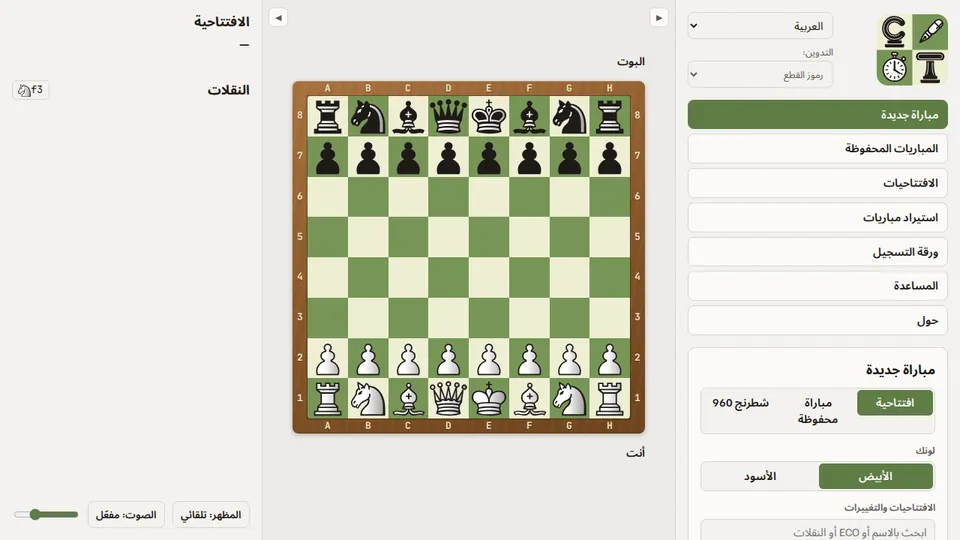
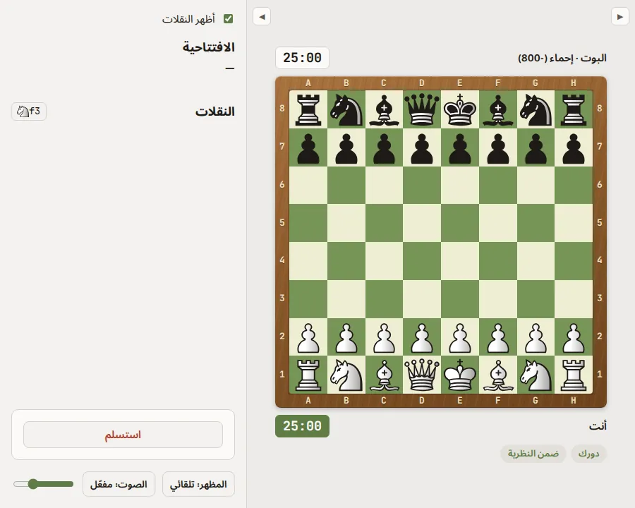
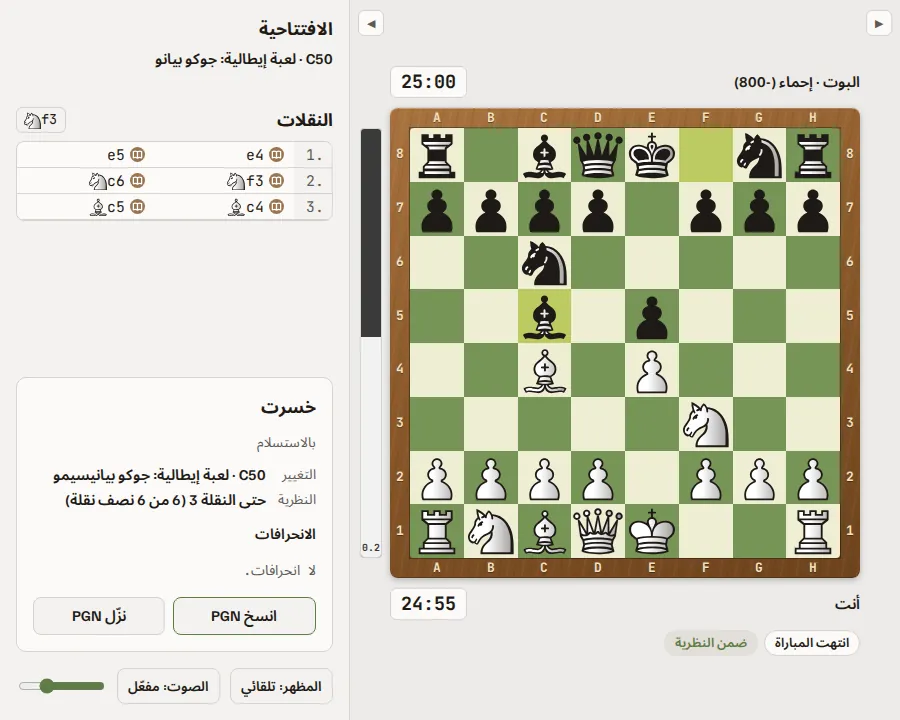
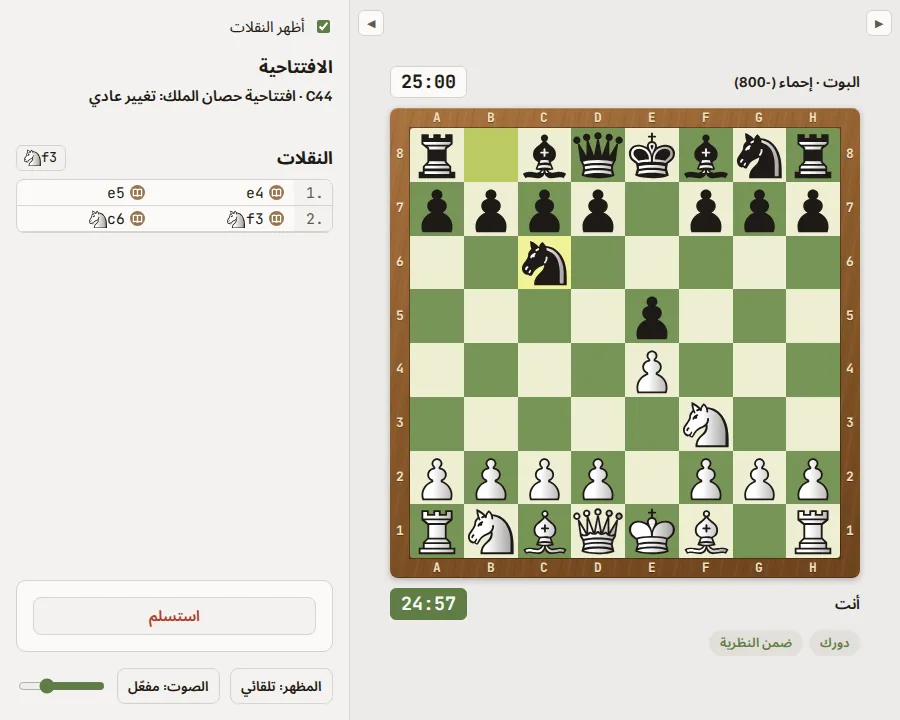
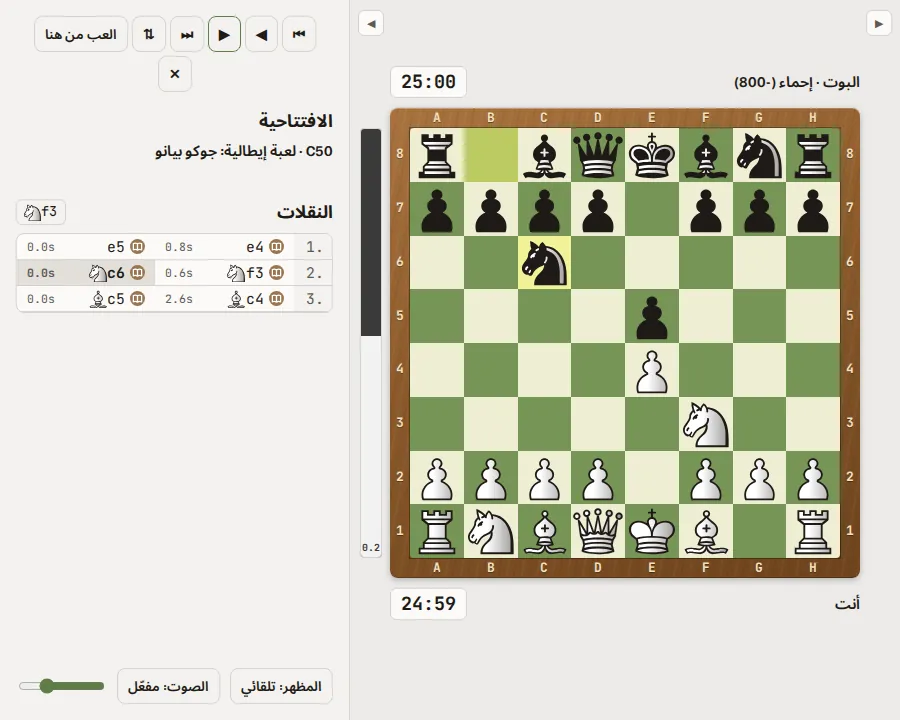

<!-- Generated by scripts/help_docs.py from the app's Help page. Do not edit. -->

# كيف تستخدم Chess Trainer

[English (US)](HELP.md) · [English (UK)](HELP.en-GB.md) · [Português (Brasil)](HELP.pt-BR.md) · [Español (Latinoamérica)](HELP.es-419.md) · [Español (España)](HELP.es-ES.md) · [Português (Portugal)](HELP.pt-PT.md) · [Deutsch](HELP.de.md) · [Français](HELP.fr.md) · [Italiano](HELP.it.md) · [Türkçe](HELP.tr.md) · [Polski](HELP.pl.md) · [Nederlands](HELP.nl.md) · [Bahasa Indonesia](HELP.id.md) · [Tiếng Việt](HELP.vi.md) · [Svenska](HELP.sv.md) · [Dansk](HELP.da.md) · [Norsk bokmål](HELP.nb.md) · [Suomi](HELP.fi.md) · [Русский](HELP.ru.md) · [Українська](HELP.uk.md) · [हिन्दी](HELP.hi.md) · [中文（简体）](HELP.zh-CN.md) · [日本語](HELP.ja.md) · [한국어](HELP.ko.md) · [فارسی](HELP.fa.md) · [עברית](HELP.he.md)

> هذه الترجمة آلية ولم تُراجَع بعد. نرحب بالتصحيحات: [اقترح تصحيحًا](https://github.com/nielsencampos/chess-trainer/issues/new?template=translation-fix.yml&language=ar)

Chess Trainer للتمرين: تدرّب على افتتاحياتك ضد بوت يلعب خطوطك، وواصل اللعب ضد Stockfish حين تنتهي النظرية، وراجع مبارياتك. كل شيء يعمل ويبقى على حاسوبك.

> **لا تستخدمه أبدًا للغش**
>
> لا تستخدم Chess Trainer، ولا أي محرك، أثناء مباراة ضد شخص آخر، على الإنترنت أو على الرقعة. هذا غش، وChess.com وLichess والاتحاد الدولي للشطرنج (FIDE) يحظرونه. تدرّب قبل مبارياتك وبعدها، لا أثناءها أبدًا.

> **التقييم هنا بسيط**
>
> شريط التقييم ورموز النقلات (أفضل نقلة، خطأ، خطأ فادح…) تأتي من فحص سريع بـStockfish، وهي مجرد تلميح. لتحليل حقيقي، صدّر PGN وحلّله على Chess.com أو Lichess أو أداة تحليل أخرى.

## ابدأ مباراة

- افتتاحية: اختر لونك وحدّد الافتتاحيات والتغييرات التي تريد التدرب عليها. لكل تغيير محدد الاحتمال نفسه في أن يُسحب. لعب نقلة من تغيير لم تحدده يُعد خروجًا من النظرية.
- مباراة محفوظة: تدرّب على خط مباراة لعبتها أو استوردتها، فتُفحص نقلاتك، أو واصل اللعب من أي وضعية فيها.
- شطرنج 960: اسحب وضعية ابتدائية أو الصق FEN إحدى الوضعيات الـ960. للتبييت، انقر على الملك ثم على مربع بينه وبين الرخ، أو على الرخ نفسه.
- مستوى البوت: التصنيف بجانب كل مستوى اسمي، على مقياس Stockfish نفسه، ولم يُقَس. إنه ليس تصنيفًا على Chess.com أو Lichess.
- التحكم بالوقت: إعدادات ساعة بطولة حقيقية، من الرصاص إلى الكلاسيكي، أو بلا ساعة. زمن رد البوت إما بشري، يصرف وقته كما يفعل الإنسان، أو فوري.
- الخيارات: التنبيه عند الخروج من النظرية، والسماح بالنقلات المسبقة، وترك البوت ينحرف عن خطه عمدًا، بدءًا من نقلة تختارها، لتتدرب أيضًا على المفاجآت.

*مباراة جديدة: اللون والخطوط والمستوى والساعة.*

## أثناء المباراة

- انقر على القطع أو اسحبها. يلعب البوت نقلات الكتاب في الخط المسحوب، وحين تنتهي النظرية، أو يخرج منها أحدكما، يتولى Stockfish اللعب بالمستوى المختار.
- الشارات تحت الرقعة تقول دور من، وهل ما زلت ضمن النظرية، وأين خرجت منها أنت أو البوت.
- «أظهر النقلات»، في الشريط الأيمن، يخفي اسم الافتتاحية وقائمة النقلات حتى نهاية المباراة: العب بلا تلميحات، أو اكتب النقلات على الورق.
- التدوين، تحت اللغة، يعرض النقلات برموز القطع، أو بالحروف الإنجليزية (Nf3، حروف ملفات PGN ومواقع الشطرنج)، أو بحروف لغتك. الزر بجانب «النقلات» يبدّل بينها، حتى أثناء المباراة، والمرور على نقلة، أو الوصول إليها بمفتاح Tab، يعرضها بالتدوينين الآخرين. ملفات PGN تستخدم دائمًا الحروف الإنجليزية.
- مع تفعيل النقلات المسبقة، يمكنك تجهيز نقلة واحدة بينما يفكر البوت. ومع إيقافها، يلغي «تراجع» نقلتك الأخيرة ما دام رد البوت لم يظهر بعد.
- يطلب «استسلم» نقرة ثانية، كي لا تنهي نقرة عابرة المباراة.

*انقر على قطعة أو اسحبها؛ يرد البوت من الكتاب.*

## بعد المباراة

- البطاقة تحت قائمة النقلات تعرض النتيجة، والتغيير، وإلى أين وصلت النظرية، وكل انحراف مع النقلة المتوقعة.
- انسخ PGN أو نزّله. «مباراة جديدة» تبدأ التالية بالخيارات نفسها.

*في النهاية: النتيجة والتغيير والنظرية والانحرافات.*

## كيف تتدرب

### الخسارة جزء من الطريق

الخسارة جزء من التعلم. المهم أن تدرس كل مباراة وتتعلم من أخطائك. لتتحسن حقًا، ارفع مستوى البوت شيئًا فشيئًا، ولا ترفعه مرة أخرى إلا حين ترتاح للنقلات التي يلعبها.

### لكل تحكم بالوقت مهمته

في المباريات الطويلة، فكّر بهدوء في كل نقلة، وابنِ عادة حساب نقلتين أو ثلاث أو أكثر مقدمًا. استخدم السريع والخاطف والرصاص لترسيخ الأنماط التي استوعبتها.

### ابدأ بنقلات خصمك

قبل كل نقلة، انظر أولًا إلى ما يهدد به خصمك: الكش، والأخذ، والهجمات. ثم ابحث عن خطتك.

### تدرّب كما في البطولة

أفضل طريقة للتعلم هي برقعة وساعة حقيقيتين. لا يهم إن ابتعدت الساعة عن ساعة التطبيق.

لماذا التدرب برقعة وساعة وورقة تسجيل؟ لأنها تجعلك تحفظ، وتمنعك من اللعب بلا تفكير، وتبني قدرتك على الحساب والتصور، وربما حتى تبدأ اللعب في ذهنك، بلا رقعة حقيقية أو افتراضية أمامك.

قبل المباراة، افتح «ورقة التسجيل» من القائمة واطبعها، أو احفظها بصيغة PDF، واملأ رأسها. اختر تحكمًا طويلًا بالوقت، مثل السريع أو الكلاسيكي، وألغِ تحديد «أظهر النقلات».

في دورك:

1. حرّك القطعة على الرقعة.
1. اضغط الساعة باليد نفسها التي حرّكت بها القطعة.
1. العب النقلة نفسها في التطبيق.
1. اكتب النقلة في ورقة التسجيل.

في دور البوت:

1. العب نقلته على الرقعة.
1. اضغط الساعة من جهته.
1. اكتب النقلة في ورقة التسجيل.

عندها فقط ابدأ التفكير في نقلتك.

تذكّر: القطعة التي تلمسها هي القطعة التي تحرّكها. لتجربة أفضل، صوّر نفسك وأنت تلعب وشاهد التسجيل لاحقًا لترى كيف تتصرف أمام الرقعة. خذ وقتك: مع التمرين يصبح الأمر طبيعيًا.

في النهاية، املأ النتيجة والتوقيعات، وقارن ورقتك بقائمة النقلات وبـPGN، وابحث عن النقلات التي كتبتها خطأ.

*مع إلغاء تحديد «أظهر النقلات»، تختفي قائمة النقلات، وتكتب في ورقة التسجيل.*

### حلّل قبل أن تنظر إلى التقييم

حين تنتهي مباراة، راجعها بنفسك أولًا وابحث عن اللحظة التي تغيّرت فيها. بعدها فقط قارنها بالتقييم. الشريط يظهر على الوضعية الأخيرة، فتجاهله حتى تنتهي.

## المباريات المحفوظة والمراجعة

- كل مباراة تُحفظ. ابحث في القائمة ورشّحها، وافتح مباراة على الرقعة واستعرضها بالأزرار أو بمفاتيح الأسهم وHome وEnd.
- «العب من هنا» يبدأ مباراة جديدة من الوضعية التي على الرقعة.
- حدّد مباريات لتصديرها بصيغة PGN أو لحذفها.

*مراجعة مباراة محفوظة، مع شريط التقييم.*

## الافتتاحيات

- استعرض كل خط في الكتاب على الرقعة، وحدّد خطوطًا لتصديرها بصيغة PGN.

## استيراد المباريات

- أحضر مبارياتك من Chess.com أو Lichess باسم المستخدم والفترة، أو الصق PGN أو ارفع ملفه. تذهب إلى «المباريات المحفوظة»، جاهزة للمراجعة أو التدرب.

## حلّل في مكان آخر

- خذ PGN من بطاقة نهاية المباراة أو من «المباريات المحفوظة».
- على Chess.com أو Lichess، افتح لوحة التحليل والصق PGN أو استورده، لتحليل كامل وأعمق.
