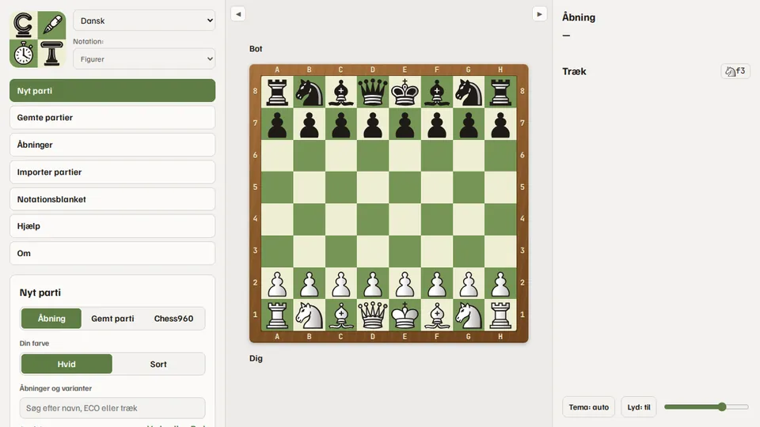
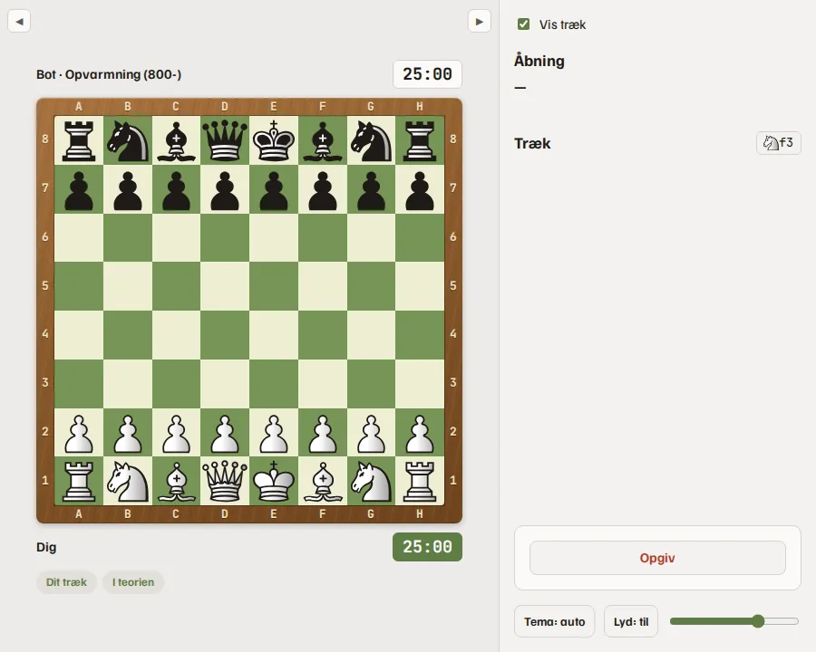
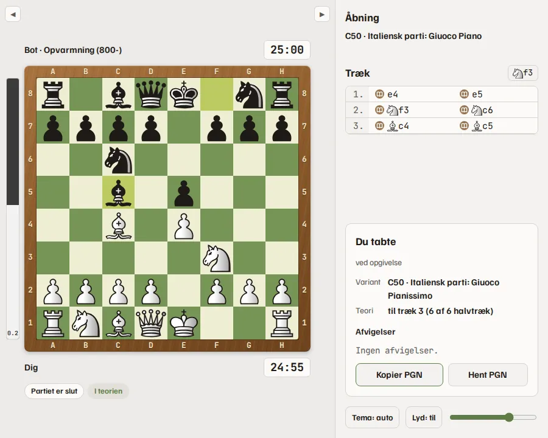
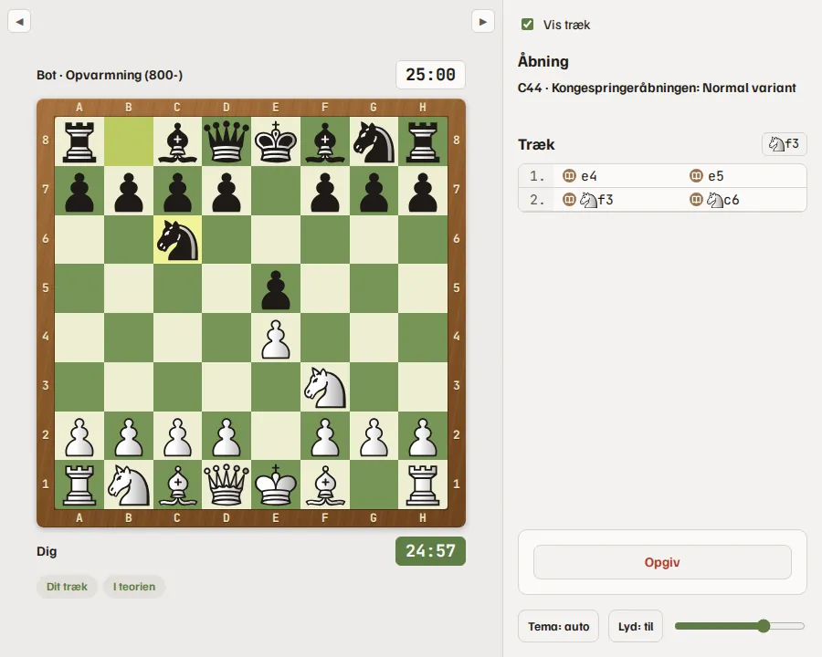
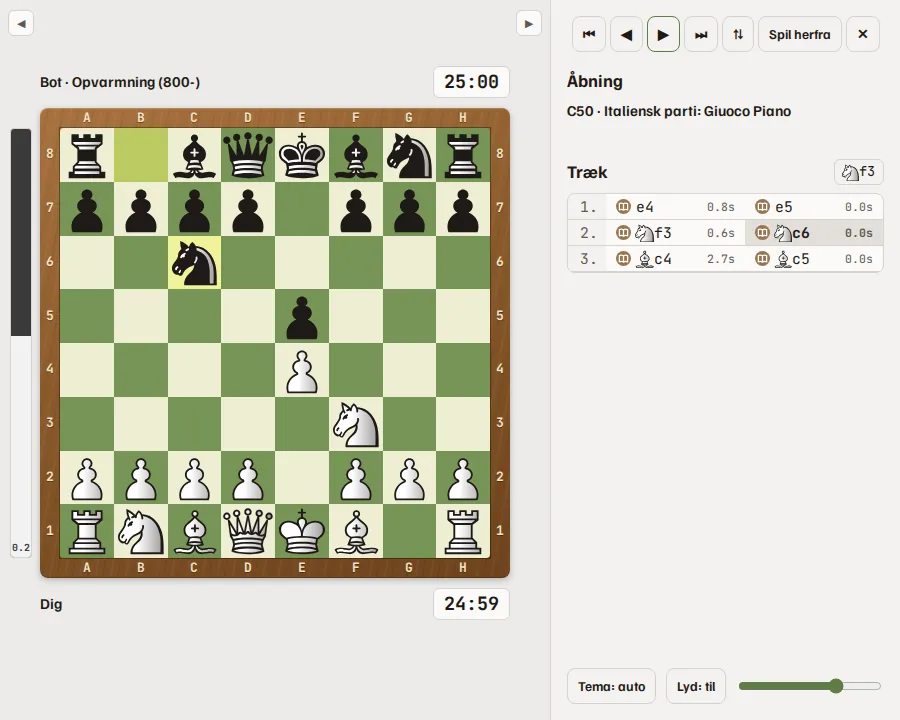

<!-- Generated by scripts/help_docs.py from the app's Help page. Do not edit. -->

# Sådan bruger du Chess Trainer

[English (US)](HELP.md) · [English (UK)](HELP.en-GB.md) · [Português (Brasil)](HELP.pt-BR.md) · [Español (Latinoamérica)](HELP.es-419.md) · [Español (España)](HELP.es-ES.md) · [Português (Portugal)](HELP.pt-PT.md) · [Deutsch](HELP.de.md) · [Français](HELP.fr.md) · [Italiano](HELP.it.md) · [Türkçe](HELP.tr.md) · [Polski](HELP.pl.md) · [Nederlands](HELP.nl.md) · [Bahasa Indonesia](HELP.id.md) · [Tiếng Việt](HELP.vi.md) · [Svenska](HELP.sv.md) · [Norsk bokmål](HELP.nb.md) · [Suomi](HELP.fi.md) · [Русский](HELP.ru.md) · [Українська](HELP.uk.md)

Chess Trainer er til træning: øv dine åbninger mod en bot, der spiller dine varianter, spil videre mod Stockfish, når teorien slutter, og gennemgå dine partier. Alt kører og bliver på din computer.

> **Brug det aldrig til snyd**
>
> Brug ikke Chess Trainer, eller noget skakprogram, under et parti mod en anden person, online eller ved brættet. Det er snyd, og Chess.com, Lichess og FIDE forbyder det. Træn før og efter dine partier, aldrig under dem.

> **Vurderingen her er enkel**
>
> Vurderingsbjælken og træk-ikonerne (bedste træk, fejl, brøler…) kommer fra et hurtigt tjek med Stockfish og er kun et fingerpeg. For en rigtig analyse eksporterer du PGN og analyserer den på Chess.com, Lichess eller et andet analyseværktøj.

## Start et parti

- Åbning: vælg din farve, og sæt flueben ved de åbninger og varianter, du vil øve. Hver valgt variant har samme chance for at blive trukket. Et træk fra en variant, du ikke valgte, tæller som at forlade teorien.
- Gemt parti: træn varianten fra et parti, du har spillet eller importeret, så dens træk kontrolleres, eller spil videre fra en hvilken som helst af dens stillinger.
- Chess960: slå terning om en udgangsstilling, eller indsæt FEN for en af de 960. For at rokere klikker du på kongen og derefter på et felt mellem den og tårnet, eller på selve tårnet.
- Bottens niveau: ratingen ved hvert niveau er nominel, på Stockfishs egen skala, og er ikke målt. Det er ikke en rating fra Chess.com eller Lichess.
- Tidskontrol: forindstillingerne på et rigtigt turneringsur, fra bullet til klassisk, eller uden ur. Bottens svartid er Menneskelig, som bruger sit ur som et menneske, eller Straks.
- Indstillinger: advar, når du forlader teorien, tillad forhåndstræk, og lad botten afvige fra sin variant med vilje, fra et valgt træk, så du også træner mod overraskelser.

*Nyt parti: farve, varianter, niveau og ur.*

## Under partiet

- Klik på eller træk brikkerne. Botten spiller teoritrækkene i den trukne variant, og når teorien slutter, eller nogen forlader den, tager Stockfish over på det valgte niveau.
- Mærkerne under brættet viser, hvis træk det er, om du stadig er i teorien, og hvor du eller botten forlod den.
- Vis træk, i højre panel, skjuler åbningens navn og træklisten til partiets slutning: spil uden hints, eller skriv trækkene på papir.
- Notation, under sproget, viser trækkene som briksymboler (figurer), med engelske bogstaver (Nf3, bogstaverne i PGN-filer og på skaksider) eller med dit sprogs bogstaver (Sf3). Knappen ved siden af Træk skifter mellem dem, også midt i partiet, og når du holder musen over et træk, eller når det med Tab, vises det i de to andre. PGN-filer bruger altid engelske bogstaver.
- Med forhåndstræk slået til kan du sætte et træk i kø, mens botten tænker. Med forhåndstræk slået fra fortryder Tag tilbage dit seneste træk, så længe bottens svar ikke er vist endnu.
- Opgiv kræver et ekstra klik, så et fejlklik ikke afslutter partiet.

*Klik på eller træk en brik; botten svarer fra bogen.*

## Efter partiet

- Kortet under træklisten viser resultatet, varianten, hvor langt teorien gik, og hver afvigelse med det forventede træk.
- Kopier eller hent PGN. Nyt parti starter det næste med de samme valg.

*Til sidst: resultat, variant, teori og afvigelser.*

## Sådan træner du

### At tabe hører med

At tabe er en del af at lære. Det vigtige er at studere hvert parti og lære af dine egne fejl. For virkelig at blive bedre hæver du bottens niveau lidt ad gangen, og hæver det først igen, når du føler dig tryg ved de træk, den spiller.

### Hver tidskontrol har en opgave

I lange partier tænker du roligt over hvert træk og opbygger vanen med at beregne to, tre eller flere træk frem. Brug hurtigskak, lynskak og bullet til at øve de mønstre, du allerede har lært.

### Begynd med modstanderens træk

Før hvert træk ser du først på, hvad modstanderen truer med: skakker, slag og angreb. Derefter leder du efter din egen plan.

### Træn som til en turnering

Den bedste måde at lære på er med et rigtigt bræt og et rigtigt ur. Det gør ikke noget, hvis uret glider fra appens.

Hvorfor træne med bræt, ur og notationsblanket? Fordi de får dig til at huske, forhindrer dig i at spille uden at tænke og opbygger din beregning og visualisering, måske indtil du begynder at spille i hovedet, uden noget fysisk eller virtuelt bræt foran dig.

Før partiet åbner du Notationsblanket i menuen og udskriver den, eller gemmer den som PDF, og udfylder hovedet. Vælg en lang tidskontrol, som hurtigskak eller klassisk, og fjern fluebenet ved Vis træk.

Når det er dit træk:

1. Flyt brikken på brættet.
1. Tryk på uret med den samme hånd, som flyttede brikken.
1. Spil det samme træk i appen.
1. Skriv trækket på notationsblanketten.

Når det er bottens træk:

1. Spil dens træk på brættet.
1. Tryk på uret på dens side.
1. Skriv trækket på notationsblanketten.

Først derefter begynder du at tænke på dit.

Husk: en brik, du rører, skal flyttes. For en endnu bedre oplevelse kan du filme dig selv, mens du spiller, og se det bagefter for at se, hvordan du opfører dig ved brættet. Tag dig god tid: med øvelse bliver det naturligt.

Til sidst udfylder du resultatet og underskrifterne, sammenligner din blanket med træklisten og PGN og leder efter de træk, du skrev forkert.

*Uden flueben ved Vis træk skjules træklisten, og du skriver på notationsblanketten.*

### Analyser, før du ser på vurderingen

Når et parti er slut, gennemgår du det først selv og leder efter, hvor det vendte. Først derefter sammenligner du med vurderingen. Bjælken vises på slutstillingen, så ignorer den, til du er færdig.

## Gemte partier og gennemgang

- Hvert parti gemmes. Søg og filtrer i listen, åbn et parti på brættet, og gennemgå det med knapperne eller piletasterne, Home og End.
- Spil herfra starter et nyt parti fra stillingen på brættet.
- Sæt flueben ved partier for at eksportere dem som PGN eller slette dem.

*Gennemgang af et gemt parti med vurderingsbjælken.*

## Åbninger

- Gennemgå alle bogens varianter på brættet, og sæt flueben ved varianter for at eksportere dem som PGN.

## Importer partier

- Hent dine partier fra Chess.com eller Lichess med brugernavn og periode, eller indsæt en PGN eller vælg en PGN-fil. De havner i Gemte partier, klar til gennemgang eller træning.

## Analyser et andet sted

- Hent PGN fra kortet efter partiet eller fra Gemte partier.
- På Chess.com eller Lichess åbner du analysebrættet og indsætter eller importerer PGN for en fuld og dybere analyse.
