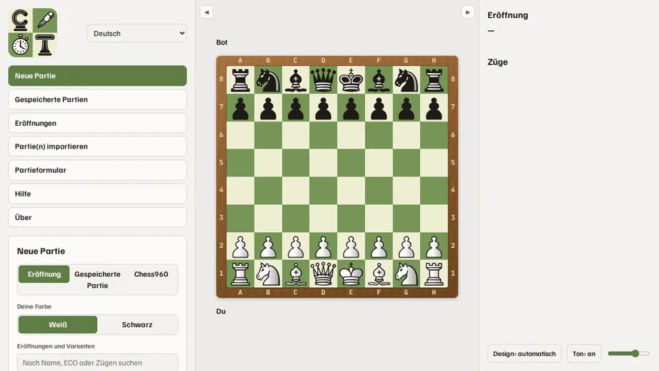
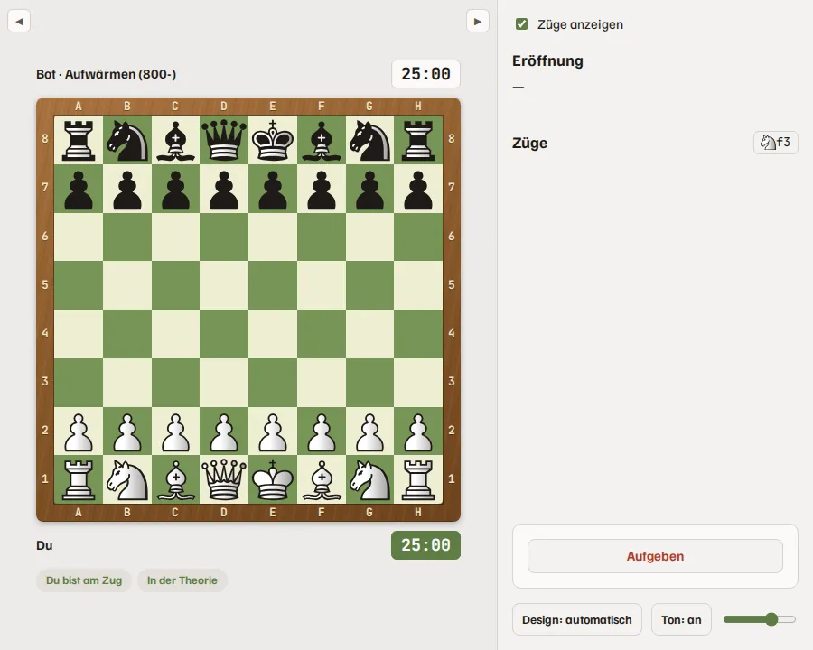
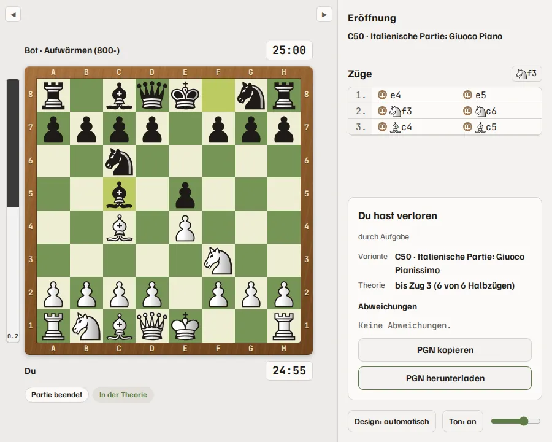
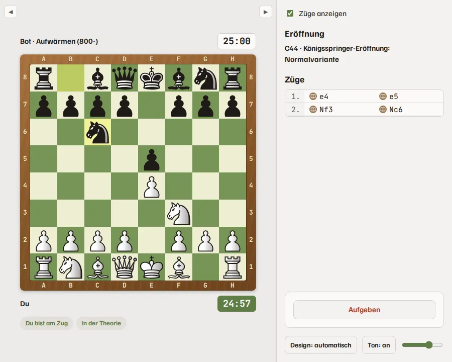
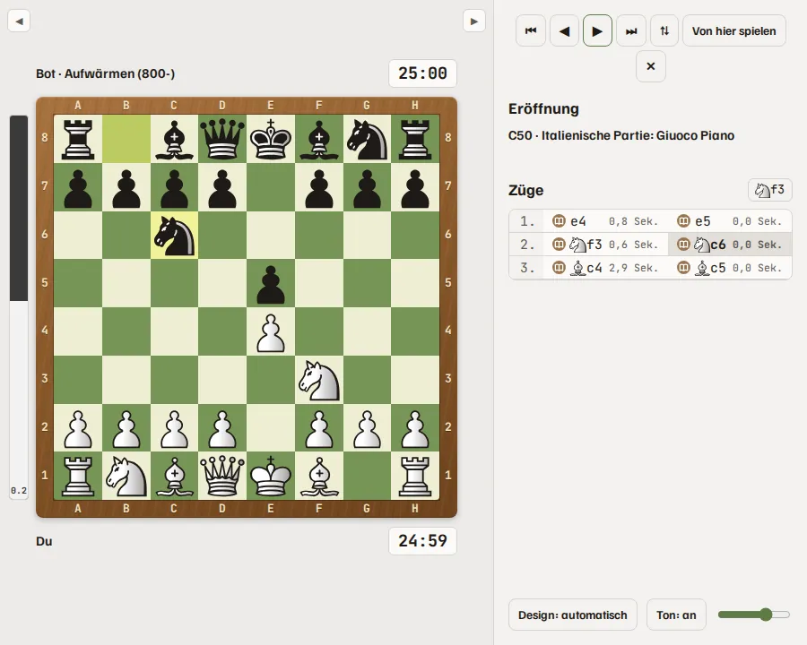

<!-- Generated by scripts/help_docs.py from the app's Help page. Do not edit. -->

# So benutzt du Chess Trainer

[English (US)](HELP.md) · [English (UK)](HELP.en-GB.md) · [Português (Brasil)](HELP.pt-BR.md) · [Español (Latinoamérica)](HELP.es.md) · [Español (España)](HELP.es-ES.md) · [Português (Portugal)](HELP.pt-PT.md)

Chess Trainer ist zum Üben da: Trainiere deine Eröffnungen gegen einen Bot, der deine Abspiele spielt, spiel gegen Stockfish weiter, wenn die Theorie endet, und schau dir deine Partien noch einmal an. Alles läuft und bleibt auf deinem Computer.

> **Benutze es nie zum Betrügen**
>
> Benutze Chess Trainer oder ein anderes Schachprogramm nie während einer Partie gegen einen anderen Menschen, weder online noch am Brett. Das ist Betrug, und Chess.com, Lichess und die FIDE verbieten es. Trainiere vor und nach deinen Partien, nie währenddessen.

> **Die Bewertung hier ist einfach**
>
> Der Bewertungsbalken und die Symbole an den Zügen (bester Zug, Fehler, Patzer …) stammen aus einer schnellen Prüfung durch Stockfish und sind nur ein Hinweis. Für eine echte Analyse exportiere die PGN und analysiere sie auf Chess.com, auf Lichess oder mit einem anderen Analysewerkzeug.

## Eine Partie beginnen

- Eröffnung: Wähle deine Farbe und markiere die Eröffnungen und Varianten, die du üben willst. Jede markierte Variante kommt mit derselben Wahrscheinlichkeit dran. Ein Zug aus einer Variante, die du nicht markiert hast, zählt als Verlassen der Theorie.
- Gespeicherte Partie: Trainiere das Abspiel einer Partie, die du gespielt oder importiert hast, wobei deine Züge geprüft werden, oder spiel ab einer ihrer Stellungen weiter.
- Chess960: Lose eine Ausgangsstellung aus oder füge die FEN einer der 960 ein. Zum Rochieren klickst du den König und dann ein Feld zwischen ihm und dem Turm an, oder den Turm selbst.
- Stärke des Bots: Die Elo-Zahl neben jeder Stufe ist nominell, auf der eigenen Skala von Stockfish, und nicht gemessen. Das ist keine Elo-Zahl von Chess.com oder Lichess.
- Bedenkzeit: die Bedenkzeiten einer echten Turnieruhr, von Bullet bis klassisch, oder ohne Uhr. Die Antwortzeit des Bots ist Menschlich, er verbraucht seine Zeit wie ein Mensch, oder Sofort.
- Optionen: beim Verlassen der Theorie warnen, Vorauszüge erlauben und den Bot ab einem gewählten Zug absichtlich von seinem Abspiel abweichen lassen, damit du auch gegen Überraschungen trainierst.

*Neue Partie: Farbe, Abspiele, Stärke und Uhr.*

## Während der Partie

- Klicke die Figuren an oder ziehe sie. Der Bot spielt die Buchzüge des ausgelosten Abspiels, und wenn die Theorie endet oder jemand sie verlässt, übernimmt Stockfish auf der gewählten Stärke.
- Die Hinweise unter dem Brett zeigen, wer am Zug ist, ob du noch in der Theorie bist und wo du oder der Bot sie verlassen habt.
- „Züge anzeigen“ in der rechten Leiste blendet den Namen der Eröffnung und die Zugliste bis zum Ende der Partie aus: Spiel ohne Hinweise oder schreib die Züge auf Papier mit.
- Mit Vorauszügen kannst du einen Zug vormerken, während der Bot nachdenkt. Ohne sie nimmt „Zug zurücknehmen“ deinen letzten Zug zurück, solange die Antwort des Bots noch nicht zu sehen ist.
- Aufgeben verlangt einen zweiten Klick, damit ein versehentlicher Klick die Partie nicht beendet.

*Klicke eine Figur an oder ziehe sie; der Bot antwortet aus dem Buch.*

## Nach der Partie

- Der Kasten unter der Zugliste zeigt das Ergebnis, die Variante, wie weit die Theorie reichte, und jede Abweichung mit dem erwarteten Zug.
- Kopiere die PGN oder lade sie herunter. „Neue Partie“ startet die nächste mit denselben Einstellungen.

*Am Ende: Ergebnis, Variante, Theorie und Abweichungen.*

## So trainierst du

### Verlieren gehört dazu

Verlieren gehört zum Lernen. Wichtig ist, jede Partie anzuschauen und aus den eigenen Fehlern zu lernen. Um wirklich besser zu werden, erhöhe die Stärke des Bots nach und nach, und erst dann wieder, wenn du mit seinen Zügen gut zurechtkommst.

### Jede Bedenkzeit hat ihren Zweck

In langen Partien denkst du in Ruhe über jeden Zug nach und gewöhnst dir an, zwei, drei oder mehr Züge im Voraus zu berechnen. Nutze Schnellschach, Blitz und Bullet, um Muster zu trainieren, die du schon verinnerlicht hast.

### Fang mit den Zügen des Gegners an

Schau vor jedem Zug zuerst, was dein Gegner droht: Schachs, Schlagzüge und Angriffe. Dann such deinen eigenen Plan.

### Trainiere wie im Turnier

Am besten lernst du mit echtem Brett und echter Uhr. Es macht nichts, wenn deine Uhr nicht mit der in der App übereinstimmt.

Warum mit Brett, Uhr und Partieformular trainieren? Weil es dich zwingt, dir Züge zu merken, nicht gedankenlos zu ziehen und zu rechnen, und weil es das Vorstellungsvermögen schult, vielleicht bis du blind spielst, ohne ein echtes oder virtuelles Brett zu sehen.

Öffne vor der Partie „Partieformular“ im Menü und drucke es aus oder speichere es als PDF, und fülle den Kopf aus. Wähle eine lange Bedenkzeit, etwa Schnellschach oder klassisch, und schalte „Züge anzeigen“ aus.

Bei deinem Zug:

1. Zieh die Figur auf dem Brett.
1. Drück die Uhr mit derselben Hand, mit der du gezogen hast.
1. Spiel denselben Zug in der App.
1. Notiere den Zug auf dem Formular.

Beim Zug des Bots:

1. Führe seinen Zug auf dem Brett aus.
1. Drück die Uhr auf seiner Seite.
1. Notiere den Zug auf dem Formular.

Erst dann denkst du über deinen nach.

Denk daran: berührt – geführt. Noch besser: Film dich beim Spielen und schau es dir danach an, um zu sehen, wie du dich am Brett verhältst. Mach alles in Ruhe: Mit der Zeit geht es von selbst.

Trag am Ende das Ergebnis und die Unterschriften ein, vergleiche dein Formular mit der Zugliste und der PGN und such die Züge, die du falsch notiert hast.

*Mit ausgeschaltetem „Züge anzeigen“ verschwindet die Liste, und du notierst auf dem Formular.*

### Analysiere, bevor du auf die Bewertung schaust

Geh eine beendete Partie zuerst allein durch und such die Stelle, an der sie gekippt ist. Erst danach vergleichst du mit der Bewertung. Der Balken erscheint in der Endstellung, also beachte ihn erst, wenn du fertig bist.

## Gespeicherte Partien und Nachspielen

- Jede Partie wird gespeichert. Durchsuche und filtere die Liste, öffne eine Partie auf dem Brett und geh sie mit den Schaltflächen oder mit den Pfeiltasten, Pos1 und Ende durch.
- „Von hier spielen“ beginnt eine neue Partie ab der Stellung auf dem Brett.
- Markiere Partien, um sie als PGN zu exportieren oder zu löschen.

*Eine gespeicherte Partie mit Bewertungsbalken nachspielen.*

## Eröffnungen

- Geh jedes Abspiel des Buchs auf dem Brett durch und markiere Abspiele, um sie als PGN zu exportieren.

## Partien importieren

- Hol deine Partien von Chess.com oder Lichess nach Benutzername und Zeitraum, oder füge eine PGN ein oder lade eine hoch. Die Partien landen unter „Gespeicherte Partien“, bereit zum Nachspielen oder Trainieren.

## Woanders analysieren

- Nimm die PGN aus dem Kasten am Ende der Partie oder aus „Gespeicherte Partien“.
- Öffne auf Chess.com oder Lichess das Analysebrett und füge die PGN ein oder importiere sie, für eine vollständige und stärkere Analyse.
