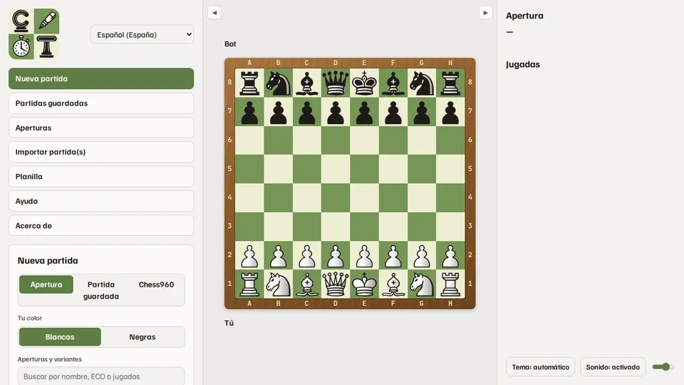
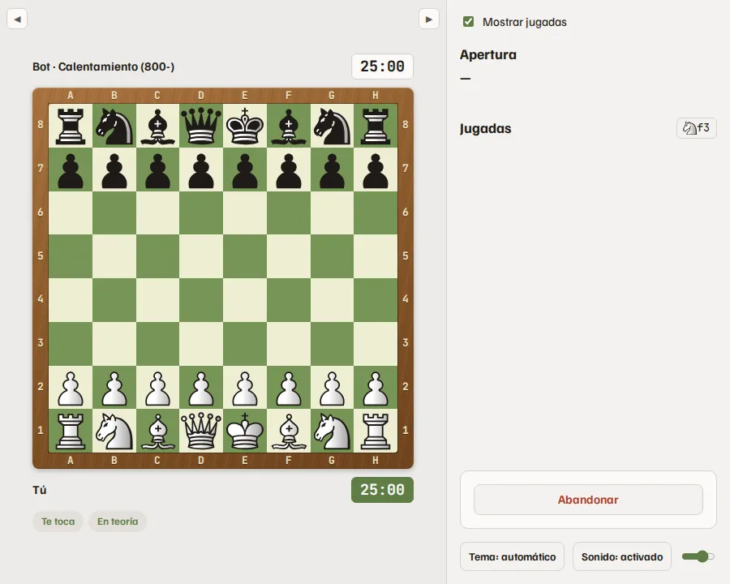
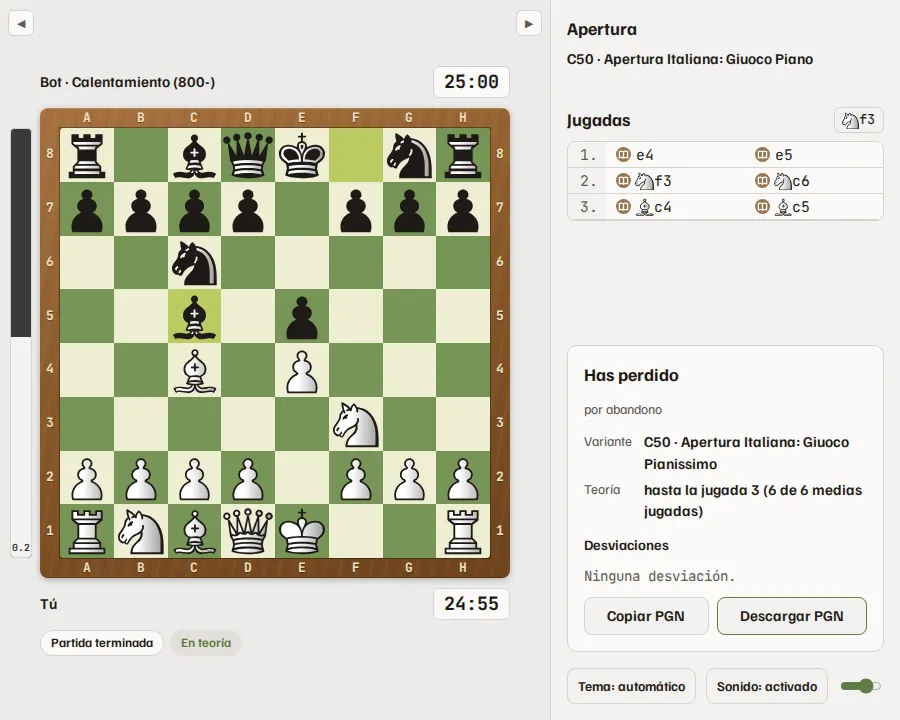
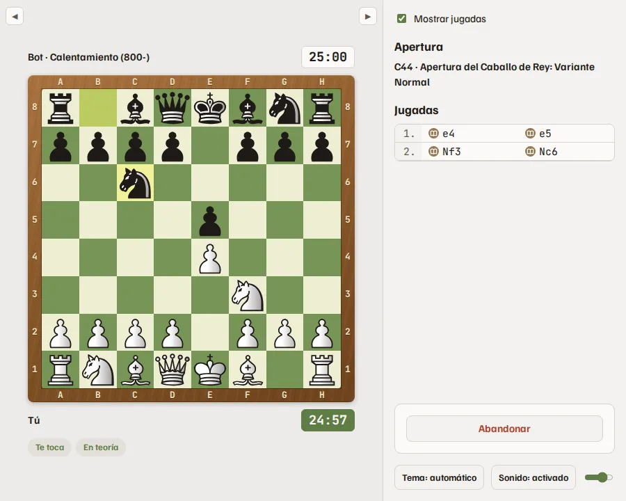
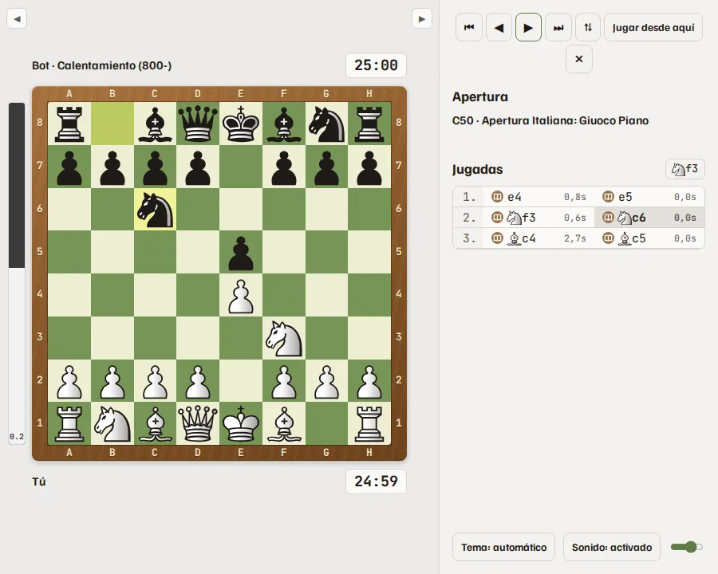

<!-- Generated by scripts/help_docs.py from the app's Help page. Do not edit. -->

# Cómo se usa Chess Trainer

[English (US)](HELP.md) · [English (UK)](HELP.en-GB.md) · [Português (Brasil)](HELP.pt-BR.md) · [Español (Latinoamérica)](HELP.es.md) · [Português (Portugal)](HELP.pt-PT.md) · [Deutsch](HELP.de.md)

Chess Trainer sirve para entrenar: practica tus aperturas contra un bot que juega tus líneas, continúa contra Stockfish cuando se acaba la teoría y repasa tus partidas. Todo funciona y se guarda en tu ordenador.

> **No lo uses nunca para hacer trampas**
>
> No uses Chess Trainer, ni ningún otro motor, durante una partida contra otra persona, ni en línea ni sobre el tablero. Eso es hacer trampas, y Chess.com, Lichess y la FIDE lo prohíben. Entrena antes y después de tus partidas, nunca durante.

> **La evaluación de aquí es básica**
>
> La barra de evaluación y los iconos de las jugadas (mejor jugada, error, error garrafal…) salen de un repaso rápido de Stockfish y son solo una pista. Para un análisis en serio, exporta el PGN y analízalo en Chess.com, en Lichess o con otra herramienta de análisis.

## Empezar una partida

- Apertura: elige tu color y marca las aperturas y variantes que quieras practicar. Todas las variantes marcadas tienen la misma probabilidad de salir. Si juegas una jugada de una variante que no has marcado, cuenta como salir de la teoría.
- Partida guardada: entrena la línea de una partida que hayas jugado o importado, con tus jugadas comprobadas, o continúa desde cualquiera de sus posiciones.
- Chess960: sortea una posición inicial o pega el FEN de una de las 960. Para enrocar, haz clic en el rey y después en una casilla entre él y la torre, o en la propia torre.
- Nivel del bot: el Elo de cada nivel es nominal, en la escala propia de Stockfish, y no se ha medido. No es un Elo de Chess.com ni de Lichess.
- Ritmo de juego: los ritmos de un reloj de torneo de verdad, del bullet a las clásicas, o sin reloj. El tiempo de respuesta del bot puede ser Humano, que gasta su reloj como lo haría una persona, o Instantáneo.
- Opciones: avisar al salir de la teoría, permitir jugadas anticipadas y dejar que el bot se desvíe de su línea a propósito, a partir de una jugada elegida, para entrenar también contra sorpresas.

*Nueva partida: color, líneas, nivel y reloj.*

## Durante la partida

- Haz clic en las piezas o arrástralas. El bot juega las jugadas de libro de la línea sorteada y, cuando se acaba la teoría o alguien se sale de ella, Stockfish toma el relevo al nivel elegido.
- Las etiquetas de debajo del tablero indican a quién le toca, si sigues dentro de la teoría y dónde os habéis salido de ella, tú o el bot.
- Mostrar jugadas, en el panel derecho, oculta el nombre de la apertura y la lista de jugadas hasta que termina la partida: juega sin pistas o apunta las jugadas en papel.
- Con las jugadas anticipadas activadas, puedes dejar una jugada preparada mientras el bot piensa. Con ellas desactivadas, Deshacer jugada anula tu última jugada mientras aún no se ve la respuesta del bot.
- Abandonar pide un segundo clic, para que un clic sin querer no acabe con la partida.

*Haz clic en una pieza o arrástrala; el bot responde con el libro.*

## Después de la partida

- El cuadro de debajo de la lista de jugadas muestra el resultado, la variante, hasta dónde llegó la teoría y cada desviación junto con la jugada esperada.
- Copia o descarga el PGN. Nueva partida empieza la siguiente con las mismas opciones.

*Al final: resultado, variante, teoría y desviaciones.*

## Cómo entrenar

### Perder forma parte del camino

Perder forma parte del aprendizaje. Lo que importa es estudiar cada partida y aprender de tus propios errores. Para mejorar de verdad, sube el nivel del bot poco a poco y no lo vuelvas a subir hasta que te sientas a gusto con las jugadas que propone.

### Cada ritmo tiene su papel

En las partidas largas, piensa cada jugada con calma y acostúmbrate a calcular dos, tres o más jugadas por delante. Usa las rápidas, el blitz y el bullet para entrenar los patrones que ya tienes interiorizados.

### Empieza por las jugadas del rival

Antes de cada jugada, mira primero qué amenaza el rival: jaques, capturas y ataques. Después busca tu propio plan.

### Entrena como en un torneo

Lo ideal para aprender es jugar con un tablero y un reloj de verdad. No pasa nada si el reloj se desacompasa del de la app.

¿Por qué entrenar con tablero, reloj y planilla? Porque te obliga a memorizar, a no jugar sin pensar y a calcular, y entrena la visualización, quizá hasta que empieces a jugar de memoria, sin necesidad de ver un tablero físico ni virtual.

Antes de la partida, abre Planilla en el menú e imprímela, o guárdala en PDF, y rellena la cabecera. Elige un ritmo largo, como rápidas o clásicas, y desmarca Mostrar jugadas.

En tu jugada:

1. Mueve la pieza en el tablero.
1. Pulsa el reloj con la misma mano con la que has movido la pieza.
1. Haz la misma jugada en la app.
1. Apunta la jugada en la planilla.

En la jugada del bot:

1. Reproduce su jugada en el tablero.
1. Pulsa el reloj por su lado.
1. Apunta la jugada en la planilla.

Solo entonces empieza a pensar en la tuya.

Recuerda: pieza tocada, pieza jugada. Para una experiencia todavía mejor, grábate jugando y mírate después para entender cómo te comportas ante el tablero. Hazlo todo con calma: con el tiempo, sale solo.

Al final, rellena el resultado y las firmas, compara tu planilla con la lista de jugadas y el PGN, y busca las jugadas que hayas apuntado mal.

*Con la opción Mostrar jugadas desmarcada, la lista se oculta y apuntas en la planilla.*

### Analiza antes de mirar la evaluación

Cuando termines una partida, repásala primero tú solo y busca dónde cambió. Solo después compárala con la evaluación. La barra aparece en la posición final, así que no le hagas caso hasta que acabes.

## Partidas guardadas y repaso

- Todas las partidas se guardan. Busca y filtra la lista, abre una partida en el tablero y recórrela con los botones o con las flechas del teclado, Inicio y Fin.
- Jugar desde aquí empieza una partida nueva desde la posición del tablero.
- Marca partidas para exportarlas en PGN o para eliminarlas.

*Repasando una partida guardada, con la barra de evaluación.*

## Aperturas

- Repasa en el tablero cada línea del libro y marca líneas para exportarlas en PGN.

## Importar partidas

- Trae tus partidas de Chess.com o Lichess por usuario y periodo, o pega o sube un PGN. Van a Partidas guardadas, listas para repasar o entrenar.

## Analiza en otra parte

- Coge el PGN del cuadro de final de partida o de Partidas guardadas.
- En Chess.com o Lichess, abre el tablero de análisis y pega o importa el PGN, para un análisis completo y más fuerte.
