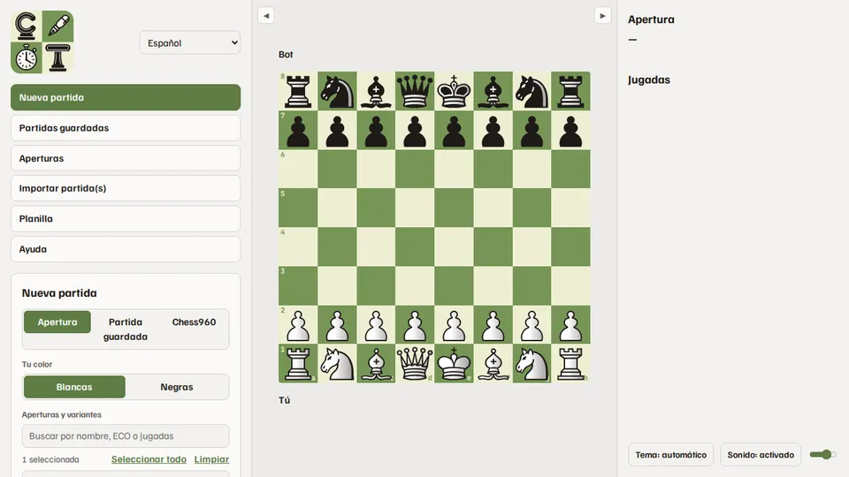
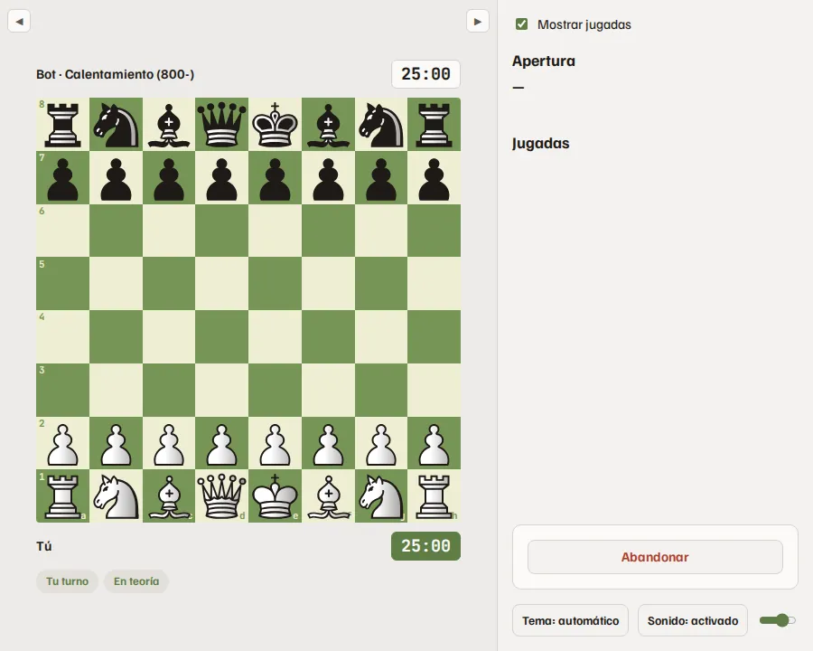
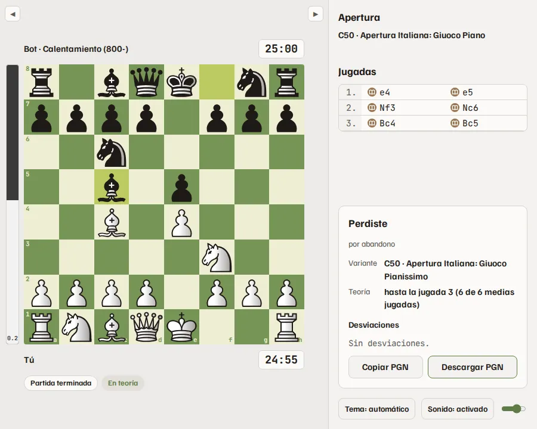
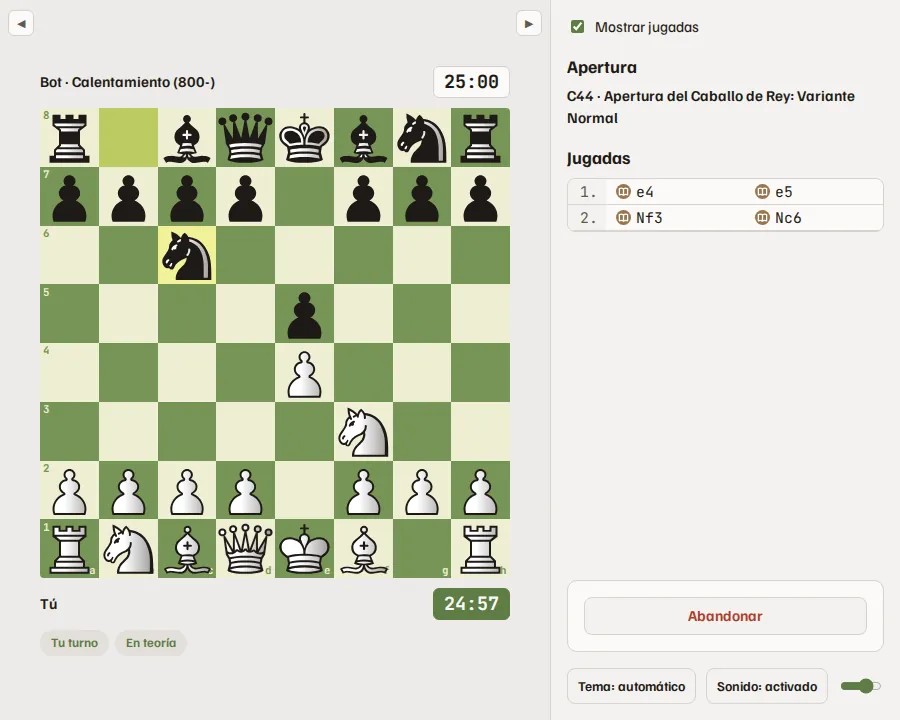
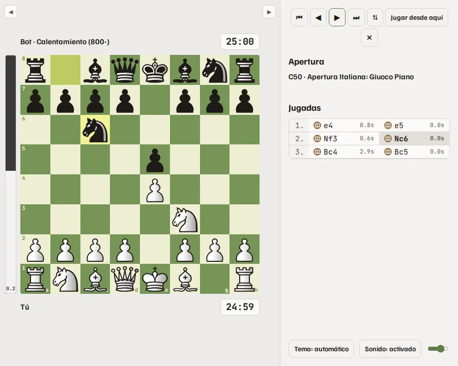

<!-- Generated by scripts/help_docs.py from the app's Help page. Do not edit. -->

# Cómo usar Chess Trainer

[English](HELP.md) · [Português (Brasil)](HELP.pt-BR.md)

Chess Trainer es para entrenar: practica tus aperturas contra un bot que juega tus líneas, sigue jugando contra Stockfish cuando la teoría se acaba y revisa tus partidas. Todo funciona y se queda en tu ordenador.

> **Nunca lo uses para hacer trampa**
>
> No uses Chess Trainer, ni ningún motor, durante una partida contra otra persona, en línea o sobre el tablero. Eso es trampa, y Lichess, Chess.com y la FIDE lo prohíben. Entrena antes y después de tus partidas, nunca durante.

> **La evaluación aquí es básica**
>
> La barra de evaluación y los iconos de las jugadas (mejor jugada, error, error grave…) salen de una revisión rápida de Stockfish y son solo una pista. Para un análisis de verdad, exporta el PGN y analízalo en Lichess, Chess.com u otra herramienta de análisis.

## Empezar una partida

- Apertura: elige tu color y marca las aperturas y variantes que quieres practicar. Cada variante marcada tiene la misma probabilidad de salir. Jugar una jugada de una variante que no marcaste cuenta como salir de la teoría.
- Partida guardada: entrena la línea de una partida que jugaste o importaste, con tus jugadas comprobadas, o sigue jugando desde cualquiera de sus posiciones.
- Chess960: sortea una posición inicial o pega el FEN de una de las 960. Para enrocar, haz clic en el rey y luego en una casilla entre él y la torre, o en la propia torre.
- Nivel del bot: el Elo junto a cada nivel es nominal, en la escala propia de Stockfish, y no se ha medido. No es un Elo de Lichess ni de Chess.com.
- Ritmo de juego: los ritmos de un reloj de torneo real, del bullet al clásico, o sin reloj. El tiempo de respuesta del bot es Humano, que gasta su reloj como una persona, o Instantáneo.
- Opciones: avisar al salir de la teoría, permitir premovimientos y dejar que el bot se desvíe de su línea a propósito, desde una jugada elegida, para entrenar también contra sorpresas.

*Nueva partida: color, líneas, nivel y reloj.*

## Durante la partida

- Haz clic o arrastra las piezas. El bot juega las jugadas de libro de la línea sorteada y, cuando la teoría se acaba, o alguien sale de ella, Stockfish toma el relevo en el nivel elegido.
- Las etiquetas bajo el tablero indican a quién le toca, si sigues en la teoría y dónde tú o el bot salieron de ella.
- Mostrar jugadas, en la barra derecha, oculta el nombre de la apertura y la lista de jugadas hasta el final de la partida: juega sin pistas o anota las jugadas en papel.
- Con los premovimientos activados, puedes dejar una jugada en cola mientras el bot piensa. Con ellos desactivados, Deshacer jugada deshace tu última jugada mientras la respuesta del bot aún no se ve.
- Abandonar pide un segundo clic, para que un clic sin querer no termine la partida.

*Haz clic o arrastra una pieza; el bot responde con el libro.*

## Después de la partida

- El cuadro bajo la lista de jugadas muestra el resultado, la variante, hasta dónde llegó la teoría y cada desviación con la jugada esperada.
- Copia o descarga el PGN. Nueva partida empieza la siguiente con las mismas opciones.

*Al final: resultado, variante, teoría y desviaciones.*

## Entrena como en una partida oficial

- Abre Planilla en el menú e imprímela, o guárdala en PDF.
- Elige un ritmo largo, como rápidas o clásicas, y desmarca Mostrar jugadas.
- Anota cada jugada, tuya y del bot, justo después de jugarse, como en el tablero. Rellena el encabezado, el resultado y las firmas, para acostumbrarte a un torneo de verdad.
- Al final, compara tu planilla con la lista de jugadas y el PGN, y busca las jugadas que anotaste mal.

*Mostrar jugadas desmarcado: la lista se oculta y anotas en la planilla.*

## Partidas guardadas y revisión

- Todas las partidas se guardan. Busca y filtra la lista, abre una partida en el tablero y recórrela con los botones o con las flechas del teclado, Inicio y Fin.
- Jugar desde aquí empieza una nueva partida desde la posición del tablero.
- Marca partidas para exportarlas en PGN o para borrarlas.

*Revisando una partida guardada, con la barra de evaluación.*

## Aperturas

- Recorre en el tablero cada línea del libro y marca líneas para exportarlas en PGN.

## Importar partidas

- Trae tus partidas de Chess.com o Lichess por usuario y periodo, o pega o sube un PGN. Van a Partidas guardadas, listas para revisar o entrenar.

## Analiza en otro sitio

- Toma el PGN del cuadro de fin de partida o de Partidas guardadas.
- En Lichess o Chess.com, abre el tablero de análisis y pega o importa el PGN, para un análisis completo y más fuerte.
