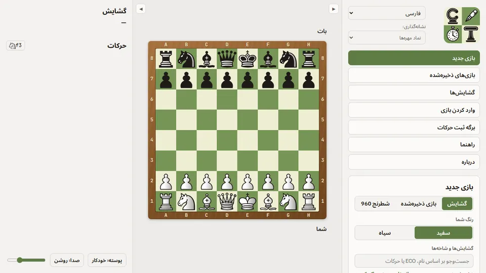
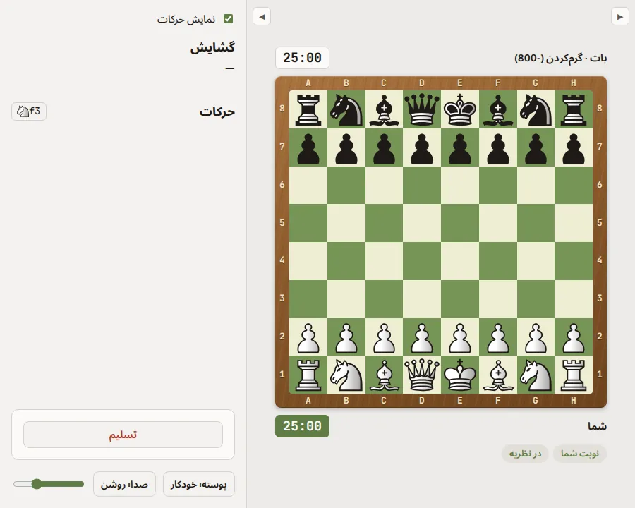
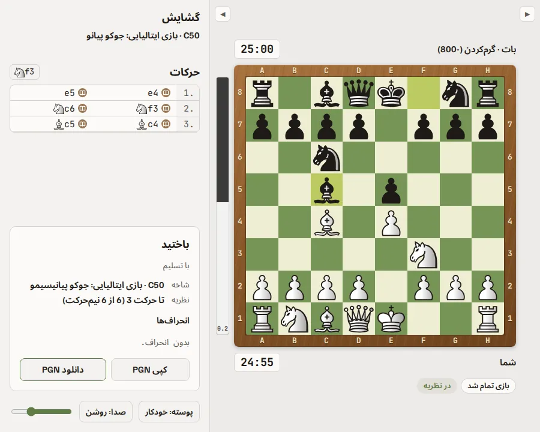
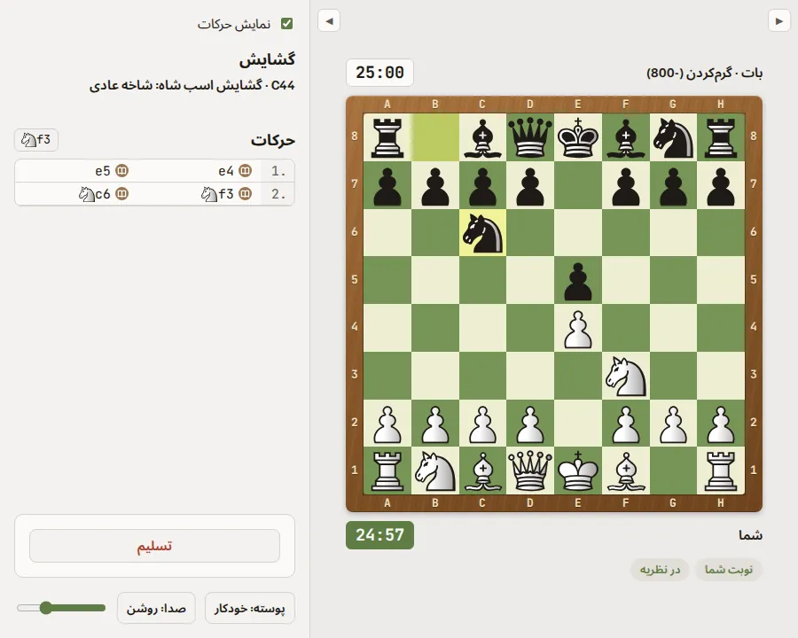
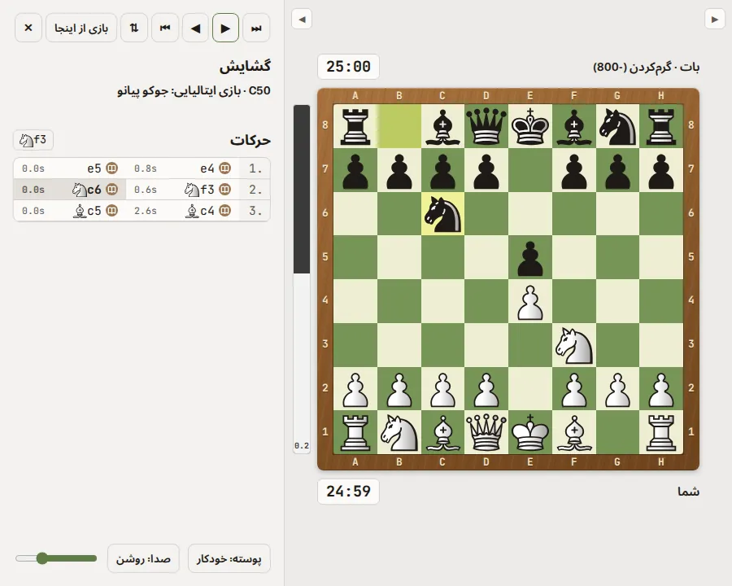

<!-- Generated by scripts/help_docs.py from the app's Help page. Do not edit. -->

# چگونه از Chess Trainer استفاده کنیم

[English (US)](HELP.md) · [English (UK)](HELP.en-GB.md) · [Português (Brasil)](HELP.pt-BR.md) · [Español (Latinoamérica)](HELP.es-419.md) · [Español (España)](HELP.es-ES.md) · [Português (Portugal)](HELP.pt-PT.md) · [Deutsch](HELP.de.md) · [Français](HELP.fr.md) · [Italiano](HELP.it.md) · [Türkçe](HELP.tr.md) · [Polski](HELP.pl.md) · [Nederlands](HELP.nl.md) · [Bahasa Indonesia](HELP.id.md) · [Tiếng Việt](HELP.vi.md) · [Svenska](HELP.sv.md) · [Dansk](HELP.da.md) · [Norsk bokmål](HELP.nb.md) · [Suomi](HELP.fi.md) · [Русский](HELP.ru.md) · [Українська](HELP.uk.md) · [हिन्दी](HELP.hi.md) · [中文（简体）](HELP.zh-CN.md) · [日本語](HELP.ja.md) · [한국어](HELP.ko.md) · [العربية](HELP.ar.md) · [עברית](HELP.he.md)

> این ترجمه ماشینی است و هنوز بازبینی نشده است. از اصلاحات استقبال می‌کنیم: [پیشنهاد اصلاح](https://github.com/nielsencampos/chess-trainer/issues/new?template=translation-fix.yml&language=fa)

Chess Trainer برای تمرین است: گشایش‌هایتان را مقابل باتی تمرین کنید که خط‌های شما را بازی می‌کند، وقتی نظریه تمام شد مقابل Stockfish ادامه دهید و بازی‌هایتان را مرور کنید. همه‌چیز روی رایانه شما اجرا می‌شود و همان‌جا می‌ماند.

> **هرگز برای تقلب از آن استفاده نکنید**
>
> در طول بازی با شخص دیگری، آنلاین یا روی صفحه، از Chess Trainer یا هیچ موتوری استفاده نکنید. این تقلب است و Chess.com، Lichess و فیده آن را ممنوع کرده‌اند. قبل و بعد از بازی‌هایتان تمرین کنید، هرگز در حین آن‌ها.

> **ارزیابی اینجا ساده است**
>
> نوار ارزیابی از یک بررسی سریع Stockfish می‌آید و فقط یک اشاره است. نمادهای حرکات (بهترین حرکت، اشتباه، اشتباه آشکار…) طبقه‌بندی سایتی هستند که بازی از آن آمده و از PGN آن خوانده می‌شوند: برنامه هیچ‌کدام را خودش حساب نمی‌کند. برای تحلیل واقعی، PGN را صادر کنید و در Chess.com، Lichess یا ابزار تحلیل دیگری تحلیلش کنید.

## شروع بازی

- گشایش: رنگتان را انتخاب کنید و گشایش‌ها و شاخه‌هایی را که می‌خواهید تمرین کنید علامت بزنید. هر شاخه علامت‌خورده شانس یکسانی برای قرعه دارد. انجام حرکتی از شاخه‌ای که علامت نزده‌اید خروج از نظریه حساب می‌شود.
- بازی ذخیره‌شده: خط بازی‌ای را که انجام داده یا وارد کرده‌اید تمرین کنید تا حرکاتتان بررسی شود، یا از هر وضعیتی از آن ادامه دهید.
- شطرنج 960: یک وضعیت آغازین قرعه بکشید یا FEN یکی از 960 وضعیت را بچسبانید. برای قلعه‌رفتن، روی شاه و سپس روی خانه‌ای بین آن و رخ، یا خود رخ، کلیک کنید.
- سطح بات: ریتینگ کنار هر سطح اسمی است، روی مقیاس خود Stockfish، و اندازه‌گیری نشده است. ریتینگ Chess.com یا Lichess نیست.
- کنترل زمان: تنظیمات ساعت یک مسابقه واقعی، از بولت تا کلاسیک، یا بدون ساعت. زمان پاسخ بات انسانی است، که وقتش را مثل یک آدم خرج می‌کند، یا فوری.
- گزینه‌ها: هشدار هنگام خروج از نظریه، اجازه پیش‌حرکت، و اینکه بات عمداً از خطش منحرف شود، از حرکتی که انتخاب می‌کنید، تا با غافلگیری‌ها هم تمرین کنید.

*بازی جدید: رنگ، خط‌ها، سطح و ساعت.*

## در طول بازی

- روی مهره‌ها کلیک کنید یا آن‌ها را بکشید. بات حرکات کتابی خط قرعه‌شده را بازی می‌کند و وقتی نظریه تمام شود، یا کسی از آن خارج شود، Stockfish در سطح انتخاب‌شده ادامه می‌دهد.
- برچسب‌های زیر صفحه می‌گویند نوبت کیست، آیا هنوز در نظریه‌اید، و شما یا بات کجا از آن خارج شدید.
- «نمایش حرکات»، در نوار راست، نام گشایش و فهرست حرکات را تا پایان بازی پنهان می‌کند: بدون راهنما بازی کنید، یا حرکات را روی کاغذ بنویسید.
- نشانه‌گذاری، زیر زبان، حرکات را با نماد مهره‌ها، با حروف انگلیسی (Nf3، حروف فایل‌های PGN و سایت‌های شطرنج) یا با حروف زبان شما نشان می‌دهد. دکمه کنار «حرکات» بین آن‌ها جابه‌جا می‌کند، حتی در میانه بازی، و نگه‌داشتن نشانگر روی یک حرکت، یا رسیدن به آن با Tab، آن را با دو نشانه‌گذاری دیگر نشان می‌دهد. فایل‌های PGN همیشه از حروف انگلیسی استفاده می‌کنند.
- با پیش‌حرکت روشن، می‌توانید وقتی بات فکر می‌کند یک حرکت را از پیش آماده کنید. با پیش‌حرکت خاموش، «پس گرفتن» آخرین حرکت شما را تا وقتی پاسخ بات نمایش داده نشده برمی‌گرداند.
- «تسلیم» کلیک دوم می‌خواهد تا یک کلیک اشتباهی بازی را تمام نکند.

*روی مهره کلیک کنید یا آن را بکشید؛ بات از کتاب پاسخ می‌دهد.*

## پس از بازی

- کارت زیر فهرست حرکات نتیجه، شاخه، اینکه نظریه تا کجا رفت، و هر انحراف را با حرکت مورد انتظار نشان می‌دهد.
- PGN را کپی یا دانلود کنید. «بازی جدید» بازی بعدی را با همان انتخاب‌ها شروع می‌کند.

*در پایان: نتیجه، شاخه، نظریه و انحراف‌ها.*

## چگونه تمرین کنیم

### باختن بخشی از کار است

باختن بخشی از یادگیری است. مهم این است که هر بازی را مطالعه کنید و از اشتباهات خودتان یاد بگیرید. برای پیشرفت واقعی، سطح بات را کم‌کم بالا ببرید و تنها وقتی دوباره بالا ببرید که با حرکاتش راحت باشید.

### هر کنترل زمان کاری دارد

در بازی‌های طولانی، با آرامش روی هر حرکت فکر کنید و عادت محاسبه دو، سه یا چند حرکت جلوتر را بسازید. از سریع، بلیتس و بولت برای تمرین الگوهایی استفاده کنید که پیش‌تر آموخته‌اید.

### از حرکات حریف شروع کنید

پیش از هر حرکت، اول ببینید حریفتان چه تهدیدی دارد: کیش‌ها، گرفتن‌ها و حمله‌ها. بعد دنبال نقشه خودتان بگردید.

### مثل مسابقه تمرین کنید

بهترین راه یادگیری با صفحه و ساعت واقعی است. مهم نیست اگر ساعت با ساعت برنامه کمی فرق کند.

چرا با صفحه، ساعت و برگه ثبت تمرین کنیم؟ چون شما را به حفظ کردن وامی‌دارند، از بازی بی‌فکر بازتان می‌دارند، و محاسبه و تجسم شما را می‌سازند، شاید تا جایی که در ذهنتان بازی کنید، بی هیچ صفحه واقعی یا مجازی پیش رو.

پیش از بازی، «برگه ثبت حرکات» را از منو باز کنید و چاپش کنید، یا به PDF ذخیره کنید، و سربرگ را پر کنید. یک کنترل زمان طولانی، مثل سریع یا کلاسیک، انتخاب کنید و علامت «نمایش حرکات» را بردارید.

در نوبت شما:

1. مهره را روی صفحه حرکت دهید.
1. ساعت را با همان دستی بزنید که مهره را حرکت داد.
1. همان حرکت را در برنامه انجام دهید.
1. حرکت را در برگه ثبت بنویسید.

در نوبت بات:

1. حرکتش را روی صفحه انجام دهید.
1. ساعت را در سمت او بزنید.
1. حرکت را در برگه ثبت بنویسید.

تنها پس از آن به حرکت خودتان فکر کنید.

به یاد داشته باشید: مهره‌ای که دست بزنید، همان را باید حرکت دهید. برای تجربه‌ای بهتر، از بازی خودتان فیلم بگیرید و بعداً ببینید پشت صفحه چگونه رفتار می‌کنید. عجله نکنید: با تمرین طبیعی می‌شود.

در پایان، نتیجه و امضاها را پر کنید، برگه‌تان را با فهرست حرکات و PGN مقایسه کنید و دنبال حرکاتی بگردید که اشتباه نوشته‌اید.

*با برداشتن علامت «نمایش حرکات»، فهرست حرکات پنهان می‌شود و شما در برگه ثبت می‌نویسید.*

### پیش از نگاه به ارزیابی، تحلیل کنید

وقتی بازی تمام شد، اول خودتان مرورش کنید و ببینید کجا ورق برگشت. تنها پس از آن با ارزیابی مقایسه کنید. نوار روی وضعیت پایانی نشان داده می‌شود، پس تا کارتان تمام نشده به آن توجه نکنید.

## بازی‌های ذخیره‌شده و مرور

- هر بازی ذخیره می‌شود. فهرست را جست‌وجو و فیلتر کنید، یک بازی را روی صفحه باز کنید و با دکمه‌ها یا کلیدهای جهت‌نما، Home و End مرورش کنید.
- «بازی از اینجا» بازی جدیدی را از وضعیت روی صفحه شروع می‌کند.
- بازی‌ها را علامت بزنید تا به PGN صادر یا حذفشان کنید.

*مرور یک بازی ذخیره‌شده، با نوار ارزیابی.*

## گشایش‌ها

- همه خط‌های کتاب را روی صفحه مرور کنید و خط‌ها را علامت بزنید تا به PGN صادرشان کنید.

## وارد کردن بازی‌ها

- بازی‌هایتان را از Chess.com یا Lichess با نام کاربری و دوره بیاورید، یا PGN را بچسبانید یا بارگذاری کنید. به «بازی‌های ذخیره‌شده» می‌روند، آماده مرور یا تمرین.

## تحلیل در جای دیگر

- PGN را از کارت پایان بازی یا از «بازی‌های ذخیره‌شده» بگیرید.
- در Chess.com یا Lichess، صفحه تحلیل را باز کنید و PGN را بچسبانید یا وارد کنید، برای تحلیلی کامل و عمیق‌تر.
