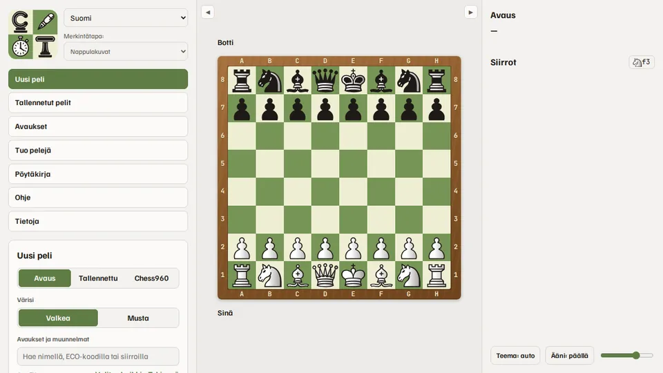
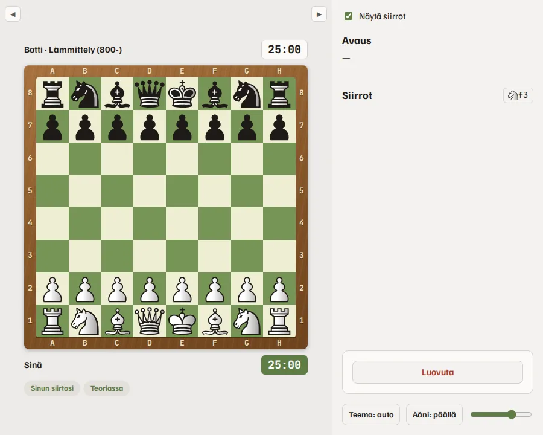
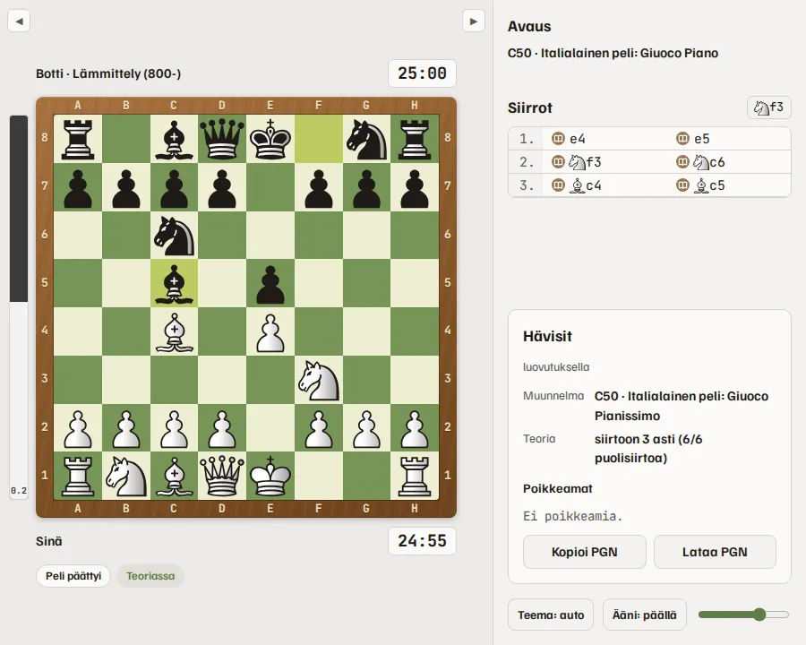
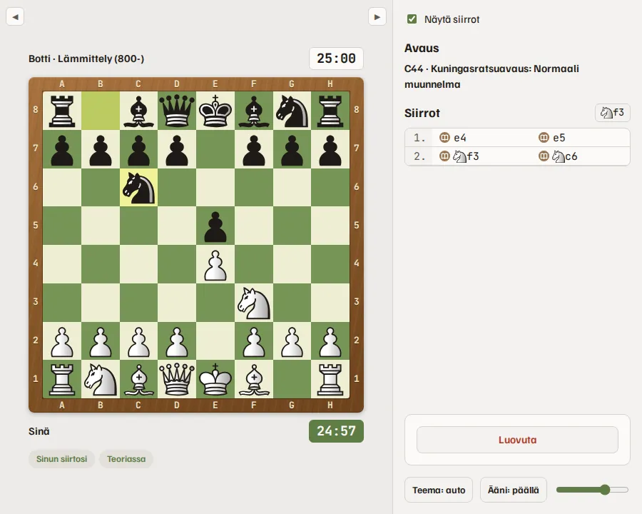
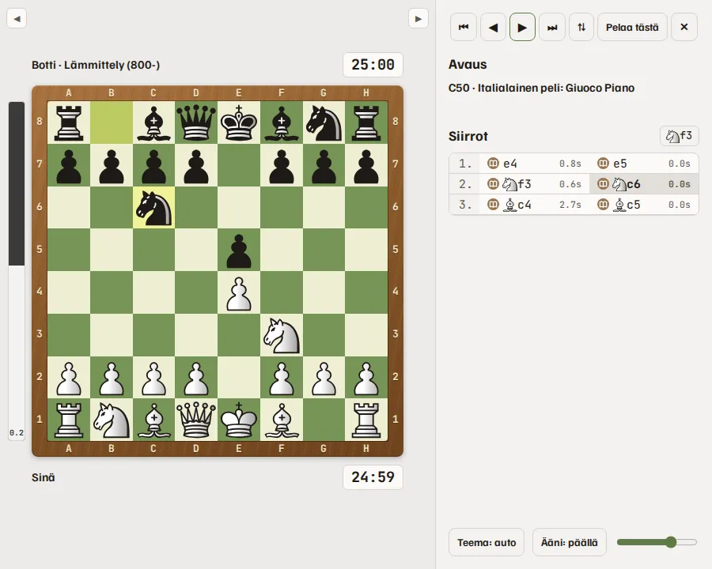

<!-- Generated by scripts/help_docs.py from the app's Help page. Do not edit. -->

# Näin käytät Chess Traineria

[English (US)](HELP.md) · [English (UK)](HELP.en-GB.md) · [Português (Brasil)](HELP.pt-BR.md) · [Español (Latinoamérica)](HELP.es-419.md) · [Español (España)](HELP.es-ES.md) · [Português (Portugal)](HELP.pt-PT.md) · [Deutsch](HELP.de.md) · [Français](HELP.fr.md) · [Italiano](HELP.it.md) · [Türkçe](HELP.tr.md) · [Polski](HELP.pl.md) · [Nederlands](HELP.nl.md) · [Bahasa Indonesia](HELP.id.md) · [Tiếng Việt](HELP.vi.md) · [Svenska](HELP.sv.md) · [Dansk](HELP.da.md) · [Norsk bokmål](HELP.nb.md) · [Русский](HELP.ru.md) · [Українська](HELP.uk.md) · [हिन्दी](HELP.hi.md) · [中文（简体）](HELP.zh-CN.md) · [日本語](HELP.ja.md) · [한국어](HELP.ko.md) · [العربية](HELP.ar.md) · [فارسی](HELP.fa.md) · [עברית](HELP.he.md)

> Tämä käännös on konekäännös, eikä sitä ole tarkistettu. Korjaukset ovat tervetulleita: [ehdota korjausta](https://github.com/nielsencampos/chess-trainer/issues/new?template=translation-fix.yml&language=fi)

Chess Trainer on harjoittelua varten: harjoittele avauksiasi bottia vastaan, joka pelaa linjojasi, jatka peliä Stockfishia vastaan, kun teoria päättyy, ja käy pelisi läpi. Kaikki toimii ja pysyy omalla tietokoneellasi.

> **Älä koskaan käytä sitä huijaamiseen**
>
> Älä käytä Chess Traineria tai mitään shakkimoottoria pelin aikana toista ihmistä vastaan, verkossa tai laudan ääressä. Se on huijaamista, ja Chess.com, Lichess ja FIDE kieltävät sen. Harjoittele ennen pelejäsi ja niiden jälkeen, älä koskaan niiden aikana.

> **Arvio on tässä yksinkertainen**
>
> Arviopalkki ja siirtojen kuvakkeet (paras siirto, virhe, munaus…) tulevat Stockfishin nopeasta tarkistuksesta ja ovat vain vihje. Kunnollista analyysiä varten vie PGN ja analysoi se Chess.comissa, Lichessissä tai muulla analyysityökalulla.

## Aloita peli

- Avaus: valitse värisi ja ne avaukset ja muunnelmat, joita haluat harjoitella. Jokaisella valitulla muunnelmalla on sama todennäköisyys tulla arvotuksi. Siirto muunnelmasta, jota et valinnut, lasketaan teoriasta poistumiseksi.
- Tallennettu: harjoittele pelaamasi tai tuomasi pelin linjaa, jolloin sen siirrot tarkistetaan, tai jatka peliä mistä tahansa sen asemasta.
- Chess960: arvo alkuasema tai liitä jonkin 960:stä FEN. Tornittaaksesi napsauta kuningasta ja sitten ruutua sen ja tornin välissä tai itse tornia.
- Botin taso: kunkin tason vieressä oleva vahvuusluku on nimellinen, Stockfishin omalla asteikolla, eikä sitä ole mitattu. Se ei ole Chess.comin tai Lichessin vahvuusluku.
- Aikakontrolli: oikean turnauskellon esiasetukset bulletista klassiseen, tai ei kelloa. Botin vastausaika on Ihmismäinen, joka käyttää kelloaan kuin ihminen, tai Välitön.
- Asetukset: varoita, kun poistut teoriasta, salli ennakkosiirrot ja anna botin poiketa linjaltaan tarkoituksella valitusta siirrosta alkaen, jotta harjoittelet myös yllätyksiä vastaan.

*Uusi peli: väri, linjat, taso ja kello.*

## Pelin aikana

- Napsauta tai vedä nappuloita. Botti pelaa arvotun linjan teoriasiirrot, ja kun teoria päättyy tai joku poistuu siitä, Stockfish jatkaa valitulla tasolla.
- Laudan alla olevat merkit kertovat, kenen siirto on, oletko yhä teoriassa ja missä sinä tai botti poistuitte siitä.
- Oikean paneelin Näytä siirrot piilottaa avauksen nimen ja siirtolistan pelin loppuun asti: pelaa ilman vihjeitä tai kirjoita siirrot paperille.
- Kielen alla oleva Merkintätapa näyttää siirrot nappulasymboleina (nappulakuvat), englanninkielisillä kirjaimilla (Nf3, PGN-tiedostojen ja shakkisivustojen kirjaimet) tai kielesi kirjaimilla (Rf3). Siirrot-kohdan vieressä oleva painike vaihtaa niiden välillä myös kesken pelin, ja kun viet hiiren siirron päälle tai saavutat sen Tab-näppäimellä, se näytetään kahdella muulla tavalla. PGN-tiedostot käyttävät aina englanninkielisiä kirjaimia.
- Kun ennakkosiirrot ovat käytössä, voit asettaa yhden siirron jonoon botin miettiessä. Kun ne eivät ole käytössä, Peru siirto peruu viimeisen siirtosi niin kauan kuin botin vastausta ei ole vielä näytetty.
- Luovuta vaatii toisen napsautuksen, jotta vahingossa tehty napsautus ei päätä peliä.

*Napsauta tai vedä nappulaa; botti vastaa kirjasta.*

## Pelin jälkeen

- Siirtolistan alla oleva kortti näyttää tuloksen, muunnelman, kuinka pitkälle teoria ulottui ja jokaisen poikkeaman odotetun siirron kanssa.
- Kopioi tai lataa PGN. Uusi peli aloittaa seuraavan samoilla valinnoilla.

*Lopussa: tulos, muunnelma, teoria ja poikkeamat.*

## Näin harjoittelet

### Häviäminen kuuluu asiaan

Häviäminen on osa oppimista. Tärkeintä on tutkia jokainen peli ja oppia omista virheistään. Jotta todella kehittyisit, nosta botin tasoa vähitellen, ja nosta sitä uudelleen vasta, kun tunnet olosi varmaksi sen pelaamien siirtojen kanssa.

### Jokaisella aikakontrollilla on tehtävänsä

Pitkissä peleissä mieti jokaista siirtoa rauhassa ja totu laskemaan kaksi, kolme tai useampia siirtoja eteenpäin. Käytä pikashakkia, salamashakkia ja bulletia jo omaksumiesi kuvioiden harjoitteluun.

### Aloita vastustajan siirroista

Katso ennen jokaista siirtoa ensin, mitä vastustajasi uhkaa: shakit, lyönnit ja hyökkäykset. Etsi vasta sitten omaa suunnitelmaasi.

### Harjoittele kuin turnauksessa

Paras tapa oppia on oikea lauta ja kello. Ei haittaa, vaikka kello erkanisi sovelluksen kellosta.

Miksi harjoitella laudan, kellon ja pöytäkirjan kanssa? Koska ne pakottavat muistamaan, estävät pelaamasta ajattelematta ja kehittävät laskemista ja visualisointia, ehkä siihen asti, että alat pelata päässäsi ilman fyysistä tai virtuaalista lautaa edessäsi.

Avaa ennen peliä valikosta Pöytäkirja ja tulosta se tai tallenna PDF:nä, ja täytä otsikkotiedot. Valitse pitkä aikakontrolli, kuten pikashakki tai klassinen, ja poista Näytä siirrot -valinta.

Kun on sinun siirtosi:

1. Siirrä nappulaa laudalla.
1. Paina kelloa samalla kädellä, jolla siirsit nappulaa.
1. Pelaa sama siirto sovelluksessa.
1. Kirjoita siirto pöytäkirjaan.

Kun on botin siirto:

1. Pelaa sen siirto laudalla.
1. Paina kelloa sen puolelta.
1. Kirjoita siirto pöytäkirjaan.

Ala vasta sitten miettiä omaasi.

Muista kosketussääntö: nappula, johon kosket, on siirrettävä. Vielä paremman kokemuksen saat kuvaamalla itsesi pelaamassa ja katsomalla videon myöhemmin nähdäksesi, miten käyttäydyt laudan ääressä. Ota aikaa: harjoittelemalla se muuttuu luontevaksi.

Täytä lopuksi tulos ja allekirjoitukset, vertaa pöytäkirjaasi siirtolistaan ja PGN:ään ja etsi siirrot, jotka kirjoitit väärin.

*Kun Näytä siirrot ei ole valittuna, siirtolista piilotetaan ja kirjoitat pöytäkirjaan.*

### Analysoi ennen kuin katsot arviota

Kun peli päättyy, käy se ensin läpi itse ja etsi kohta, jossa se kääntyi. Vasta sitten vertaa sitä arvioon. Palkki näkyy loppuasemassa, joten älä välitä siitä ennen kuin olet valmis.

## Tallennetut pelit ja läpikäynti

- Jokainen peli tallennetaan. Hae ja suodata listaa, avaa peli laudalle ja käy se läpi painikkeilla tai nuolinäppäimillä, Home ja End.
- Pelaa tästä aloittaa uuden pelin laudalla olevasta asemasta.
- Valitse pelejä viedäksesi ne PGN-muodossa tai poistaaksesi ne.

*Tallennetun pelin läpikäynti arviopalkin kanssa.*

## Avaukset

- Käy laudalla läpi kirjan kaikki linjat, ja valitse linjoja viedäksesi ne PGN-muodossa.

## Tuo pelejä

- Tuo pelisi Chess.comista tai Lichessistä käyttäjänimen ja ajanjakson perusteella, tai liitä tai lataa PGN. Ne menevät Tallennettuihin peleihin valmiina läpikäyntiin tai harjoitteluun.

## Analysoi muualla

- Hae PGN pelin lopun kortista tai Tallennetuista peleistä.
- Avaa Chess.comissa tai Lichessissä analyysilauta ja liitä tai tuo PGN saadaksesi täyden ja syvemmän analyysin.
