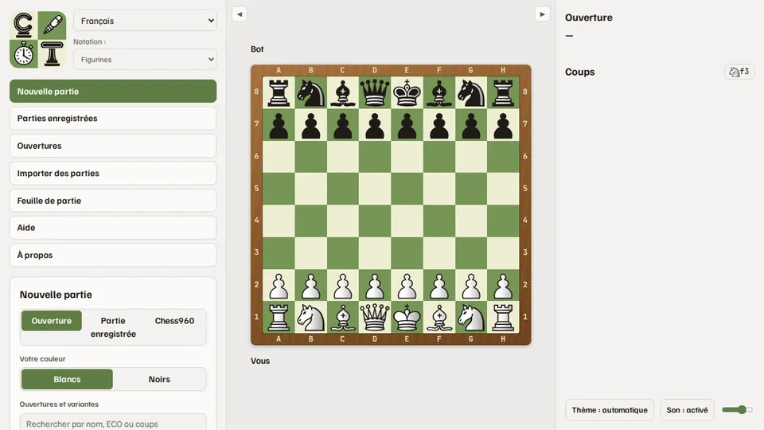
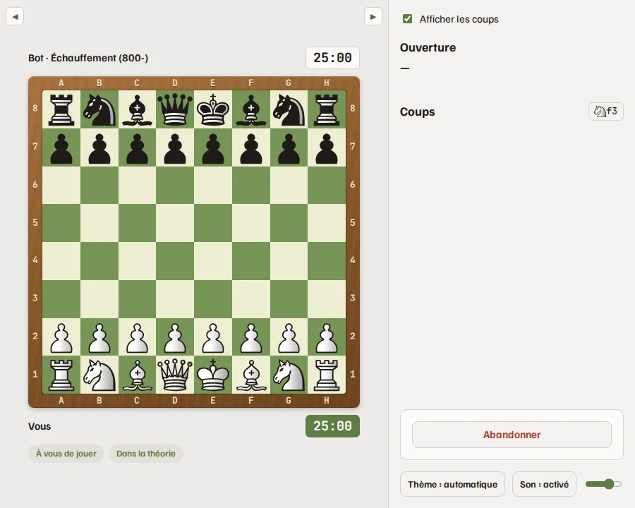
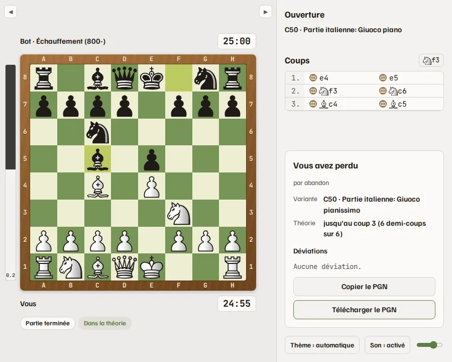
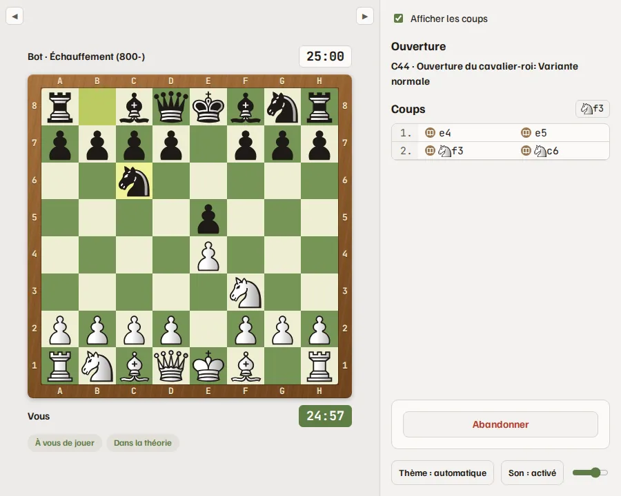
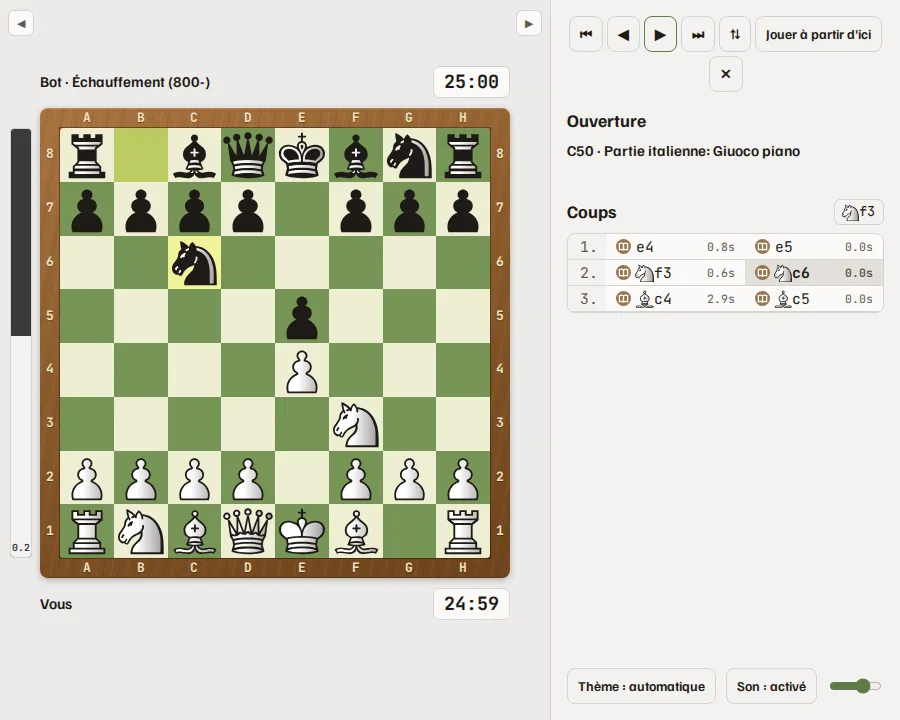

<!-- Generated by scripts/help_docs.py from the app's Help page. Do not edit. -->

# Comment utiliser Chess Trainer

[English (US)](HELP.md) · [English (UK)](HELP.en-GB.md) · [Português (Brasil)](HELP.pt-BR.md) · [Español (Latinoamérica)](HELP.es.md) · [Español (España)](HELP.es-ES.md) · [Português (Portugal)](HELP.pt-PT.md) · [Deutsch](HELP.de.md)

Chess Trainer sert à s'entraîner : travaillez vos ouvertures contre un bot qui joue vos lignes, continuez contre Stockfish quand la théorie s'arrête et revoyez vos parties. Tout fonctionne et reste sur votre ordinateur.

> **Ne l'utilisez jamais pour tricher**
>
> N'utilisez pas Chess Trainer, ni aucun autre moteur, pendant une partie contre une autre personne, en ligne ou sur l'échiquier. C'est de la triche, et Chess.com, Lichess et la FIDE l'interdisent. Entraînez-vous avant et après vos parties, jamais pendant.

> **L'évaluation est sommaire**
>
> La barre d'évaluation et les icônes des coups (meilleur coup, erreur, gaffe…) viennent d'un examen rapide par Stockfish et ne sont qu'une indication. Pour une vraie analyse, exportez le PGN et analysez-le sur Chess.com, sur Lichess ou avec un autre outil d'analyse.

## Commencer une partie

- Ouverture : choisissez votre couleur et cochez les ouvertures et variantes à travailler. Chaque variante cochée a la même probabilité d'être tirée. Jouer un coup d'une variante que vous n'avez pas cochée compte comme une sortie de la théorie.
- Partie enregistrée : travaillez la ligne d'une partie que vous avez jouée ou importée, avec vos coups vérifiés, ou continuez à jouer à partir de n'importe laquelle de ses positions.
- Chess960 : tirez au sort une position initiale ou collez le FEN de l'une des 960. Pour roquer, cliquez sur le roi puis sur une case entre lui et la tour, ou sur la tour elle-même.
- Niveau du bot : l'Elo affiché pour chaque niveau est nominal, sur l'échelle propre à Stockfish, et n'a pas été mesuré. Ce n'est pas un Elo de Chess.com ni de Lichess.
- Cadence : les cadences d'une vraie pendule de tournoi, du bullet au classique, ou sans pendule. Le temps de réponse du bot est Humain, qui use sa pendule comme une personne, ou Instantané.
- Options : prévenir en sortant de la théorie, autoriser les précoups et laisser le bot dévier volontairement de sa ligne à partir d'un coup choisi, pour vous entraîner aussi contre les surprises.

*Nouvelle partie : couleur, lignes, niveau et pendule.*

## Pendant la partie

- Cliquez sur les pièces ou faites-les glisser. Le bot joue les coups de théorie de la ligne tirée au sort et, quand la théorie s'arrête ou que quelqu'un en sort, Stockfish prend le relais au niveau choisi.
- Les étiquettes sous l'échiquier indiquent qui a le trait, si vous êtes encore dans la théorie et où vous ou le bot en êtes sortis.
- « Afficher les coups », dans le panneau de droite, masque le nom de l'ouverture et la liste des coups jusqu'à la fin de la partie : jouez sans indice ou notez les coups sur papier.
- Avec les précoups activés, vous pouvez préparer un coup pendant que le bot réfléchit. Sans eux, « Reprendre le coup » annule votre dernier coup tant que la réponse du bot n'est pas encore visible.
- Abandonner demande un second clic, pour qu'un clic involontaire ne termine pas la partie.

*Cliquez sur une pièce ou faites-la glisser ; le bot répond avec la théorie.*

## Après la partie

- Le cadre sous la liste des coups montre le résultat, la variante, jusqu'où est allée la théorie et chaque déviation avec le coup attendu.
- Copiez ou téléchargez le PGN. « Nouvelle partie » lance la suivante avec les mêmes réglages.

*À la fin : résultat, variante, théorie et déviations.*

## Comment s'entraîner

### Perdre fait partie du chemin

Perdre fait partie de l'apprentissage. L'important est d'étudier chaque partie et d'apprendre de ses propres erreurs. Pour vraiment progresser, augmentez le niveau du bot petit à petit, et ne l'augmentez à nouveau que lorsque vous êtes à l'aise avec les coups qu'il propose.

### Chaque cadence a son rôle

Dans les parties longues, réfléchissez calmement à chaque coup et prenez l'habitude de calculer deux, trois coups à l'avance ou plus. Servez-vous des parties rapides, du blitz et du bullet pour travailler les schémas que vous avez déjà assimilés.

### Commencez par les coups de l'adversaire

Avant chaque coup, regardez d'abord ce que menace l'adversaire : échecs, prises et attaques. Cherchez ensuite votre propre plan.

### Entraînez-vous comme en tournoi

L'idéal pour apprendre est de jouer avec un vrai échiquier et une vraie pendule. Peu importe si la pendule se décale par rapport à celle de l'application.

Pourquoi s'entraîner avec échiquier, pendule et feuille de partie ? Parce que cela oblige à mémoriser, à ne pas jouer sans réfléchir et à calculer, et que cela entraîne la visualisation, peut-être jusqu'à jouer à l'aveugle, sans avoir besoin de voir un échiquier réel ou virtuel.

Avant la partie, ouvrez « Feuille de partie » dans le menu et imprimez-la, ou enregistrez-la en PDF, puis remplissez l'en-tête. Choisissez une cadence longue, comme rapide ou classique, et décochez « Afficher les coups ».

À votre coup :

1. Déplacez la pièce sur l'échiquier.
1. Appuyez sur la pendule avec la main qui a déplacé la pièce.
1. Jouez le même coup dans l'application.
1. Notez le coup sur la feuille.

Au coup du bot :

1. Reproduisez son coup sur l'échiquier.
1. Appuyez sur la pendule de son côté.
1. Notez le coup sur la feuille.

Alors seulement, commencez à réfléchir au vôtre.

Rappelez-vous : pièce touchée, pièce jouée. Pour une expérience encore meilleure, filmez-vous en train de jouer et regardez-vous ensuite pour comprendre votre comportement devant l'échiquier. Faites tout calmement : avec le temps, cela devient naturel.

À la fin, remplissez le résultat et les signatures, comparez votre feuille avec la liste des coups et le PGN, et cherchez les coups mal notés.

*Avec « Afficher les coups » décoché, la liste disparaît et vous notez sur la feuille.*

### Analysez avant de regarder l'évaluation

Une fois la partie terminée, revoyez-la d'abord seul et cherchez où elle a basculé. Comparez seulement ensuite avec l'évaluation. La barre apparaît sur la position finale, alors ignorez-la jusqu'à la fin.

## Parties enregistrées et révision

- Toutes les parties sont enregistrées. Recherchez et filtrez la liste, ouvrez une partie sur l'échiquier et parcourez-la avec les boutons ou avec les flèches du clavier, Début et Fin.
- « Jouer à partir d'ici » lance une nouvelle partie à partir de la position de l'échiquier.
- Cochez des parties pour les exporter en PGN ou les supprimer.

*Révision d'une partie enregistrée, avec la barre d'évaluation.*

## Ouvertures

- Parcourez sur l'échiquier chaque ligne du livre et cochez des lignes pour les exporter en PGN.

## Importer des parties

- Récupérez vos parties de Chess.com ou Lichess par nom d'utilisateur et période, ou collez ou envoyez un PGN. Elles arrivent dans « Parties enregistrées », prêtes à être revues ou travaillées.

## Analyser ailleurs

- Récupérez le PGN dans le cadre de fin de partie ou dans « Parties enregistrées ».
- Sur Chess.com ou Lichess, ouvrez l'échiquier d'analyse et collez ou importez le PGN, pour une analyse complète et plus forte.
