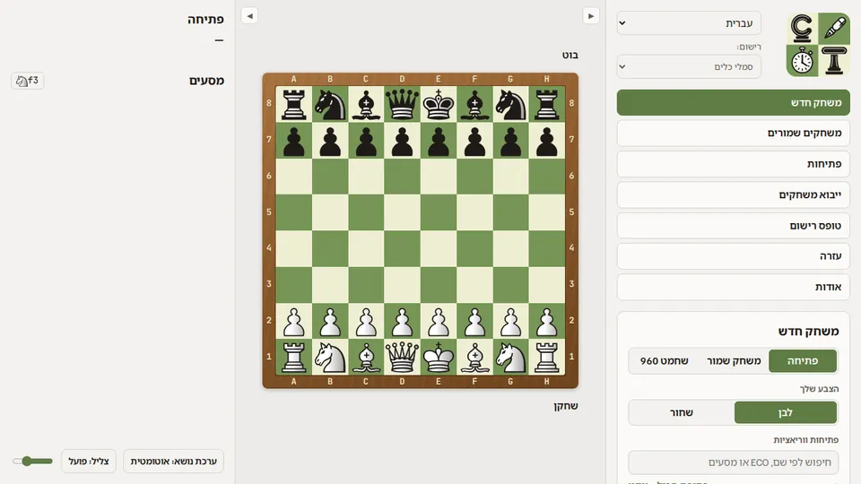
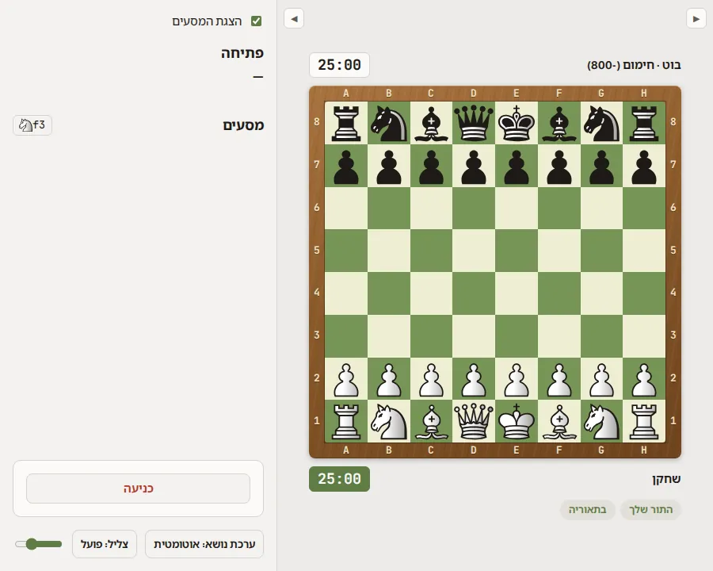
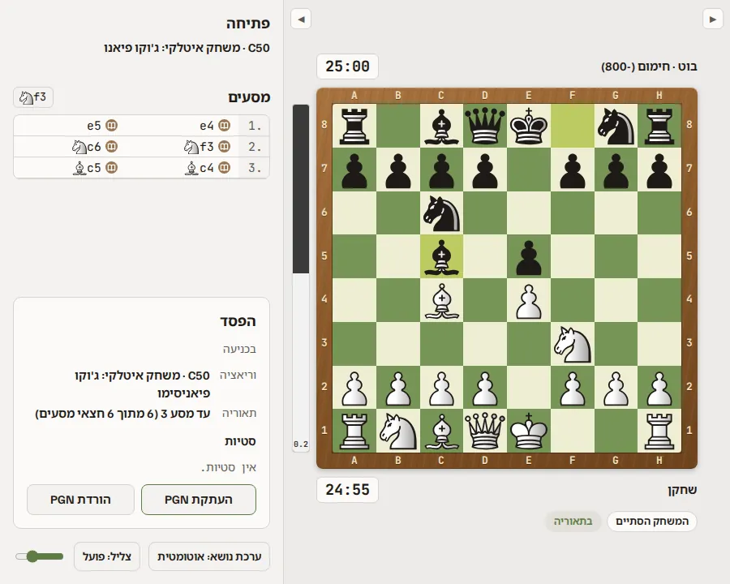
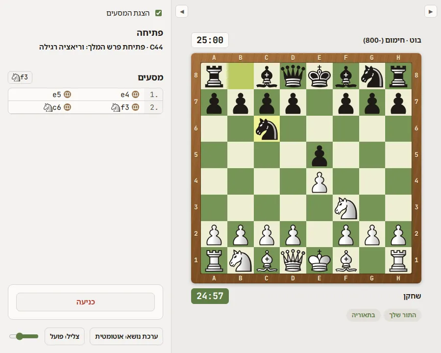
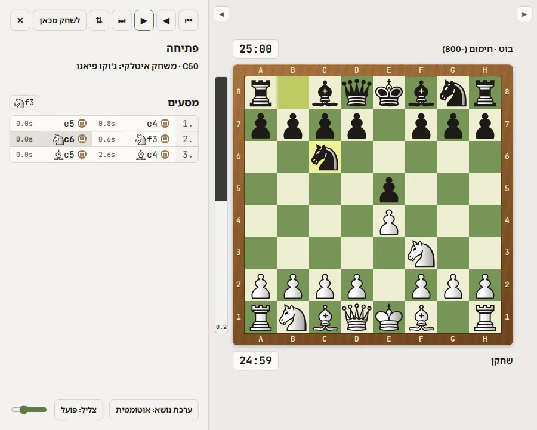

<!-- Generated by scripts/help_docs.py from the app's Help page. Do not edit. -->

# איך להשתמש ב-Chess Trainer

[English (US)](HELP.md) · [English (UK)](HELP.en-GB.md) · [Português (Brasil)](HELP.pt-BR.md) · [Español (Latinoamérica)](HELP.es-419.md) · [Español (España)](HELP.es-ES.md) · [Português (Portugal)](HELP.pt-PT.md) · [Deutsch](HELP.de.md) · [Français](HELP.fr.md) · [Italiano](HELP.it.md) · [Türkçe](HELP.tr.md) · [Polski](HELP.pl.md) · [Nederlands](HELP.nl.md) · [Bahasa Indonesia](HELP.id.md) · [Tiếng Việt](HELP.vi.md) · [Svenska](HELP.sv.md) · [Dansk](HELP.da.md) · [Norsk bokmål](HELP.nb.md) · [Suomi](HELP.fi.md) · [Русский](HELP.ru.md) · [Українська](HELP.uk.md) · [हिन्दी](HELP.hi.md) · [中文（简体）](HELP.zh-CN.md) · [日本語](HELP.ja.md) · [한국어](HELP.ko.md) · [العربية](HELP.ar.md) · [فارسی](HELP.fa.md)

Chess Trainer נועד לתרגול: לאמן את הפתיחות מול בוט שמשחק את הקווים שלך, להמשיך לשחק נגד Stockfish כשהתאוריה נגמרת, ולסקור את המשחקים. הכול רץ ונשאר במחשב שלך.

> **לעולם לא להשתמש בו לרמאות**
>
> אין להשתמש ב-Chess Trainer, או בשום מנוע, במהלך משחק נגד אדם אחר, ברשת או ליד הלוח. זו רמאות, ו-Chess.com,‏ Lichess ופיד"ה אוסרים אותה. להתאמן לפני המשחקים ואחריהם, לעולם לא במהלכם.

> **ההערכה כאן בסיסית**
>
> סרגל ההערכה וסמלי המסעים (המסע הטוב ביותר, טעות, טעות גסה…) מגיעים מבדיקה מהירה של Stockfish והם רק רמז. לניתוח אמיתי, לייצא את ה-PGN ולנתח אותו ב-Chess.com, ב-Lichess או בכלי ניתוח אחר.

## התחלת משחק

- פתיחה: לבחור צבע ולסמן את הפתיחות והווריאציות לאימון. לכל וריאציה מסומנת אותו סיכוי לעלות בהגרלה. מסע מווריאציה שלא סומנה נחשב יציאה מהתאוריה.
- משחק שמור: להתאמן על הקו של משחק ששיחקת או ייבאת, כך שהמסעים נבדקים, או להמשיך לשחק מכל עמדה בו.
- שחמט 960: להגריל עמדת פתיחה או להדביק FEN של אחת מ-960 העמדות. כדי להצריח, ללחוץ על המלך ואז על משבצת בינו לבין הצריח, או על הצריח עצמו.
- רמת הבוט: הדירוג ליד כל רמה הוא נקוב, בסולם של Stockfish עצמו, ולא נמדד. אין זה דירוג של Chess.com או של Lichess.
- בקרת זמן: ההגדרות של שעון טורניר אמיתי, מבולט ועד קלאסי, או ללא שעון. זמן התגובה של הבוט הוא אנושי, שמנצל את השעון כמו אדם, או מיידי.
- אפשרויות: התראה ביציאה מהתאוריה, מסעים מוקדמים, ולתת לבוט לסטות מהקו שלו בכוונה, החל ממסע שנבחר, כדי להתאמן גם מול הפתעות.

*משחק חדש: צבע, קווים, רמה ושעון.*

## במהלך המשחק

- ללחוץ על הכלים או לגרור אותם. הבוט משחק את מסעי הספר של הקו שהוגרל, וכשהתאוריה נגמרת, או שמישהו יוצא ממנה, Stockfish ממשיך ברמה שנבחרה.
- התגיות שמתחת ללוח אומרות של מי התור, האם עדיין בתאוריה, והיכן יצאו ממנה, השחקן או הבוט.
- „הצגת המסעים”, בסרגל הימני, מסתירה את שם הפתיחה ואת רשימת המסעים עד סוף המשחק: לשחק בלי רמזים, או לכתוב את המסעים על נייר.
- הרישום, מתחת לשפה, מציג מסעים בסמלי כלים, באותיות באנגלית (Nf3, האותיות של קובצי PGN ואתרי שחמט) או באותיות של השפה שלך. הכפתור ליד „מסעים” מחליף ביניהם, גם באמצע משחק, וריחוף מעל מסע, או הגעה אליו עם Tab, מציגים אותו בשני הרישומים האחרים. קובצי PGN משתמשים תמיד באותיות באנגלית.
- כשמסעים מוקדמים מופעלים, אפשר לתזמן מסע אחד בזמן שהבוט חושב. כשהם כבויים, „ביטול מסע” מבטל את המסע האחרון כל עוד תשובת הבוט עוד לא הוצגה.
- „כניעה” דורשת לחיצה שנייה, כדי שלחיצה מקרית לא תסיים את המשחק.

*ללחוץ על כלי או לגרור אותו; הבוט עונה מהספר.*

## אחרי המשחק

- הכרטיס שמתחת לרשימת המסעים מציג את התוצאה, את הווריאציה, עד היכן הגיעה התאוריה, וכל סטייה עם המסע הצפוי.
- להעתיק או להוריד את ה-PGN. „משחק חדש” מתחיל את הבא עם אותן בחירות.

*בסוף: תוצאה, וריאציה, תאוריה וסטיות.*

## איך להתאמן

### הפסד הוא חלק מהדרך

הפסד הוא חלק מהלמידה. מה שחשוב הוא ללמוד כל משחק ולהפיק לקחים מהטעויות שלך. כדי להשתפר באמת, להעלות את רמת הבוט בהדרגה, ולהעלות אותה שוב רק כשהמסעים שלו כבר נוחים לך.

### לכל בקרת זמן תפקיד

במשחקים ארוכים, לחשוב בשקט על כל מסע ולבנות הרגל של חישוב שניים, שלושה או יותר מסעים קדימה. להשתמש במהיר, בבזק ובבולט כדי לתרגל את הדפוסים שכבר נקלטו.

### להתחיל מהמסעים של היריב

לפני כל מסע, לבדוק קודם במה היריב מאיים: שחים, הכאות והתקפות. רק אחר כך לחפש תוכנית משלך.

### להתאמן כמו בטורניר

הדרך הטובה ביותר ללמוד היא עם לוח ושעון אמיתיים. לא משנה אם השעון סוטה מזה של היישום.

למה להתאמן עם לוח, שעון וטופס רישום? כי הם מחייבים לשנן, מונעים משחק בלי מחשבה, ובונים חישוב והדמיה, אולי עד שמתחילים לשחק בראש, בלי לוח פיזי או וירטואלי מול העיניים.

לפני המשחק, לפתוח את „טופס רישום” בתפריט ולהדפיס אותו, או לשמור כ-PDF, ולמלא את הכותרת. לבחור בקרת זמן ארוכה, כמו מהיר או קלאסי, ולבטל את הסימון של „הצגת המסעים”.

בתור שלך:

1. להזיז את הכלי על הלוח.
1. ללחוץ על השעון באותה יד שהזיזה את הכלי.
1. לשחק את אותו מסע ביישום.
1. לכתוב את המסע בטופס הרישום.

בתור של הבוט:

1. לשחק את המסע שלו על הלוח.
1. ללחוץ על השעון בצד שלו.
1. לכתוב את המסע בטופס הרישום.

רק אז להתחיל לחשוב על המסע שלך.

לזכור: כלי שנוגעים בו הוא כלי שמזיזים. לחוויה טובה עוד יותר, לצלם את עצמך משחק ולצפות אחר כך כדי לראות איך מתנהגים ליד הלוח. בלי למהר: עם התרגול זה נעשה טבעי.

בסוף, למלא את התוצאה ואת החתימות, להשוות את הטופס לרשימת המסעים ול-PGN, ולחפש את המסעים שנכתבו לא נכון.

*כש„הצגת המסעים” אינה מסומנת, רשימת המסעים מוסתרת, וכותבים בטופס הרישום.*

### לנתח לפני שמסתכלים בהערכה

כשמשחק נגמר, לסקור אותו קודם לבד ולחפש היכן הוא התהפך. רק אז להשוות להערכה. הסרגל מוצג בעמדה הסופית, אז להתעלם ממנו עד הסוף.

## משחקים שמורים וסקירה

- כל משחק נשמר. לחפש ולסנן את הרשימה, לפתוח משחק על הלוח ולעבור עליו עם הכפתורים או עם מקשי החיצים, Home ו-End.
- „לשחק מכאן” מתחיל משחק חדש מהעמדה שעל הלוח.
- לסמן משחקים כדי לייצא אותם כ-PGN או למחוק אותם.

*סקירת משחק שמור, עם סרגל ההערכה.*

## פתיחות

- לעבור על כל קו בספר על הלוח, ולסמן קווים כדי לייצא אותם כ-PGN.

## ייבוא משחקים

- להביא את המשחקים שלך מ-Chess.com או מ-Lichess לפי שם משתמש ותקופה, או להדביק או להעלות PGN. הם עוברים ל„משחקים שמורים”, מוכנים לסקירה או לאימון.

## ניתוח במקום אחר

- לקחת את ה-PGN מכרטיס סוף המשחק או מ„משחקים שמורים”.
- ב-Chess.com או ב-Lichess, לפתוח את לוח הניתוח ולהדביק או לייבא את ה-PGN, לניתוח מלא ועמוק יותר.
