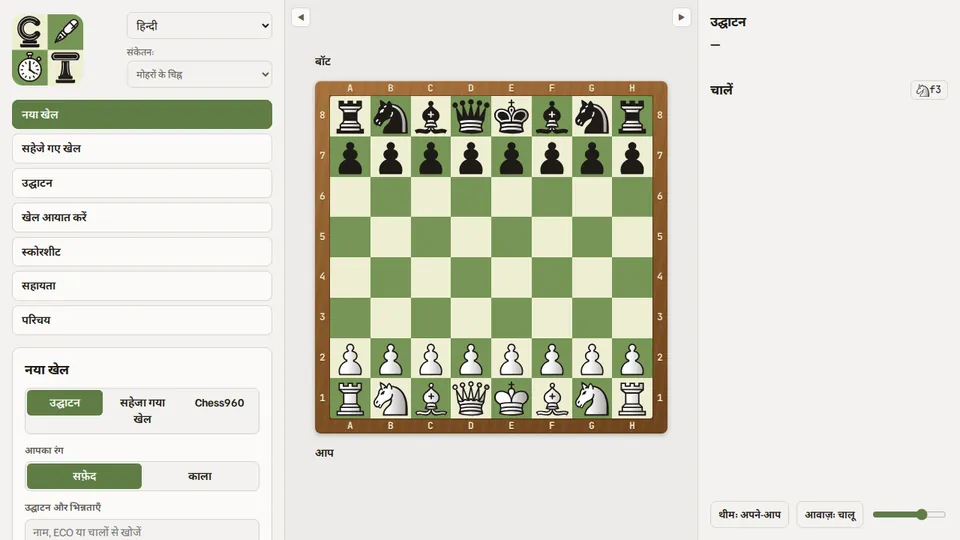
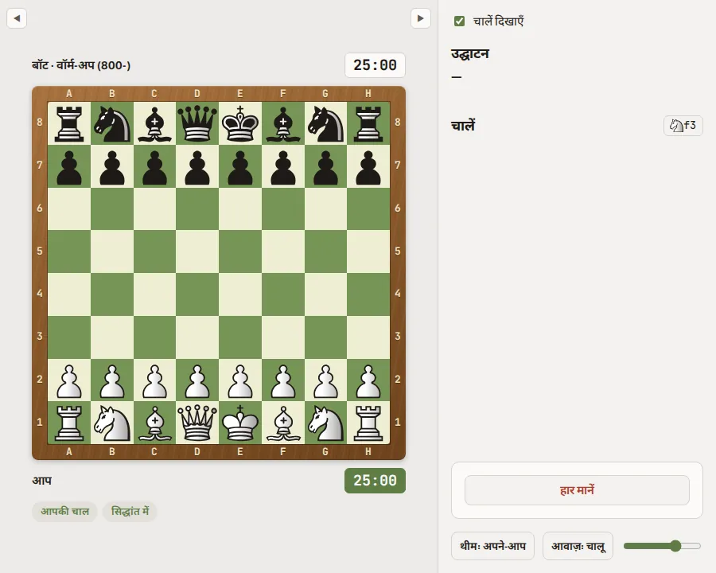
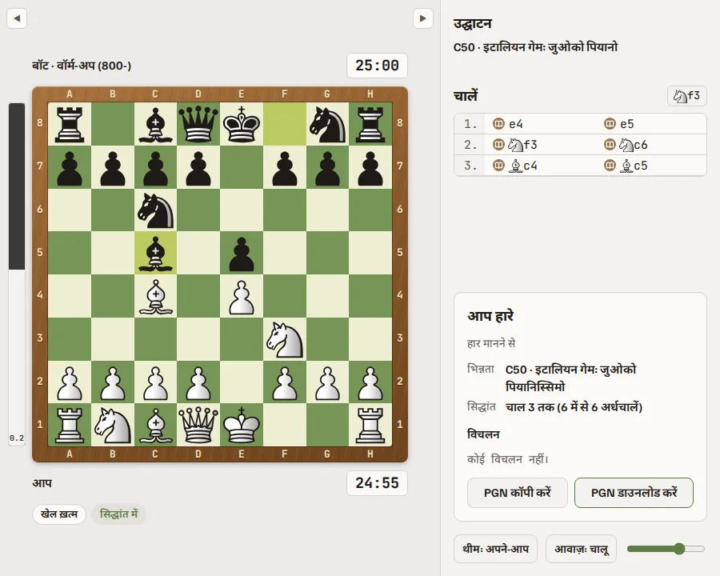
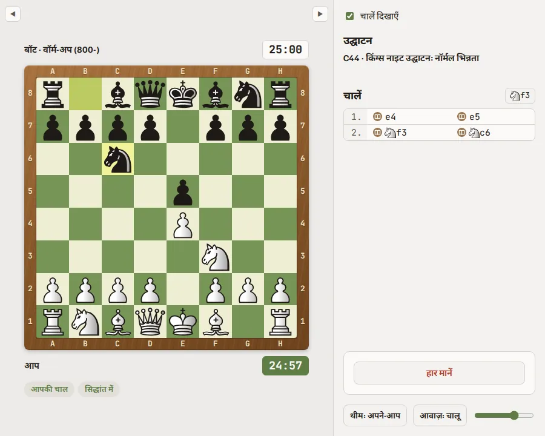
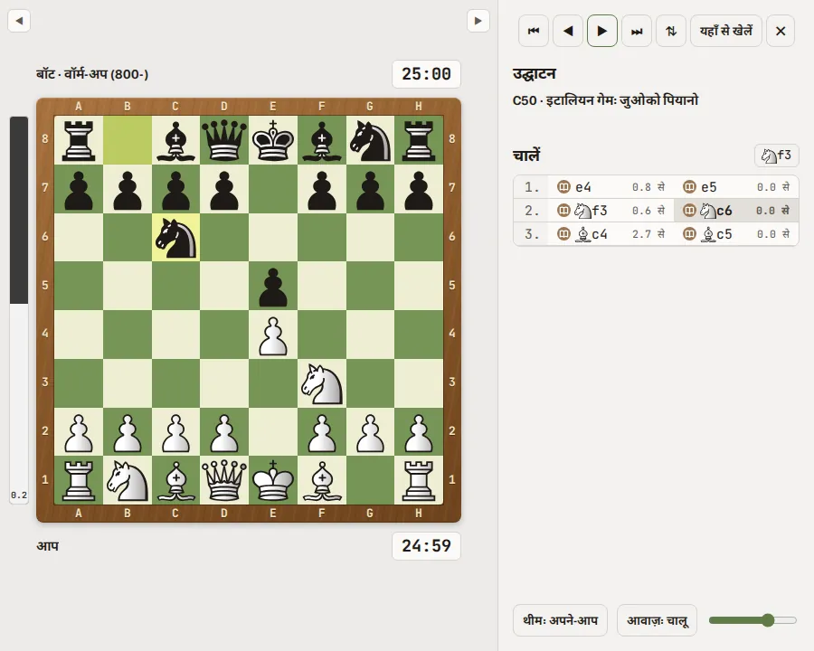

<!-- Generated by scripts/help_docs.py from the app's Help page. Do not edit. -->

# Chess Trainer का इस्तेमाल कैसे करें

[English (US)](HELP.md) · [English (UK)](HELP.en-GB.md) · [Português (Brasil)](HELP.pt-BR.md) · [Español (Latinoamérica)](HELP.es-419.md) · [Español (España)](HELP.es-ES.md) · [Português (Portugal)](HELP.pt-PT.md) · [Deutsch](HELP.de.md) · [Français](HELP.fr.md) · [Italiano](HELP.it.md) · [Türkçe](HELP.tr.md) · [Polski](HELP.pl.md) · [Nederlands](HELP.nl.md) · [Bahasa Indonesia](HELP.id.md) · [Tiếng Việt](HELP.vi.md) · [Svenska](HELP.sv.md) · [Dansk](HELP.da.md) · [Norsk bokmål](HELP.nb.md) · [Suomi](HELP.fi.md) · [Русский](HELP.ru.md) · [Українська](HELP.uk.md)

Chess Trainer अभ्यास के लिए है: ऐसे बॉट के ख़िलाफ़ अपने उद्घाटनों का अभ्यास करें जो आपकी लाइनें खेलता है, सिद्धांत ख़त्म होने पर Stockfish के ख़िलाफ़ खेलते रहें, और अपने खेलों की समीक्षा करें। सब कुछ आपके कंप्यूटर पर चलता है और वहीं रहता है।

> **इसका इस्तेमाल कभी धोखाधड़ी के लिए न करें**
>
> किसी दूसरे व्यक्ति के ख़िलाफ़ खेल के दौरान, ऑनलाइन हो या बिसात पर, Chess Trainer या किसी भी इंजन का इस्तेमाल न करें। यह धोखाधड़ी है, और Chess.com, Lichess और FIDE इस पर पाबंदी लगाते हैं। अपने खेलों से पहले और बाद में अभ्यास करें, उनके दौरान कभी नहीं।

> **यहाँ का मूल्यांकन बुनियादी है**
>
> मूल्यांकन बार और चालों के आइकन (सर्वश्रेष्ठ चाल, ग़लती, भारी भूल…) Stockfish की एक तेज़ जाँच से आते हैं और सिर्फ़ एक संकेत हैं। असली विश्लेषण के लिए PGN निर्यात करें और उसका विश्लेषण Chess.com, Lichess या किसी दूसरे विश्लेषण टूल पर करें।

## खेल शुरू करें

- उद्घाटन: अपना रंग चुनें और जिन उद्घाटनों और भिन्नताओं का अभ्यास करना है, उन पर निशान लगाएँ। निशान लगी हर भिन्नता के चुने जाने की संभावना बराबर है। किसी ऐसी भिन्नता की चाल चलना जिस पर आपने निशान नहीं लगाया, सिद्धांत छोड़ना माना जाता है।
- सहेजा गया खेल: अपने खेले या आयात किए किसी खेल की लाइन का अभ्यास करें, ताकि उसकी चालें जाँची जाएँ, या उसकी किसी भी स्थिति से खेलते रहें।
- Chess960: कोई प्रारंभिक स्थिति निकालें या 960 में से किसी एक का FEN चिपकाएँ। क़िलाबंदी के लिए राजा पर क्लिक करें और फिर उसके और हाथी के बीच के किसी वर्ग पर, या ख़ुद हाथी पर।
- बॉट का स्तर: हर स्तर के साथ दी गई रेटिंग नाममात्र है, Stockfish के अपने पैमाने पर, और इसे मापा नहीं गया है। यह Chess.com या Lichess की रेटिंग नहीं है।
- समय नियंत्रण: असली टूर्नामेंट घड़ी के प्रीसेट, बुलेट से क्लासिकल तक, या बिना घड़ी। बॉट के जवाब का समय इंसान जैसा हो सकता है, जो किसी व्यक्ति की तरह अपनी घड़ी का समय ख़र्च करता है, या तुरंत।
- विकल्प: सिद्धांत छोड़ने पर चेतावनी पाएँ, प्रीमूव की अनुमति दें, और बॉट को चुनी हुई चाल से जान-बूझकर अपनी लाइन से हटने दें, ताकि आप अचानक आई चालों के ख़िलाफ़ भी अभ्यास करें।

*नया खेल: रंग, लाइनें, स्तर और घड़ी।*

## खेल के दौरान

- मोहरों पर क्लिक करें या उन्हें खींचें। बॉट चुनी गई लाइन की पुस्तकीय चालें चलता है, और जब सिद्धांत ख़त्म होता है, या कोई उसे छोड़ता है, तो Stockfish चुने गए स्तर पर खेल सँभाल लेता है।
- बिसात के नीचे के चिप बताते हैं कि चाल किसकी है, आप अब भी सिद्धांत में हैं या नहीं, और आपने या बॉट ने उसे कहाँ छोड़ा।
- दाएँ पैनल में चालें दिखाएँ खेल के अंत तक उद्घाटन का नाम और चालों की सूची छिपा देता है: बिना संकेत के खेलें, या चालें काग़ज़ पर लिखें।
- भाषा के नीचे संकेतन चालों को मोहरों के चिह्नों में, अंग्रेज़ी अक्षरों में (Nf3, PGN फ़ाइलों और शतरंज साइटों के अक्षर) या आपकी भाषा के अक्षरों में दिखाता है। चालें के बगल का बटन इनके बीच बदलता है, खेल के बीच भी, और किसी चाल पर माउस ले जाने या Tab से उस तक पहुँचने पर वह बाक़ी दो में दिखती है। PGN फ़ाइलें हमेशा अंग्रेज़ी अक्षर इस्तेमाल करती हैं।
- प्रीमूव चालू होने पर, बॉट के सोचते समय आप एक चाल पहले से तय कर सकते हैं। प्रीमूव बंद होने पर, चाल वापस लें आपकी आख़िरी चाल को तब तक रद्द करता है जब तक बॉट का जवाब नहीं दिखा।
- हार मानें दूसरा क्लिक माँगता है, ताकि ग़लती से हुआ क्लिक खेल ख़त्म न करे।

*किसी मोहरे पर क्लिक करें या उसे खींचें; बॉट पुस्तक से जवाब देता है।*

## खेल के बाद

- चालों की सूची के नीचे का कार्ड परिणाम, भिन्नता, सिद्धांत कितनी दूर तक गया, और हर विचलन अपेक्षित चाल के साथ दिखाता है।
- PGN कॉपी या डाउनलोड करें। नया खेल अगला खेल उन्हीं विकल्पों के साथ शुरू करता है।

*अंत में: परिणाम, भिन्नता, सिद्धांत और विचलन।*

## अभ्यास कैसे करें

### हारना इसका हिस्सा है

हारना सीखने का हिस्सा है। ज़रूरी यह है कि हर खेल का अध्ययन करें और अपनी ग़लतियों से सीखें। सचमुच बेहतर होने के लिए बॉट का स्तर धीरे-धीरे बढ़ाएँ, और उसे दोबारा तभी बढ़ाएँ जब आप उसकी चालों के साथ सहज महसूस करें।

### हर समय नियंत्रण का एक काम है

लंबे खेलों में हर चाल पर शांति से सोचें और दो, तीन या ज़्यादा चालें आगे तक गणना करने की आदत डालें। रैपिड, ब्लिट्ज़ और बुलेट का इस्तेमाल उन पैटर्नों के अभ्यास के लिए करें जो आप पहले ही सीख चुके हैं।

### प्रतिद्वंद्वी की चालों से शुरू करें

हर चाल से पहले, सबसे पहले देखें कि प्रतिद्वंद्वी क्या धमकी दे रहा है: शह, मोहरे काटना और हमले। फिर अपनी योजना देखें।

### टूर्नामेंट की तरह अभ्यास करें

सीखने का सबसे अच्छा तरीक़ा असली बिसात और घड़ी के साथ है। अगर घड़ी ऐप की घड़ी से थोड़ी अलग चले तो कोई बात नहीं।

बिसात, घड़ी और स्कोरशीट के साथ अभ्यास क्यों करें? क्योंकि वे आपसे याद करवाते हैं, बिना सोचे खेलने से रोकते हैं, और आपकी गणना और कल्पना को मज़बूत करते हैं, शायद तब तक जब तक आप दिमाग़ में खेलना शुरू न कर दें, सामने कोई असली या आभासी बिसात न होने पर भी।

खेल से पहले, मेन्यू में स्कोरशीट खोलें और उसे प्रिंट करें, या PDF के रूप में सहेजें, और ऊपर का हिस्सा भरें। कोई लंबा समय नियंत्रण चुनें, जैसे रैपिड या क्लासिकल, और चालें दिखाएँ से निशान हटा दें।

आपकी चाल पर:

1. बिसात पर मोहरा चलें।
1. घड़ी उसी हाथ से दबाएँ जिससे मोहरा चला।
1. ऐप में वही चाल चलें।
1. चाल स्कोरशीट पर लिखें।

बॉट की चाल पर:

1. उसकी चाल बिसात पर चलें।
1. उसकी तरफ़ की घड़ी दबाएँ।
1. चाल स्कोरशीट पर लिखें।

उसके बाद ही अपनी चाल के बारे में सोचना शुरू करें।

याद रखें: जिस मोहरे को छुएँ, वही चलना होगा। और भी बेहतर अनुभव के लिए, ख़ुद को खेलते हुए रिकॉर्ड करें और बाद में देखें कि आप बिसात पर कैसा व्यवहार करते हैं। जल्दबाज़ी न करें: अभ्यास के साथ यह स्वाभाविक हो जाता है।

अंत में, परिणाम और हस्ताक्षर भरें, अपनी शीट की तुलना चालों की सूची और PGN से करें, और वे चालें ढूँढ़ें जो आपने ग़लत लिखीं।

*चालें दिखाएँ से निशान हटाने पर चालों की सूची छिप जाती है, और आप स्कोरशीट पर लिखते हैं।*

### मूल्यांकन देखने से पहले विश्लेषण करें

खेल ख़त्म होने पर पहले ख़ुद उसकी समीक्षा करें और देखें कि वह कहाँ पलटा। उसके बाद ही उसे मूल्यांकन से मिलाएँ। बार आख़िरी स्थिति पर दिखता है, इसलिए जब तक आप पूरा न कर लें, उसे अनदेखा करें।

## सहेजे गए खेल और समीक्षा

- हर खेल सहेजा जाता है। सूची में खोजें और फ़िल्टर करें, किसी खेल को बिसात पर खोलें और बटनों से या तीर वाली कुंजियों, Home और End से उसे देखें।
- यहाँ से खेलें बिसात की स्थिति से एक नया खेल शुरू करता है।
- खेलों को PGN में निर्यात करने या हटाने के लिए उन पर निशान लगाएँ।

*मूल्यांकन बार के साथ सहेजे गए खेल की समीक्षा।*

## उद्घाटन

- पुस्तक की हर लाइन बिसात पर देखें, और लाइनों को PGN में निर्यात करने के लिए उन पर निशान लगाएँ।

## खेल आयात करें

- यूज़रनेम और अवधि से Chess.com या Lichess से अपने खेल लाएँ, या कोई PGN चिपकाएँ या अपलोड करें। वे सहेजे गए खेल में जाते हैं, समीक्षा या अभ्यास के लिए तैयार।

## कहीं और विश्लेषण करें

- PGN खेल के अंत के कार्ड से या सहेजे गए खेल से लें।
- पूरे, गहरे विश्लेषण के लिए Chess.com या Lichess पर विश्लेषण बोर्ड खोलें और PGN चिपकाएँ या आयात करें।
