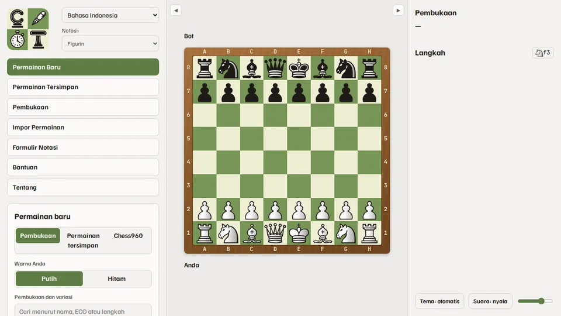
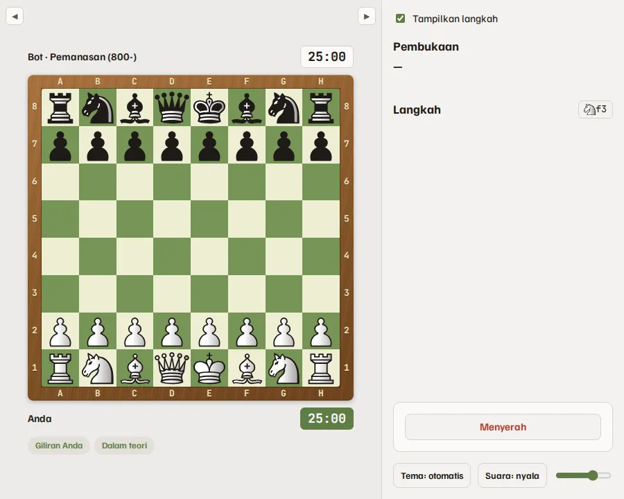
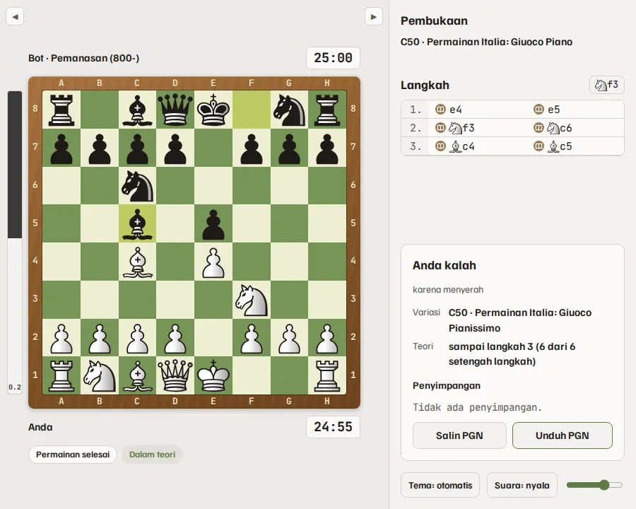
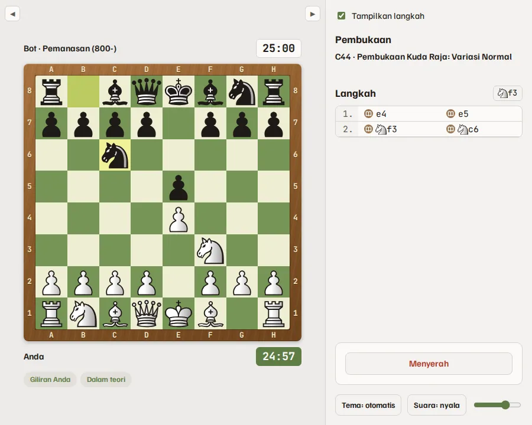
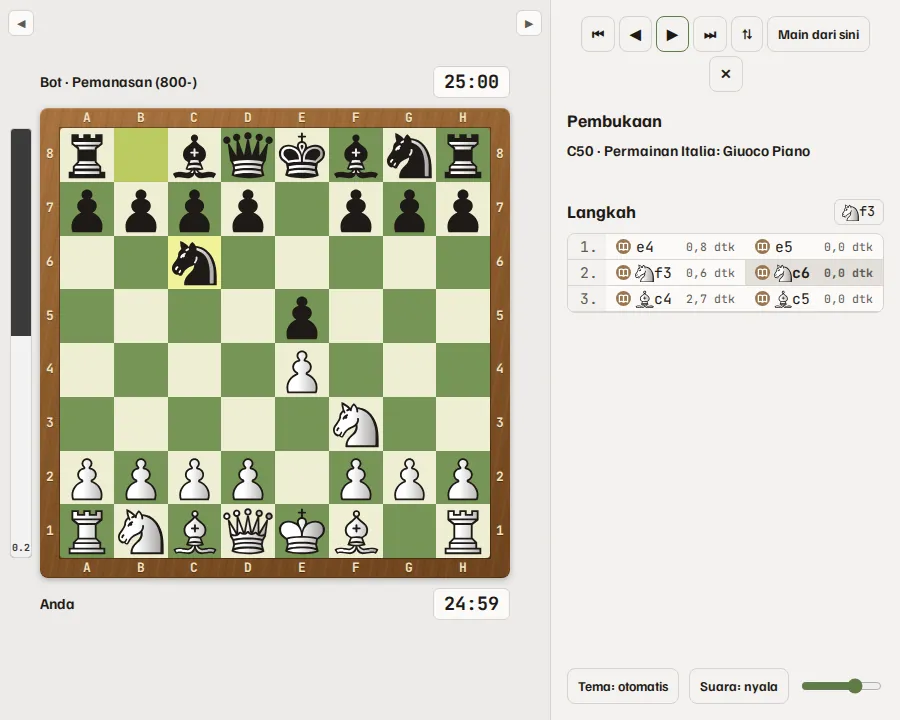

<!-- Generated by scripts/help_docs.py from the app's Help page. Do not edit. -->

# Cara memakai Chess Trainer

[English (US)](HELP.md) · [English (UK)](HELP.en-GB.md) · [Português (Brasil)](HELP.pt-BR.md) · [Español (Latinoamérica)](HELP.es-419.md) · [Español (España)](HELP.es-ES.md) · [Português (Portugal)](HELP.pt-PT.md) · [Deutsch](HELP.de.md) · [Français](HELP.fr.md) · [Italiano](HELP.it.md) · [Türkçe](HELP.tr.md) · [Polski](HELP.pl.md) · [Nederlands](HELP.nl.md) · [Tiếng Việt](HELP.vi.md)

Chess Trainer untuk berlatih: latih pembukaan Anda melawan bot yang memainkan lini Anda, terus bermain melawan Stockfish saat teori habis, dan tinjau permainan Anda. Semuanya berjalan dan tetap di komputer Anda.

> **Jangan pernah memakainya untuk curang**
>
> Jangan memakai Chess Trainer, atau mesin catur apa pun, selama permainan melawan orang lain, daring maupun di papan. Itu curang, dan Chess.com, Lichess, serta FIDE melarangnya. Berlatihlah sebelum dan sesudah permainan Anda, jangan pernah selama permainan.

> **Evaluasi di sini sederhana**
>
> Bilah evaluasi dan ikon langkah (langkah terbaik, kesalahan, blunder…) berasal dari pemeriksaan cepat Stockfish dan hanya petunjuk. Untuk analisis sungguhan, ekspor PGN dan analisis di Chess.com, Lichess atau alat analisis lain.

## Mulai permainan

- Pembukaan: pilih warna Anda dan centang pembukaan dan variasi yang ingin dilatih. Setiap variasi yang dicentang memiliki peluang yang sama untuk terpilih. Memainkan langkah dari variasi yang tidak Anda centang dihitung sebagai keluar dari teori.
- Permainan tersimpan: latih lini dari permainan yang Anda mainkan atau impor, sehingga langkah-langkahnya diperiksa, atau terus bermain dari posisi mana pun di dalamnya.
- Chess960: acak posisi awal atau tempel FEN salah satu dari 960 posisi. Untuk rokade, klik raja lalu sebuah kotak di antara raja dan benteng, atau benteng itu sendiri.
- Tingkat bot: rating di samping setiap tingkat bersifat nominal, pada skala Stockfish sendiri, dan belum diukur. Itu bukan rating Chess.com atau Lichess.
- Kontrol waktu: pengaturan jam turnamen sungguhan, dari bullet sampai klasik, atau tanpa jam. Waktu respons bot adalah Manusiawi, yang memakai jamnya seperti manusia, atau Seketika.
- Opsi: peringatan saat Anda keluar dari teori, izinkan langkah awal, dan biarkan bot sengaja menyimpang dari lininya mulai dari langkah yang dipilih, agar Anda juga berlatih menghadapi kejutan.

*Permainan Baru: warna, lini, tingkat dan jam.*

## Selama permainan

- Klik atau seret buah. Bot memainkan langkah teori dari lini yang terpilih, dan saat teori habis, atau seseorang keluar darinya, Stockfish mengambil alih pada tingkat yang dipilih.
- Label di bawah papan menunjukkan giliran siapa, apakah Anda masih dalam teori, dan di mana Anda atau bot keluar darinya.
- Tampilkan langkah, di panel kanan, menyembunyikan nama pembukaan dan daftar langkah sampai akhir permainan: bermainlah tanpa petunjuk, atau tulis langkahnya di kertas.
- Notasi, di bawah bahasa, menampilkan langkah sebagai simbol buah (figurin), dengan huruf Inggris (Nf3, huruf berkas PGN dan situs catur) atau dengan huruf bahasa Anda. Tombol di samping Langkah berganti di antara ketiganya, juga di tengah permainan, dan mengarahkan penunjuk ke sebuah langkah, atau mencapainya dengan Tab, menampilkannya dalam dua notasi lainnya. Berkas PGN selalu memakai huruf Inggris.
- Dengan langkah awal aktif, Anda dapat menyiapkan satu langkah saat bot berpikir. Dengan langkah awal nonaktif, Batalkan langkah membatalkan langkah terakhir Anda selama jawaban bot belum ditampilkan.
- Menyerah meminta klik kedua, agar klik yang tidak sengaja tidak mengakhiri permainan.

*Klik atau seret buah; bot menjawab dari repertoar.*

## Setelah permainan

- Kartu di bawah daftar langkah menampilkan hasil, variasi, sejauh mana teori berjalan, dan setiap penyimpangan dengan langkah yang seharusnya.
- Salin atau unduh PGN. Permainan Baru memulai permainan berikutnya dengan pilihan yang sama.

*Di akhir: hasil, variasi, teori dan penyimpangan.*

## Cara berlatih

### Kalah adalah bagian darinya

Kalah adalah bagian dari belajar. Yang penting adalah mempelajari setiap permainan dan belajar dari kesalahan Anda sendiri. Untuk benar-benar berkembang, naikkan tingkat bot sedikit demi sedikit, dan naikkan lagi hanya setelah Anda merasa nyaman dengan langkah-langkah yang dimainkannya.

### Setiap kontrol waktu punya tugas

Dalam permainan panjang, pikirkan setiap langkah dengan tenang dan bangun kebiasaan menghitung dua, tiga atau lebih langkah ke depan. Pakai cepat, blitz dan bullet untuk melatih pola yang sudah Anda kuasai.

### Mulailah dari langkah lawan

Sebelum setiap langkah, lihat dulu apa yang diancam lawan Anda: sekak, makan dan serangan. Lalu cari rencana Anda sendiri.

### Berlatihlah seperti di turnamen

Cara terbaik untuk belajar adalah dengan papan dan jam sungguhan. Tidak masalah jika jamnya sedikit berbeda dari jam aplikasi.

Mengapa berlatih dengan papan, jam dan formulir notasi? Karena semua itu membuat Anda menghafal, mencegah Anda bermain tanpa berpikir, dan membangun kemampuan menghitung dan memvisualisasikan, mungkin sampai Anda mulai bermain di kepala, tanpa papan sungguhan atau virtual di depan Anda.

Sebelum permainan, buka Formulir Notasi di menu dan cetak, atau simpan sebagai PDF, lalu isi bagian atasnya. Pilih kontrol waktu yang panjang, seperti cepat atau klasik, dan hilangkan centang Tampilkan langkah.

Pada giliran Anda:

1. Gerakkan buah di papan.
1. Tekan jam dengan tangan yang sama yang menggerakkan buah.
1. Mainkan langkah yang sama di aplikasi.
1. Tulis langkahnya di formulir notasi.

Pada giliran bot:

1. Mainkan langkahnya di papan.
1. Tekan jam di sisinya.
1. Tulis langkahnya di formulir notasi.

Baru setelah itu mulai memikirkan langkah Anda.

Ingat: buah yang disentuh harus dijalankan. Untuk pengalaman yang lebih baik lagi, rekam diri Anda saat bermain dan tonton nanti untuk melihat bagaimana Anda bersikap di papan. Santai saja: dengan latihan, semuanya menjadi alami.

Di akhir, isi hasil dan tanda tangan, bandingkan formulir Anda dengan daftar langkah dan PGN, lalu cari langkah yang salah Anda tulis.

*Dengan Tampilkan langkah tidak dicentang, daftar langkah tersembunyi dan Anda menulis di formulir notasi.*

### Analisis sebelum melihat evaluasi

Saat permainan selesai, tinjau dulu sendiri dan cari titik baliknya. Baru setelah itu cocokkan dengan evaluasi. Bilahnya tampil pada posisi akhir, jadi abaikan sampai Anda selesai.

## Permainan tersimpan dan peninjauan

- Setiap permainan disimpan. Cari dan saring daftarnya, buka permainan di papan dan telusuri dengan tombol atau tombol panah, Home dan End.
- Main dari sini memulai permainan baru dari posisi di papan.
- Centang permainan untuk mengekspornya sebagai PGN atau menghapusnya.

*Meninjau permainan tersimpan, dengan bilah evaluasi.*

## Pembukaan

- Telusuri setiap lini repertoar di papan, dan centang lini untuk mengekspornya sebagai PGN.

## Impor permainan

- Ambil permainan Anda dari Chess.com atau Lichess menurut nama pengguna dan periode, atau tempel atau unggah PGN. Semuanya masuk ke Permainan Tersimpan, siap ditinjau atau dilatih.

## Analisis di tempat lain

- Ambil PGN dari kartu akhir permainan atau dari Permainan Tersimpan.
- Di Chess.com atau Lichess, buka papan analisis dan tempel atau impor PGN, untuk analisis yang lengkap dan lebih dalam.
