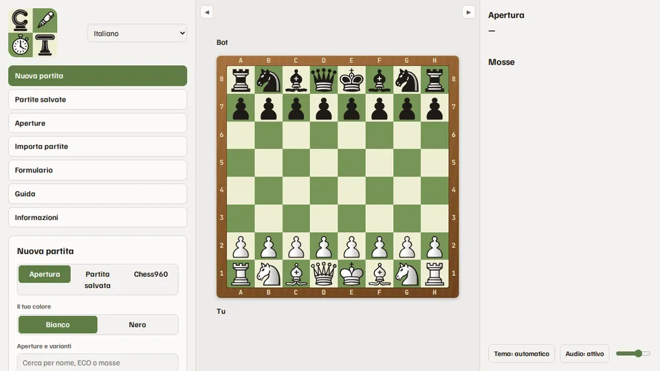
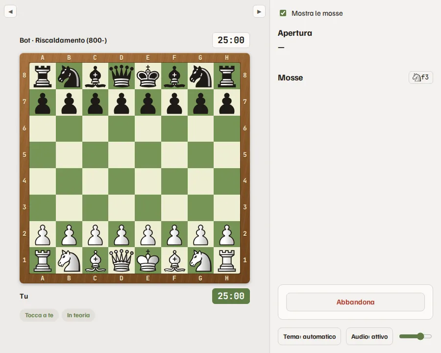
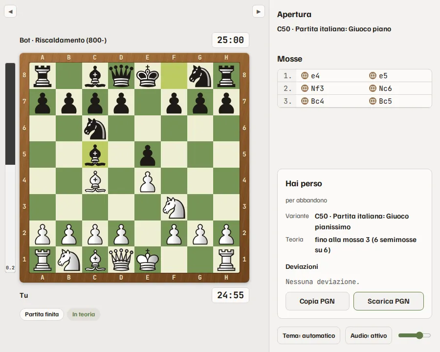
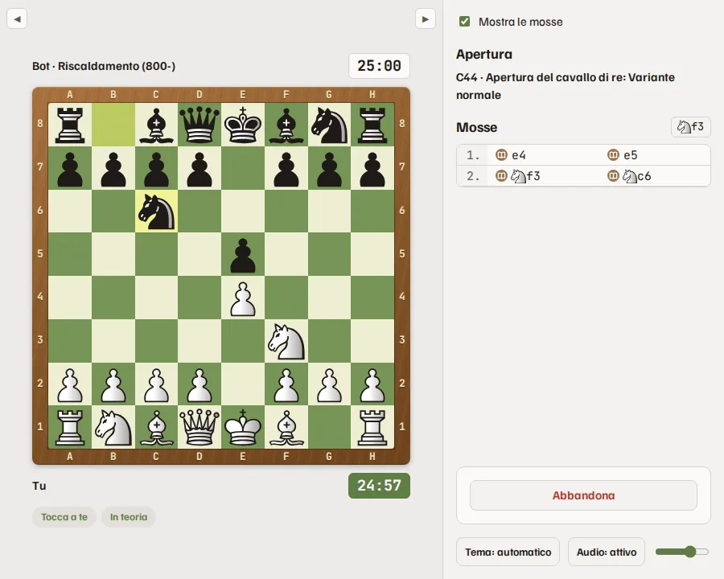
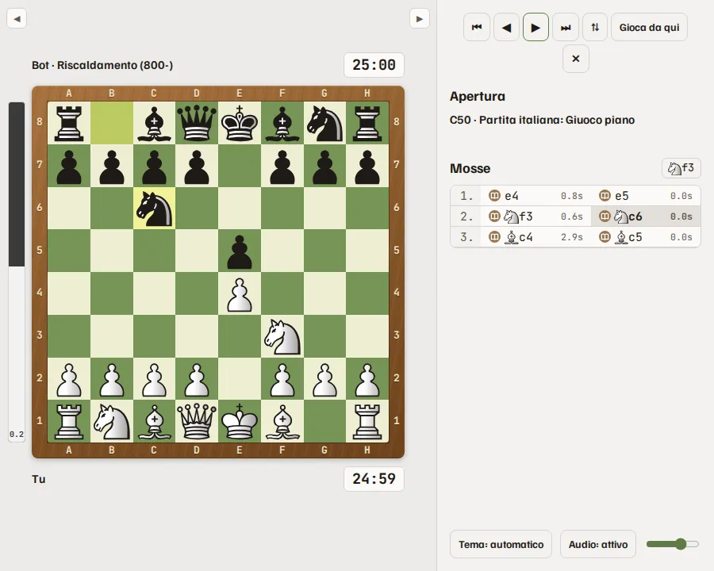

<!-- Generated by scripts/help_docs.py from the app's Help page. Do not edit. -->

# Come usare Chess Trainer

[English (US)](HELP.md) · [English (UK)](HELP.en-GB.md) · [Português (Brasil)](HELP.pt-BR.md) · [Español (Latinoamérica)](HELP.es-419.md) · [Español (España)](HELP.es-ES.md) · [Português (Portugal)](HELP.pt-PT.md) · [Deutsch](HELP.de.md) · [Français](HELP.fr.md) · [Türkçe](HELP.tr.md) · [Polski](HELP.pl.md) · [Nederlands](HELP.nl.md) · [Bahasa Indonesia](HELP.id.md) · [Tiếng Việt](HELP.vi.md) · [Svenska](HELP.sv.md) · [Dansk](HELP.da.md) · [Norsk bokmål](HELP.nb.md) · [Suomi](HELP.fi.md) · [Русский](HELP.ru.md) · [Українська](HELP.uk.md)

Chess Trainer serve ad allenarsi: esercita le tue aperture contro un bot che gioca le tue linee, continua contro Stockfish quando la teoria finisce e rivedi le tue partite. Tutto funziona e resta sul tuo computer.

> **Non usarlo mai per barare**
>
> Non usare Chess Trainer, né alcun altro motore, durante una partita contro un'altra persona, online o alla scacchiera. È barare, e Chess.com, Lichess e la FIDE lo vietano. Allenati prima e dopo le partite, mai durante.

> **La valutazione qui è semplice**
>
> La barra di valutazione e le icone delle mosse (mossa migliore, errore, errore grave e così via) vengono da un rapido controllo di Stockfish e sono solo un indizio. Per un'analisi vera, esporta il PGN e analizzalo su Chess.com, su Lichess o con un altro strumento di analisi.

## Iniziare una partita

- Apertura: scegli il tuo colore e seleziona le aperture e le varianti da esercitare. Ogni variante selezionata ha la stessa probabilità di uscire. Giocare una mossa di una variante che non hai selezionato conta come uscire dalla teoria.
- Partita salvata: allena la linea di una partita che hai giocato o importato, con le tue mosse controllate, oppure continua a giocare da una qualsiasi delle sue posizioni.
- Chess960: sorteggia una posizione iniziale oppure incolla il FEN di una delle 960. Per arroccare, fai clic sul re e poi su una casa tra il re e la torre, oppure sulla torre stessa.
- Livello del bot: l'Elo accanto a ogni livello è nominale, sulla scala propria di Stockfish, e non è stato misurato. Non è un Elo di Chess.com né di Lichess.
- Cadenza: le cadenze di un vero orologio da torneo, dal bullet alla classica, oppure senza orologio. Il tempo di risposta del bot è Umano, che consuma il suo tempo come una persona, oppure Istantaneo.
- Opzioni: avvisare quando esci dalla teoria, consentire le premosse e lasciare che il bot devii di proposito dalla sua linea a partire da una mossa scelta, per allenarti anche contro le sorprese.

*Nuova partita: colore, linee, livello e orologio.*

## Durante la partita

- Fai clic sui pezzi o trascinali. Il bot gioca le mosse di teoria della linea sorteggiata e, quando la teoria finisce o qualcuno ne esce, subentra Stockfish al livello scelto.
- Le etichette sotto la scacchiera indicano a chi tocca, se sei ancora in teoria e dove tu o il bot ne siete usciti.
- «Mostra le mosse», nel pannello destro, nasconde il nome dell'apertura e l'elenco delle mosse fino alla fine della partita: gioca senza indizi o annota le mosse su carta.
- «Notazione», sotto la lingua, mostra le mosse con i simboli dei pezzi, con le lettere inglesi (Nf3, quelle dei file PGN e dei siti di scacchi) o con le lettere italiane (Cf3). Il pulsante accanto a «Mosse» cambia notazione, anche a metà partita, e passando il mouse su una mossa, o raggiungendola con Tab, la vedi nelle altre due. Il PGN usa sempre le lettere inglesi.
- Con le premosse attive, puoi preparare una mossa mentre il bot pensa. Senza, «Ritira mossa» annulla la tua ultima mossa finché la risposta del bot non è ancora visibile.
- Abbandona chiede un secondo clic, così un clic per sbaglio non chiude la partita.

*Fai clic su un pezzo o trascinalo; il bot risponde con il libro.*

## Dopo la partita

- Il riquadro sotto l'elenco delle mosse mostra il risultato, la variante, fin dove è arrivata la teoria e ogni deviazione con la mossa attesa.
- Copia o scarica il PGN. «Nuova partita» avvia la successiva con le stesse impostazioni.

*Alla fine: risultato, variante, teoria e deviazioni.*

## Come allenarsi

### Perdere fa parte del percorso

Perdere fa parte dell'apprendimento. L'importante è studiare ogni partita e imparare dai propri errori. Per migliorare davvero, alza il livello del bot a poco a poco e rialzalo solo quando ti senti a tuo agio con le mosse che propone.

### Ogni cadenza ha il suo scopo

Nelle partite lunghe, pensa con calma a ogni mossa e prendi l'abitudine di calcolare due, tre o più mosse in avanti. Usa le rapide, il blitz e il bullet per allenare gli schemi che hai già assimilato.

### Comincia dalle mosse dell'avversario

Prima di ogni mossa, guarda per prima cosa che cosa minaccia l'avversario: scacchi, catture e attacchi. Poi cerca il tuo piano.

### Allenati come in un torneo

L'ideale per imparare è giocare con scacchiera e orologio veri. Non importa se l'orologio non resta allineato con quello dell'app.

Perché allenarsi con scacchiera, orologio e formulario? Perché ti obbliga a memorizzare, a non giocare senza pensare e a calcolare, e allena la visualizzazione, forse fino a giocare alla cieca, senza bisogno di vedere una scacchiera reale o virtuale.

Prima della partita, apri «Formulario» nel menu e stampalo, o salvalo in PDF, e compila l'intestazione. Scegli una cadenza lunga, come rapida o classica, e togli la spunta a «Mostra le mosse».

Alla tua mossa:

1. Muovi il pezzo sulla scacchiera.
1. Premi l'orologio con la stessa mano con cui hai mosso il pezzo.
1. Gioca la stessa mossa nell'app.
1. Annota la mossa sul formulario.

Alla mossa del bot:

1. Riproduci la sua mossa sulla scacchiera.
1. Premi l'orologio dal suo lato.
1. Annota la mossa sul formulario.

Solo allora inizia a pensare alla tua.

Ricorda: pezzo toccato, pezzo mosso. Per un'esperienza ancora migliore, filmati mentre giochi e riguardati dopo, per capire come ti comporti davanti alla scacchiera. Fai tutto con calma: col tempo, diventa naturale.

Alla fine, compila il risultato e le firme, confronta il tuo formulario con l'elenco delle mosse e il PGN, e cerca le mosse che hai annotato male.

*Senza la spunta a «Mostra le mosse», l'elenco sparisce e annoti sul formulario.*

### Analizza prima di guardare la valutazione

Finita una partita, rivedila prima da solo e cerca dove è cambiata. Solo dopo confrontala con la valutazione. La barra compare nella posizione finale, quindi ignorala finché non hai finito.

## Partite salvate e revisione

- Ogni partita viene salvata. Cerca e filtra l'elenco, apri una partita sulla scacchiera e scorrila con i pulsanti o con le frecce della tastiera, Home e Fine.
- «Gioca da qui» avvia una nuova partita dalla posizione sulla scacchiera.
- Seleziona delle partite per esportarle in PGN o per eliminarle.

*Revisione di una partita salvata, con la barra di valutazione.*

## Aperture

- Scorri sulla scacchiera ogni linea del libro e seleziona delle linee per esportarle in PGN.

## Importa partite

- Prendi le tue partite da Chess.com o Lichess per nome utente e periodo, oppure incolla o carica un PGN. Finiscono in «Partite salvate», pronte da rivedere o da allenare.

## Analizza altrove

- Prendi il PGN dal riquadro di fine partita o da «Partite salvate».
- Su Chess.com o Lichess, apri la scacchiera di analisi e incolla o importa il PGN, per un'analisi completa e più forte.
