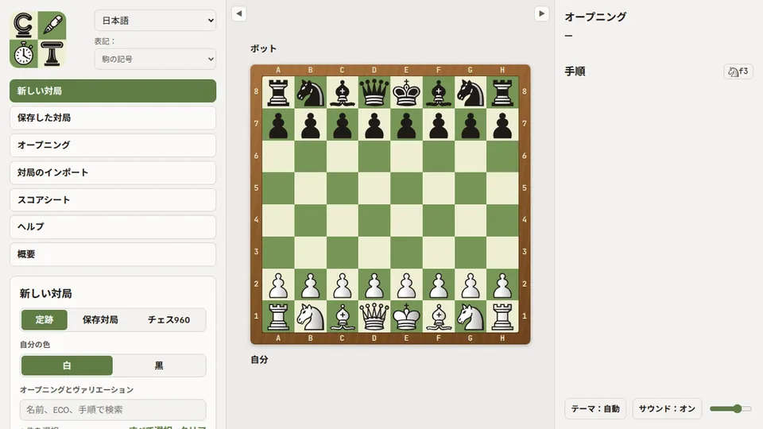
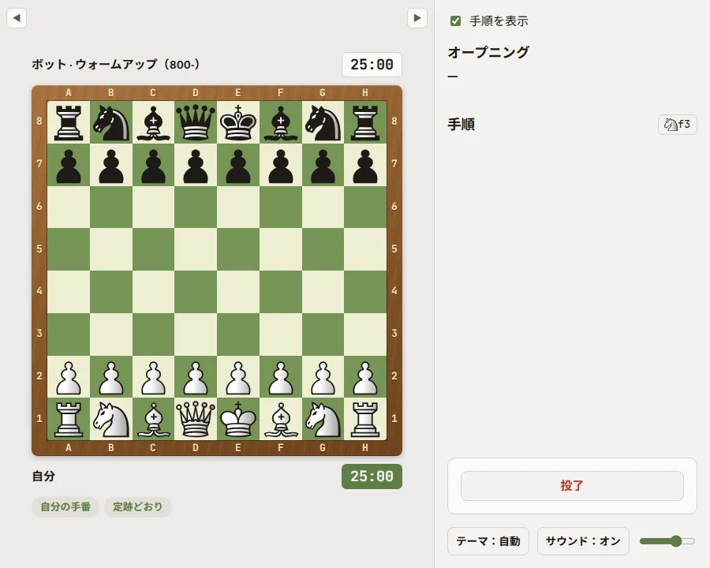
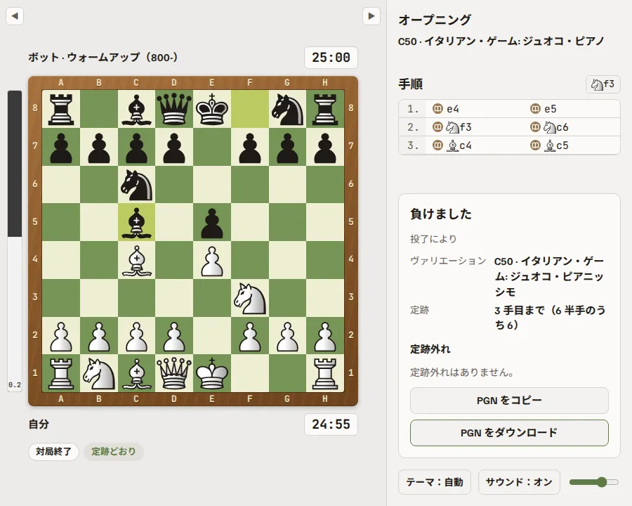
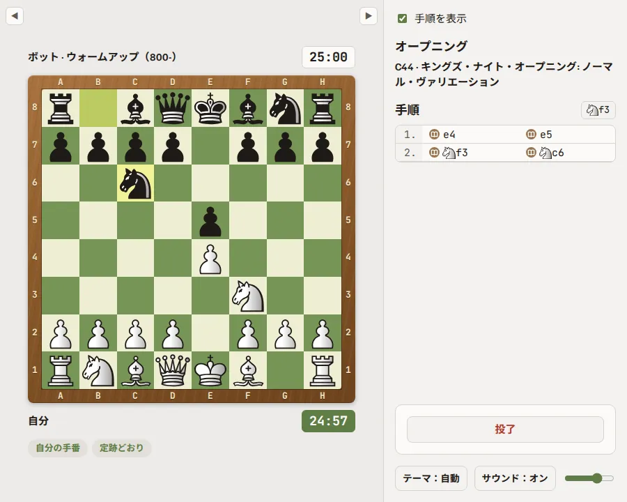
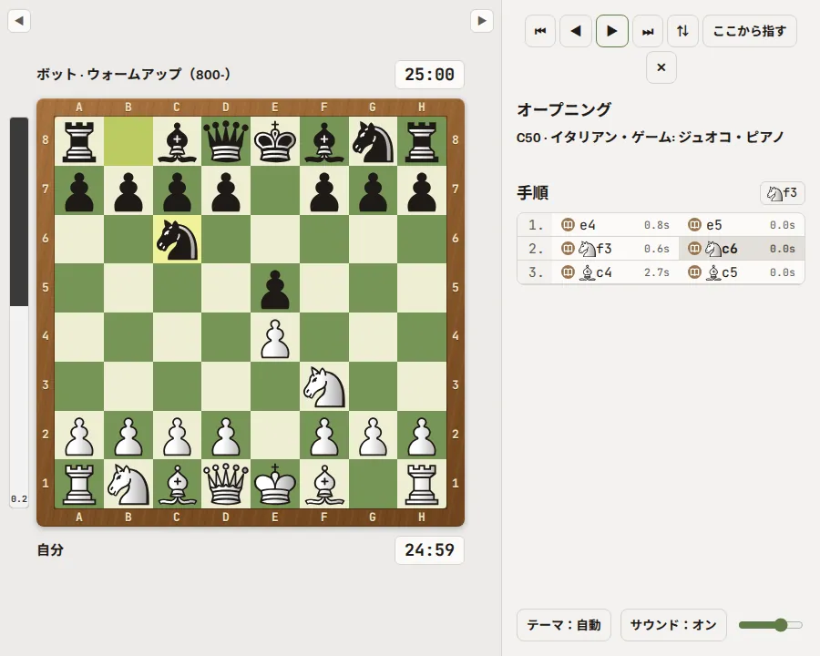

<!-- Generated by scripts/help_docs.py from the app's Help page. Do not edit. -->

# Chess Trainer の使い方

[English (US)](HELP.md) · [English (UK)](HELP.en-GB.md) · [Português (Brasil)](HELP.pt-BR.md) · [Español (Latinoamérica)](HELP.es-419.md) · [Español (España)](HELP.es-ES.md) · [Português (Portugal)](HELP.pt-PT.md) · [Deutsch](HELP.de.md) · [Français](HELP.fr.md) · [Italiano](HELP.it.md) · [Türkçe](HELP.tr.md) · [Polski](HELP.pl.md) · [Nederlands](HELP.nl.md) · [Bahasa Indonesia](HELP.id.md) · [Tiếng Việt](HELP.vi.md) · [Svenska](HELP.sv.md) · [Dansk](HELP.da.md) · [Norsk bokmål](HELP.nb.md) · [Suomi](HELP.fi.md) · [Русский](HELP.ru.md) · [Українська](HELP.uk.md) · [हिन्दी](HELP.hi.md) · [中文（简体）](HELP.zh-CN.md) · [한국어](HELP.ko.md) · [العربية](HELP.ar.md) · [فارسی](HELP.fa.md) · [עברית](HELP.he.md)

> この翻訳は機械翻訳で、まだ確認されていません。修正を歓迎します： [修正を提案する](https://github.com/nielsencampos/chess-trainer/issues/new?template=translation-fix.yml&language=ja)

Chess Trainer は練習のためのものです。自分のラインを指すボットを相手にオープニングを繰り返し練習し、定跡が終わったら Stockfish と指し続け、対局を振り返ります。すべてが自分のコンピュータで動き、そこに残ります。

> **不正には絶対に使わないでください**
>
> 他の人との対局中は、オンラインでも盤の前でも、Chess Trainer やどんなエンジンも使わないでください。それは不正行為であり、Chess.com、Lichess、FIDE が禁止しています。練習は対局の前と後に行い、対局中には決して行わないでください。

> **ここでの評価は簡易的なものです**
>
> 評価バーと手のアイコン（最善手、悪手、大悪手…）は Stockfish の簡単なチェックによるもので、目安にすぎません。本格的な解析には、PGN をエクスポートして Chess.com、Lichess などの解析ツールで解析してください。

## 対局を始める

- オープニング：自分の色を選び、練習したいオープニングとヴァリエーションにチェックを入れます。チェックしたヴァリエーションは、どれも同じ確率で選ばれます。チェックしていないヴァリエーションの手を指すと、定跡外れとして扱われます。
- 保存した対局：指した対局やインポートした対局のラインを練習して手をチェックしたり、その対局のどの局面からでも指し続けたりできます。
- チェス960：初期配置をランダムに選ぶか、960通りのうち1つの FEN を貼り付けます。キャスリングするには、キングをクリックしてから、キングとルークの間のマスかルークそのものをクリックします。
- ボットのレベル：各レベルの横のレーティングは名目上のもので、Stockfish 独自の尺度によるもので、測定されたものではありません。Chess.com や Lichess のレーティングではありません。
- 持ち時間：バレットからクラシカルまでの、実際の大会で使う対局時計の設定、または時計なし。ボットの応答時間は、人のように時間を使う「人間らしく」か、「即座に」です。
- オプション：定跡を外れたら知らせる、プレムーブを許可する、選んだ手からボットがわざとラインを外れる。不意の手に対する練習にもなります。

*新しい対局：色、ライン、レベル、時計。*

## 対局中

- 駒をクリックするかドラッグします。ボットは選ばれたラインの定跡手を指し、定跡が終わるか、どちらかが定跡を外れると、選んだレベルで Stockfish が引き継ぎます。
- 盤の下のラベルは、どちらの手番か、まだ定跡どおりか、自分やボットがどこで定跡を外れたかを示します。
- 右バーの「手順を表示」は、対局が終わるまでオープニング名と手順の一覧を隠します。ヒントなしで指したり、手を紙に書いたりできます。
- 言語の下の「表記」は、手を駒の記号、英字（Nf3、PGN ファイルやチェスサイトの文字）、またはその言語の文字で表示します。日本語の文字は英字と同じです。「手順」の横のボタンで対局中でも切り替えられ、手にカーソルを合わせるか Tab で移動すると、残りの2つの表記で表示されます。PGN ファイルは常に英字を使います。
- プレムーブがオンなら、ボットが考えている間に1手を予約できます。オフなら、ボットの応手が表示される前に「待った」で直前の手を取り消せます。
- 投了はもう一度クリックする必要があるので、うっかりクリックしても対局は終わりません。

*駒をクリックかドラッグ。ボットは定跡で応じます。*

## 対局のあと

- 手順の一覧の下のカードには、結果、ヴァリエーション、定跡がどこまで続いたか、そして定跡外れごとに定跡の手が表示されます。
- PGN をコピーまたはダウンロードします。「新しい対局」で同じ設定のまま次の対局を始められます。

*終局時：結果、ヴァリエーション、定跡、定跡外れ。*

## 練習のしかた

### 負けることも練習のうちです

負けることは学ぶことの一部です。大切なのは、1局ごとに研究し、自分のミスから学ぶことです。本当に上達するには、ボットのレベルを少しずつ上げ、その手に慣れたと感じてから、また上げるようにしてください。

### 持ち時間ごとに役割があります

長い対局では、1手ごとに落ち着いて考え、2手、3手、あるいはそれ以上先まで読む習慣をつけましょう。ラピッド、ブリッツ、バレットは、すでに身につけたパターンの反復練習に使います。

### まず相手の手を見る

指す前に、まず相手の狙いを見ます。チェック、駒取り、攻撃です。そのあとで自分の計画を探します。

### 大会のように練習する

いちばん良い学び方は、本物の盤と時計を使うことです。時計がアプリと少しずれても問題ありません。

なぜ盤と時計とスコアシートで練習するのか？記憶する力が鍛えられ、考えずに指すことがなくなり、読みと視覚化の力が育つからです。やがて、物理的な盤も画面の盤もなしに、頭の中で指せるようになるかもしれません。

対局の前に、メニューの「スコアシート」を開いて印刷するか PDF で保存し、ヘッダーを記入します。ラピッドやクラシカルなどの長い持ち時間を選び、「手順を表示」のチェックを外します。

自分の手番では：

1. 盤の上で駒を動かします。
1. 駒を動かしたのと同じ手で時計を押します。
1. アプリで同じ手を指します。
1. スコアシートに手を書きます。

ボットの手番では：

1. ボットの手を盤の上で指します。
1. ボット側の時計を押します。
1. スコアシートに手を書きます。

それから自分の手を考え始めます。

忘れないでください：触った駒は動かさなければなりません。さらに良い練習にするには、自分が指しているところを撮影して、あとで盤の前でのふるまいを見直します。焦らずに：練習すれば自然にできるようになります。

最後に結果と署名を記入し、スコアシートを手順の一覧や PGN と比べて、書き間違えた手を探します。

*「手順を表示」のチェックを外すと手順の一覧が隠れ、スコアシートに記録します。*

### 評価を見る前に自分で解析する

対局が終わったら、まず自分で振り返り、形勢がどこで変わったかを探します。そのあとで評価と照らし合わせます。評価バーは最終局面で表示されるので、振り返りが終わるまで気にしないでください。

## 保存した対局と振り返り

- すべての対局が保存されます。一覧を検索して絞り込み、対局を盤に開いて、ボタンか矢印キー、Home、End でたどります。
- 「ここから指す」は、盤の局面から新しい対局を始めます。
- 対局にチェックを入れると、PGN でエクスポートしたり削除したりできます。

*評価バー付きで保存した対局を振り返る。*

## オープニング

- ブックのすべてのラインを盤の上でたどり、ラインにチェックを入れて PGN でエクスポートします。

## 対局のインポート

- ユーザー名と期間を指定して Chess.com や Lichess から対局を取り込むか、PGN を貼り付けまたはアップロードします。対局は「保存した対局」に入り、振り返りや練習に使えます。

## ほかの場所で解析する

- 対局終了のカードか「保存した対局」から PGN を取得します。
- Chess.com や Lichess で解析ボードを開き、PGN を貼り付けるかインポートすると、より深く本格的な解析ができます。
