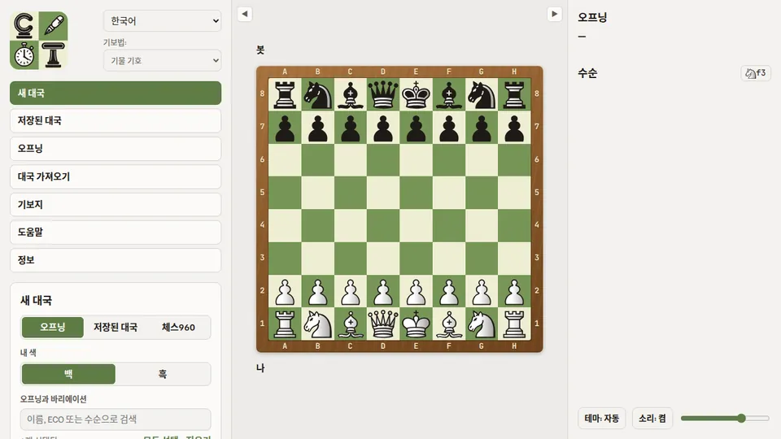
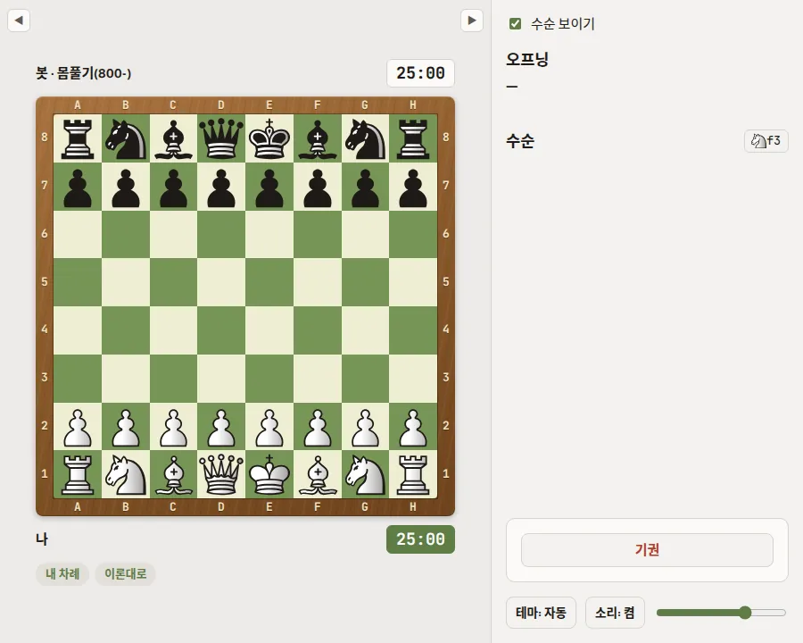
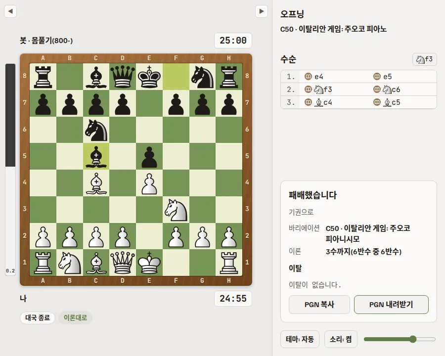
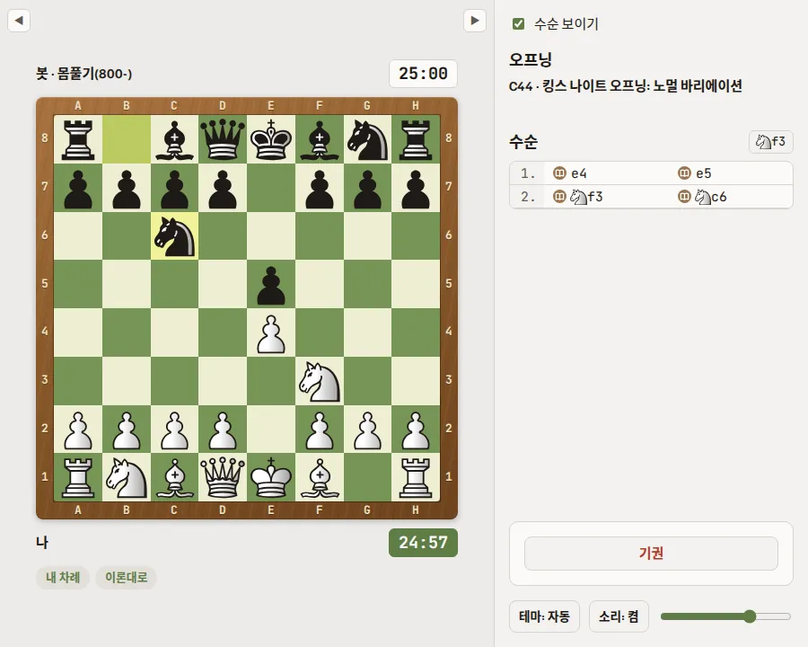
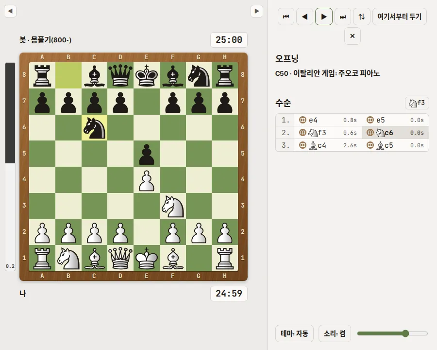

<!-- Generated by scripts/help_docs.py from the app's Help page. Do not edit. -->

# Chess Trainer 사용법

[English (US)](HELP.md) · [English (UK)](HELP.en-GB.md) · [Português (Brasil)](HELP.pt-BR.md) · [Español (Latinoamérica)](HELP.es-419.md) · [Español (España)](HELP.es-ES.md) · [Português (Portugal)](HELP.pt-PT.md) · [Deutsch](HELP.de.md) · [Français](HELP.fr.md) · [Italiano](HELP.it.md) · [Türkçe](HELP.tr.md) · [Polski](HELP.pl.md) · [Nederlands](HELP.nl.md) · [Bahasa Indonesia](HELP.id.md) · [Tiếng Việt](HELP.vi.md) · [Svenska](HELP.sv.md) · [Dansk](HELP.da.md) · [Norsk bokmål](HELP.nb.md) · [Suomi](HELP.fi.md) · [Русский](HELP.ru.md) · [Українська](HELP.uk.md) · [हिन्दी](HELP.hi.md) · [中文（简体）](HELP.zh-CN.md) · [日本語](HELP.ja.md) · [العربية](HELP.ar.md) · [فارسی](HELP.fa.md) · [עברית](HELP.he.md)

Chess Trainer는 연습용입니다. 내 라인을 두는 봇을 상대로 오프닝을 반복 연습하고, 이론이 끝나면 Stockfish를 상대로 계속 두고, 대국을 복기합니다. 모든 것이 내 컴퓨터에서 실행되고 내 컴퓨터에만 남습니다.

> **부정행위에는 절대 쓰지 마세요**
>
> 다른 사람과 대국하는 동안에는 온라인이든 체스판 앞이든 Chess Trainer나 어떤 엔진도 쓰지 마세요. 그것은 부정행위이며, Chess.com, Lichess, FIDE가 금지합니다. 대국 전과 후에 연습하고, 대국 중에는 절대 하지 마세요.

> **여기의 평가는 기본적인 것입니다**
>
> 평가 막대와 수 아이콘(최선의 수, 실수, 대실수…)은 Stockfish의 빠른 확인에서 나오며 참고일 뿐입니다. 제대로 분석하려면 PGN을 내보내 Chess.com, Lichess 또는 다른 분석 도구에서 분석하세요.

## 대국 시작

- 오프닝: 내 색을 고르고, 연습할 오프닝과 바리에이션을 선택하세요. 선택한 바리에이션은 모두 같은 확률로 뽑힙니다. 선택하지 않은 바리에이션의 수를 두면 이론을 벗어난 것으로 칩니다.
- 저장된 대국: 직접 두었거나 가져온 대국의 라인을 연습해 수를 확인하거나, 그 대국의 어느 국면에서든 계속 둘 수 있습니다.
- 체스960: 초기 배치를 무작위로 고르거나, 960가지 중 하나의 FEN을 붙여넣으세요. 캐슬링하려면 킹을 클릭한 다음 킹과 룩 사이의 칸이나 룩 자체를 클릭하세요.
- 봇 레벨: 각 레벨 옆의 레이팅은 명목상의 것으로, Stockfish 자체의 척도이며 측정된 것이 아닙니다. Chess.com이나 Lichess의 레이팅이 아닙니다.
- 대국 시간 설정: 불릿부터 클래시컬까지 실제 대회 대국 시계의 설정, 또는 시계 없음. 봇의 응수 시간은 사람처럼 시간을 쓰는 사람처럼, 또는 즉시입니다.
- 옵션: 이론을 벗어나면 알림, 프리무브 허용, 그리고 고른 수부터 봇이 일부러 라인을 벗어나게 하기. 예상하지 못한 수에 대한 연습도 됩니다.

*새 대국: 색, 라인, 레벨, 시계.*

## 대국 중

- 기물을 클릭하거나 끌어서 옮기세요. 봇은 뽑힌 라인의 정석 수를 두고, 이론이 끝나거나 누군가 이론을 벗어나면 고른 레벨로 Stockfish가 이어받습니다.
- 체스판 아래의 표시는 누구 차례인지, 아직 이론대로인지, 나나 봇이 어디서 이론을 벗어났는지 알려 줍니다.
- 오른쪽 막대의 수순 보이기는 대국이 끝날 때까지 오프닝 이름과 수순 목록을 숨깁니다. 힌트 없이 두거나, 수를 종이에 적을 수 있습니다.
- 언어 아래의 기보법은 수를 기물 기호, 영문 문자(Nf3, PGN 파일과 체스 사이트의 문자) 또는 그 언어의 문자로 보여 줍니다. 한국어의 문자는 영문 문자와 같습니다. 수순 옆의 버튼으로 대국 중에도 바꿀 수 있고, 수에 마우스를 올리거나 Tab으로 이동하면 나머지 두 가지로 보여 줍니다. PGN 파일은 항상 영문 문자를 씁니다.
- 프리무브를 켜면 봇이 생각하는 동안 한 수를 예약할 수 있습니다. 끄면 봇의 응수가 보이기 전에 무르기로 직전 수를 취소할 수 있습니다.
- 기권은 한 번 더 클릭해야 하므로, 잘못 클릭해도 대국이 끝나지 않습니다.

*기물을 클릭하거나 끌어 옮기면 봇이 정석으로 응수합니다.*

## 대국 후

- 수순 목록 아래의 카드는 결과, 바리에이션, 이론이 어디까지 이어졌는지, 그리고 이탈마다 정석 수를 보여 줍니다.
- PGN을 복사하거나 내려받으세요. 새 대국은 같은 선택으로 다음 대국을 시작합니다.

*끝나면: 결과, 바리에이션, 이론, 이탈.*

## 연습하는 법

### 지는 것도 과정입니다

지는 것은 배우는 과정의 일부입니다. 중요한 것은 대국마다 연구하고 자신의 실수에서 배우는 것입니다. 정말로 실력을 늘리려면 봇의 레벨을 조금씩 올리고, 봇의 수에 익숙해졌다고 느낄 때만 다시 올리세요.

### 시간 설정마다 역할이 있습니다

긴 대국에서는 수마다 차분히 생각하고, 두 수, 세 수 또는 그 이상을 내다보며 계산하는 습관을 들이세요. 래피드, 블리츠, 불릿은 이미 익힌 패턴을 반복 연습하는 데 쓰세요.

### 상대의 수부터 보세요

수를 두기 전에 먼저 상대가 무엇을 노리는지 보세요. 체크, 잡기, 공격입니다. 그다음에 자신의 계획을 찾으세요.

### 대회처럼 연습하세요

가장 좋은 학습 방법은 실제 체스판과 시계를 쓰는 것입니다. 시계가 앱과 조금 어긋나도 괜찮습니다.

왜 체스판, 시계, 기보지로 연습할까요? 기억하게 만들고, 생각 없이 두는 것을 막고, 계산과 시각화 능력을 길러 주기 때문입니다. 어쩌면 실제 체스판도 화면의 체스판도 없이 머릿속으로 두게 될지도 모릅니다.

대국 전에 메뉴에서 기보지를 열어 인쇄하거나 PDF로 저장하고, 머리말을 채우세요. 래피드나 클래시컬 같은 긴 시간 설정을 고르고, 수순 보이기를 해제하세요.

내 차례에는:

1. 체스판에서 기물을 옮깁니다.
1. 기물을 옮긴 손으로 시계를 누릅니다.
1. 앱에서 같은 수를 둡니다.
1. 기보지에 수를 적습니다.

봇의 차례에는:

1. 봇의 수를 체스판에서 둡니다.
1. 봇 쪽의 시계를 누릅니다.
1. 기보지에 수를 적습니다.

그다음에야 자신의 수를 생각하기 시작합니다.

기억하세요: 만진 기물은 움직여야 합니다. 더 좋은 연습을 위해 두는 모습을 촬영해 두었다가, 나중에 체스판 앞에서 어떻게 행동하는지 보세요. 서두르지 마세요. 연습하면 자연스러워집니다.

끝나면 결과와 서명을 채우고, 기보지를 수순 목록과 PGN과 비교해 잘못 적은 수를 찾으세요.

*수순 보이기를 해제하면 수순 목록이 숨겨지고, 기보지에 적습니다.*

### 평가를 보기 전에 직접 분석하세요

대국이 끝나면 먼저 혼자 복기하며 형세가 어디서 바뀌었는지 찾으세요. 그다음에 평가와 비교하세요. 평가 막대는 마지막 국면에서 보이므로, 복기가 끝날 때까지 무시하세요.

## 저장된 대국과 복기

- 모든 대국이 저장됩니다. 목록을 검색하고 걸러서 대국을 체스판에 열고, 버튼이나 화살표 키, Home, End로 따라가세요.
- 여기서부터 두기는 체스판의 국면에서 새 대국을 시작합니다.
- 대국을 선택해 PGN으로 내보내거나 삭제할 수 있습니다.

*평가 막대와 함께 저장된 대국을 복기합니다.*

## 오프닝

- 체스판에서 책의 모든 라인을 따라가고, 라인을 선택해 PGN으로 내보내세요.

## 대국 가져오기

- 사용자 이름과 기간으로 Chess.com이나 Lichess에서 대국을 가져오거나, PGN을 붙여넣거나 올리세요. 대국은 저장된 대국에 들어가 복기하거나 연습할 수 있습니다.

## 다른 곳에서 분석하기

- 대국 종료 카드나 저장된 대국에서 PGN을 받으세요.
- Chess.com이나 Lichess에서 분석 보드를 열고 PGN을 붙여넣거나 가져오면, 더 깊고 완전한 분석을 할 수 있습니다.
