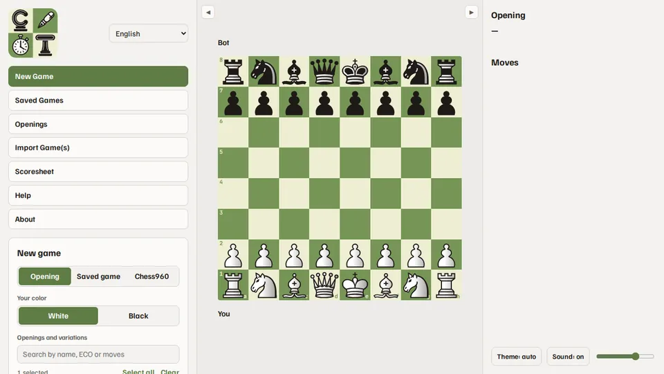
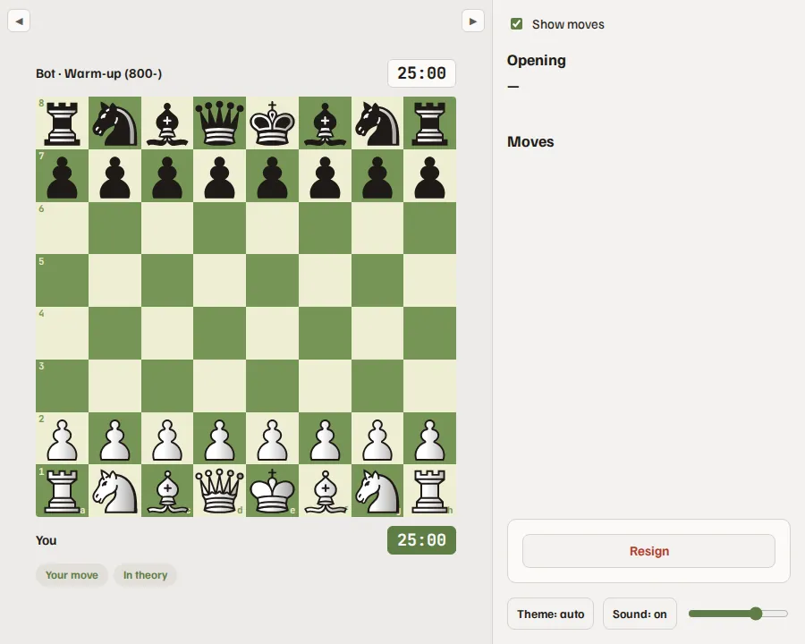
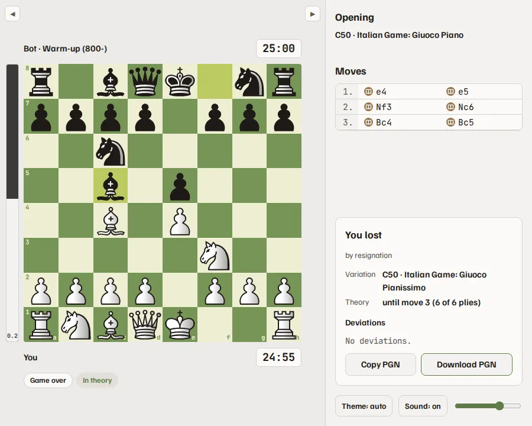
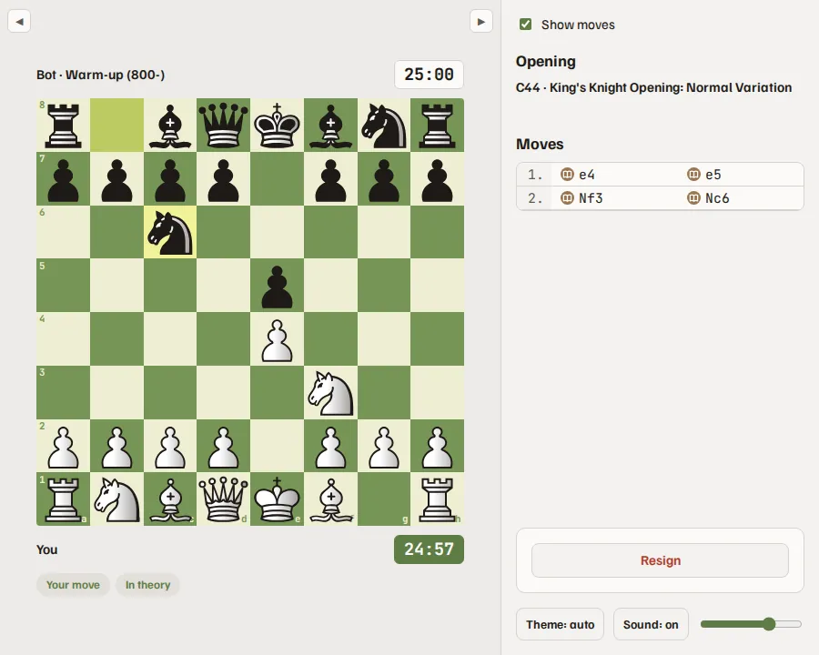
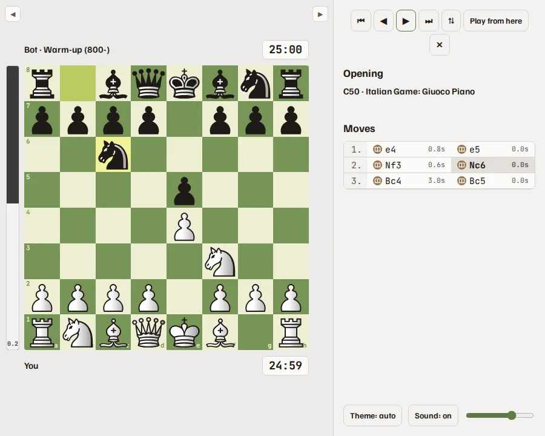

<!-- Generated by scripts/help_docs.py from the app's Help page. Do not edit. -->

# How to use Chess Trainer

[Português (Brasil)](HELP.pt-BR.md) · [Español](HELP.es.md)

Chess Trainer is for practice: drill your openings against a bot that plays your lines, keep playing against Stockfish when theory ends, and review your games. Everything runs and stays on your computer.

> **Never use it to cheat**
>
> Do not use Chess Trainer, or any engine, during a game against another person, online or over the board. That is cheating, and Chess.com, Lichess and FIDE ban it. Train before and after your games, never during them.

> **The evaluation here is basic**
>
> The evaluation bar and the move icons (best move, mistake, blunder…) come from a quick Stockfish check and are only a hint. For a real analysis, export the PGN and analyze it on Chess.com, Lichess or another analysis tool.

## Start a game

- Opening: pick your color and tick the openings and variations to drill. Each ticked variation has the same chance of being drawn. Playing a move from a variation you did not tick counts as leaving theory.
- Saved game: train the line of a game you played or imported, so its moves are checked, or play on from any of its positions.
- Chess960: roll a starting position or paste the FEN of one of the 960. To castle, click the king and then a square between it and the rook, or the rook itself.
- Bot level: the rating beside each level is nominal, on Stockfish's own scale, and has not been measured. It is not a Chess.com or Lichess rating.
- Time control: the presets of a real tournament clock, from bullet to classical, or no clock. The bot's response time is Human, which spends its clock like a person, or Instant.
- Options: warn when you leave theory, allow premoves, and let the bot deviate from its line on purpose, from a chosen move, so you also train against surprises.

*New Game: color, lines, level and clock.*

## During the game

- Click or drag the pieces. The bot plays the book moves of the drawn line, and when theory ends, or someone leaves it, Stockfish takes over at the chosen level.
- The chips under the board say whose move it is, whether you are still in theory, and where you or the bot left it.
- Show moves, in the right bar, hides the opening name and the move list until the end of the game: play without hints, or write the moves on paper.
- With premoves on, you can queue one move while the bot thinks. With premoves off, Take back undoes your last move while the bot's reply is not shown yet.
- Resign asks for a second click, so a stray click does not end the game.

*Click or drag a piece; the bot answers from the book.*

## After the game

- The card under the move list shows the result, the variation, how far theory went, and each deviation with the expected move.
- Copy or download the PGN. New Game starts the next one with the same choices.

*At the end: result, variation, theory and deviations.*

## How to train

### Losing is part of it

Losing is part of learning. What matters is studying each game and learning from your own mistakes. To really improve, raise the bot's level little by little, and only raise it again once you feel comfortable with the moves it plays.

### Each time control has a job

In long games, think calmly about every move and build the habit of calculating two, three or more moves ahead. Use rapid, blitz and bullet to drill the patterns you have already taken in.

### Start with your opponent's moves

Before each move, first look at what your opponent threatens: checks, captures and attacks. Then look for your own plan.

### Train as in a tournament

The best way to learn is with a physical board and clock. It does not matter if the clock drifts from the app's.

Before the game, open Scoresheet in the menu and print it, or save it as a PDF, and fill in the header. Choose a long time control, such as rapid or classical, and untick Show moves.

On your move:

1. Move the piece on the board.
1. Press the clock with the same hand that moved the piece.
1. Play the same move in the app.
1. Write the move on the scoresheet.

On the bot's move:

1. Play its move on the board.
1. Press the clock on its side.
1. Write the move on the scoresheet.

Only then start thinking about yours.

Remember: a piece you touch is a piece you move. For an even better experience, film yourself playing and watch it later to see how you behave at the board. Take your time: with practice it becomes natural.

At the end, fill in the result and the signatures, compare your sheet with the move list and the PGN, and look for the moves you wrote wrong.

*Show moves unticked: the move list hides, so you write on the scoresheet.*

### Analyze before you look at the evaluation

When a game ends, review it on your own first and look for where it turned. Only then check it against the evaluation. The bar shows on the final position, so ignore it until you are done.

## Saved games and review

- Every game is saved. Search and filter the list, open a game on the board and go through it with the buttons or the arrow keys, Home and End.
- Play from here starts a new game from the position on the board.
- Tick games to export them as PGN or to delete them.

*Reviewing a saved game, with the evaluation bar.*

## Openings

- Go through every line of the book on the board, and tick lines to export them as PGN.

## Import games

- Bring your games from Chess.com or Lichess by username and period, or paste or upload a PGN. They go to Saved games, ready to review or to train.

## Analyze elsewhere

- Get the PGN from the end-of-game card or from Saved games.
- On Chess.com or Lichess, open the analysis board and paste or import the PGN, for a full analysis by a stronger setup.
