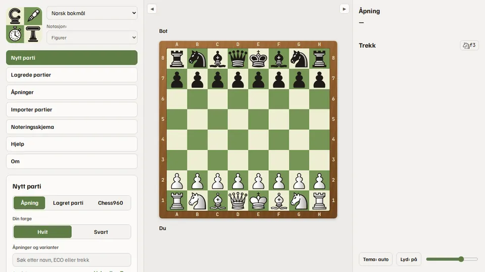
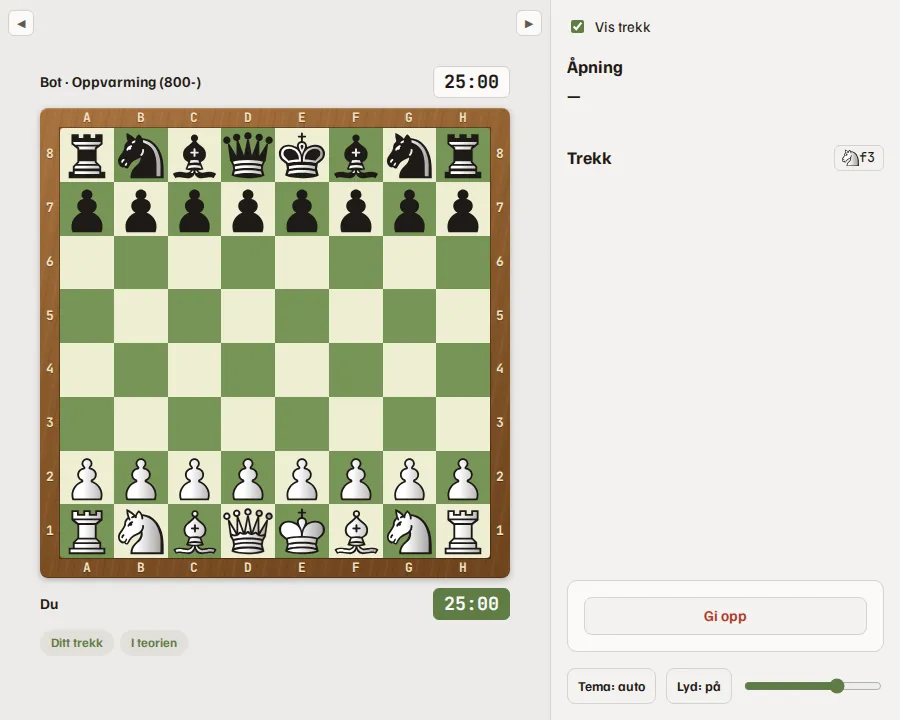
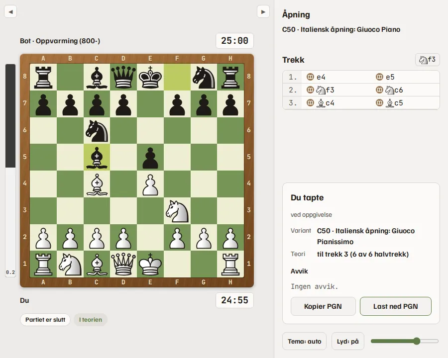
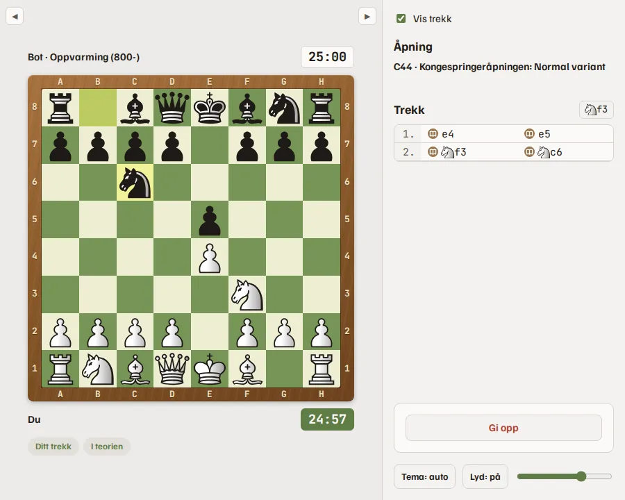
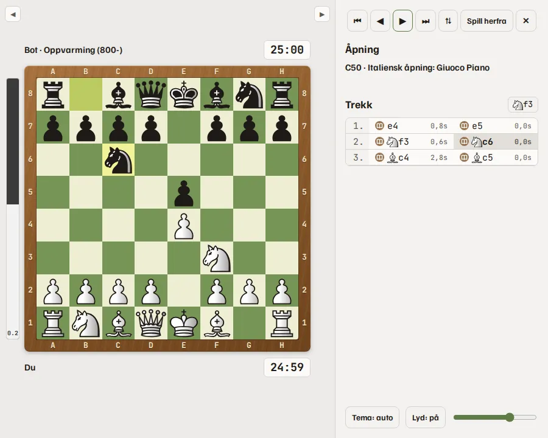

<!-- Generated by scripts/help_docs.py from the app's Help page. Do not edit. -->

# Slik bruker du Chess Trainer

[English (US)](HELP.md) · [English (UK)](HELP.en-GB.md) · [Português (Brasil)](HELP.pt-BR.md) · [Español (Latinoamérica)](HELP.es-419.md) · [Español (España)](HELP.es-ES.md) · [Português (Portugal)](HELP.pt-PT.md) · [Deutsch](HELP.de.md) · [Français](HELP.fr.md) · [Italiano](HELP.it.md) · [Türkçe](HELP.tr.md) · [Polski](HELP.pl.md) · [Nederlands](HELP.nl.md) · [Bahasa Indonesia](HELP.id.md) · [Tiếng Việt](HELP.vi.md) · [Svenska](HELP.sv.md) · [Dansk](HELP.da.md) · [Suomi](HELP.fi.md) · [Русский](HELP.ru.md) · [Українська](HELP.uk.md) · [हिन्दी](HELP.hi.md) · [中文（简体）](HELP.zh-CN.md) · [日本語](HELP.ja.md) · [한국어](HELP.ko.md)

Chess Trainer er til trening: øv på åpningene dine mot en bot som spiller variantene dine, spill videre mot Stockfish når teorien slutter, og gå gjennom partiene dine. Alt kjører og blir på datamaskinen din.

> **Bruk det aldri til juks**
>
> Ikke bruk Chess Trainer, eller noen sjakkmotor, under et parti mot en annen person, på nett eller ved brettet. Det er juks, og Chess.com, Lichess og FIDE forbyr det. Tren før og etter partiene dine, aldri under dem.

> **Vurderingen her er enkel**
>
> Vurderingsstolpen og trekk-ikonene (beste trekk, feil, bukk…) kommer fra en rask sjekk med Stockfish og er bare et hint. For en ekte analyse eksporterer du PGN og analyserer den på Chess.com, Lichess eller et annet analyseverktøy.

## Start et parti

- Åpning: velg farge og kryss av åpningene og variantene du vil øve på. Hver avkrysset variant har like stor sjanse til å bli trukket. Et trekk fra en variant du ikke krysset av, regnes som å forlate teorien.
- Lagret parti: tren varianten fra et parti du har spilt eller importert, så trekkene kontrolleres, eller spill videre fra hvilken som helst stilling i det.
- Chess960: trekk en tilfeldig utgangsstilling eller lim inn FEN for en av de 960. For å rokere klikker du på kongen og så på et felt mellom den og tårnet, eller på selve tårnet.
- Botens nivå: ratingen ved hvert nivå er nominell, på Stockfish sin egen skala, og er ikke målt. Det er ikke en rating fra Chess.com eller Lichess.
- Betenkningstid: forhåndsinnstillingene på en ekte turneringsklokke, fra bullet til klassisk, eller uten klokke. Botens svartid er Menneskelig, som bruker klokken sin som et menneske, eller Umiddelbar.
- Innstillinger: varsle når du forlater teorien, tillat forhåndstrekk, og la boten avvike fra varianten sin med vilje, fra et valgt trekk, så du også trener mot overraskelser.

*Nytt parti: farge, varianter, nivå og klokke.*

## Under partiet

- Klikk på eller dra brikkene. Boten spiller teoritrekkene i den trukne varianten, og når teorien slutter, eller noen forlater den, tar Stockfish over på det valgte nivået.
- Merkene under brettet viser hvem som er i trekket, om du fortsatt er i teorien, og hvor du eller boten forlot den.
- Vis trekk, i høyre panel, skjuler åpningens navn og trekklisten til slutten av partiet: spill uten hint, eller skriv trekkene på papir.
- Notasjon, under språket, viser trekkene som brikkesymboler (figurer), med engelske bokstaver (Nf3, bokstavene i PGN-filer og på sjakksider) eller med språkets egne bokstaver (Sf3). Knappen ved siden av Trekk bytter mellom dem, også midt i partiet, og når du holder musepekeren over et trekk, eller når det med Tab, vises det i de to andre. PGN-filer bruker alltid engelske bokstaver.
- Med forhåndstrekk slått på kan du legge et trekk i kø mens boten tenker. Med forhåndstrekk slått av angrer Ta tilbake det siste trekket ditt så lenge botens svar ikke er vist ennå.
- Gi opp krever et ekstra klikk, så et feilklikk ikke avslutter partiet.

*Klikk på eller dra en brikke; boten svarer fra boken.*

## Etter partiet

- Kortet under trekklisten viser resultatet, varianten, hvor langt teorien gikk, og hvert avvik med det ventede trekket.
- Kopier eller last ned PGN. Nytt parti starter det neste med de samme valgene.

*Til slutt: resultat, variant, teori og avvik.*

## Slik trener du

### Å tape hører med

Å tape er en del av å lære. Det viktige er å studere hvert parti og lære av dine egne feil. For å virkelig bli bedre hever du botens nivå litt om gangen, og hever det igjen først når du føler deg trygg på trekkene den spiller.

### Hver betenkningstid har en oppgave

I lange partier tenker du rolig over hvert trekk og bygger opp vanen med å beregne to, tre eller flere trekk fram. Bruk hurtigsjakk, lynsjakk og bullet til å øve på mønstrene du allerede har lært.

### Begynn med motstanderens trekk

Før hvert trekk ser du først på hva motstanderen truer med: sjakker, slag og angrep. Så leter du etter din egen plan.

### Tren som i en turnering

Den beste måten å lære på er med et ekte brett og en ekte klokke. Det gjør ingenting om klokken glir fra appens.

Hvorfor trene med brett, klokke og noteringsskjema? Fordi de får deg til å huske, hindrer deg i å spille uten å tenke og bygger opp beregningen og visualiseringen din, kanskje helt til du begynner å spille i hodet, uten noe fysisk eller virtuelt brett foran deg.

Før partiet åpner du Noteringsskjema i menyen og skriver det ut, eller lagrer det som PDF, og fyller ut toppen. Velg en lang betenkningstid, som hurtigsjakk eller klassisk, og fjern krysset for Vis trekk.

Når det er ditt trekk:

1. Flytt brikken på brettet.
1. Trykk på klokken med den samme hånden som flyttet brikken.
1. Spill det samme trekket i appen.
1. Skriv trekket på noteringsskjemaet.

Når det er botens trekk:

1. Spill trekket dens på brettet.
1. Trykk på klokken på dens side.
1. Skriv trekket på noteringsskjemaet.

Først da begynner du å tenke på ditt.

Husk: en brikke du berører, skal flyttes. For en enda bedre opplevelse kan du filme deg selv mens du spiller, og se det etterpå for å se hvordan du oppfører deg ved brettet. Ta deg god tid: med øvelse blir det naturlig.

Til slutt fyller du ut resultatet og signaturene, sammenligner skjemaet ditt med trekklisten og PGN og ser etter trekkene du skrev feil.

*Uten kryss for Vis trekk skjules trekklisten, og du skriver på noteringsskjemaet.*

### Analyser før du ser på vurderingen

Når et parti er slutt, går du først gjennom det på egen hånd og ser etter hvor det snudde. Først da sammenligner du med vurderingen. Stolpen vises på sluttstillingen, så overse den til du er ferdig.

## Lagrede partier og gjennomgang

- Hvert parti lagres. Søk og filtrer i listen, åpne et parti på brettet og gå gjennom det med knappene eller piltastene, Home og End.
- Spill herfra starter et nytt parti fra stillingen på brettet.
- Kryss av partier for å eksportere dem som PGN eller slette dem.

*Gjennomgang av et lagret parti, med vurderingsstolpen.*

## Åpninger

- Gå gjennom alle variantene i boken på brettet, og kryss av varianter for å eksportere dem som PGN.

## Importer partier

- Hent partiene dine fra Chess.com eller Lichess med brukernavn og periode, eller lim inn eller last opp en PGN. De havner i Lagrede partier, klare for gjennomgang eller trening.

## Analyser et annet sted

- Hent PGN fra kortet etter partiet eller fra Lagrede partier.
- På Chess.com eller Lichess åpner du analysebrettet og limer inn eller importerer PGN, for en full og dypere analyse.
