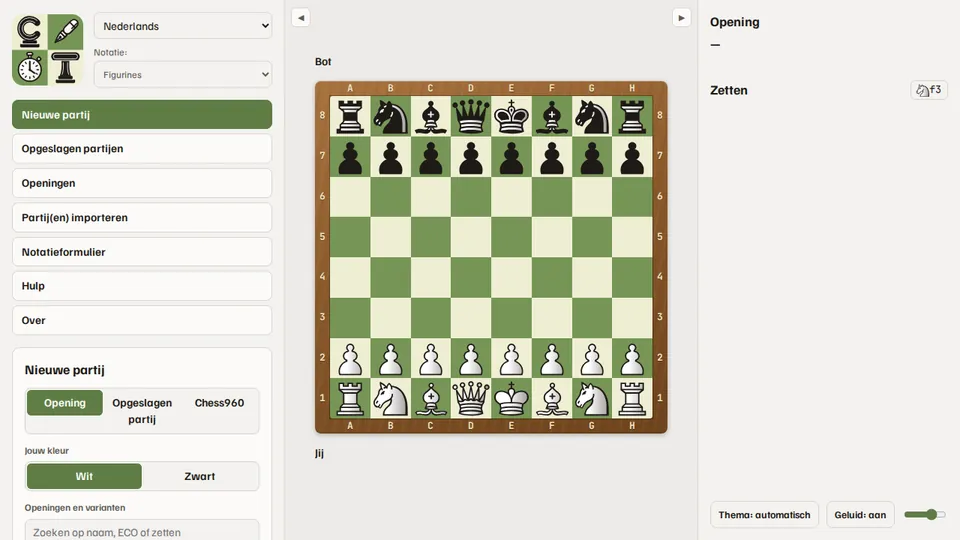
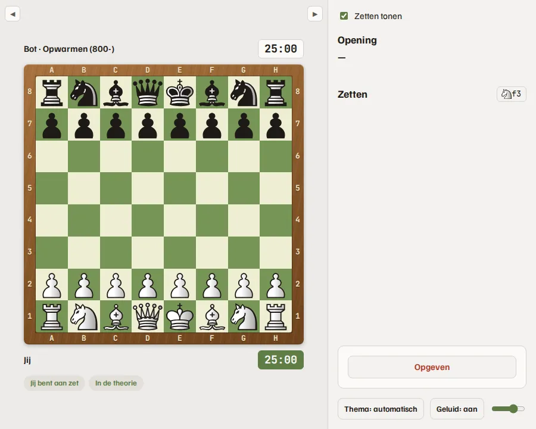
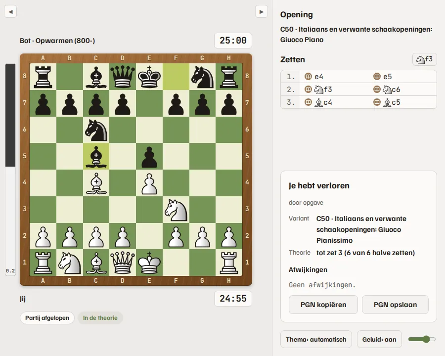
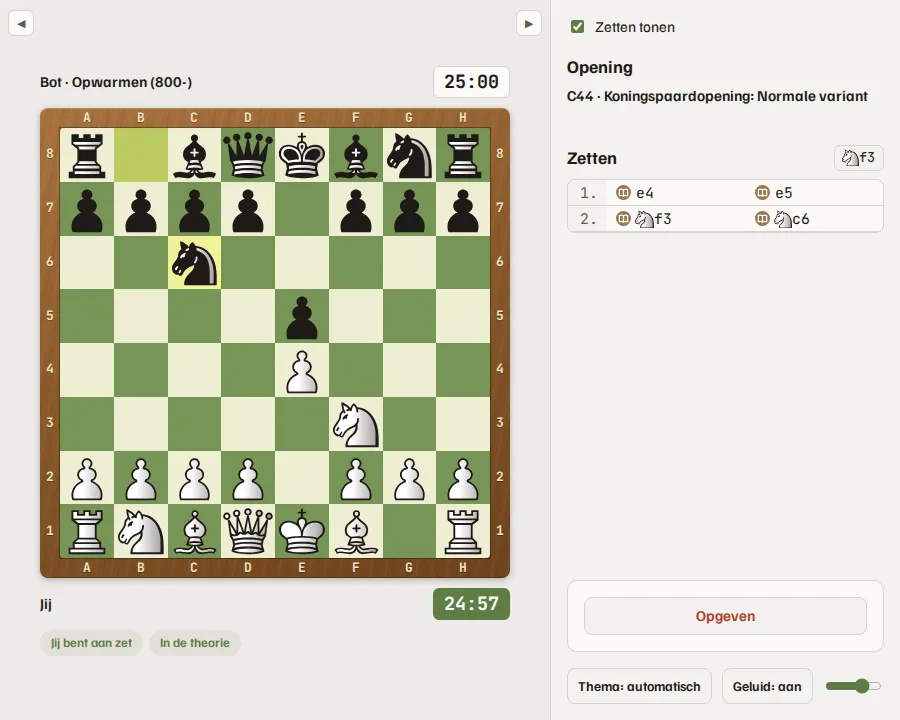
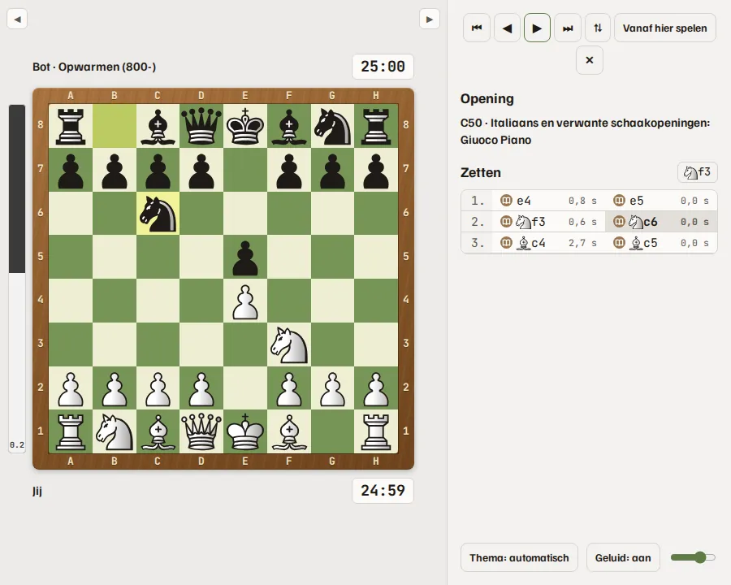

<!-- Generated by scripts/help_docs.py from the app's Help page. Do not edit. -->

# Zo gebruik je Chess Trainer

[English (US)](HELP.md) · [English (UK)](HELP.en-GB.md) · [Português (Brasil)](HELP.pt-BR.md) · [Español (Latinoamérica)](HELP.es-419.md) · [Español (España)](HELP.es-ES.md) · [Português (Portugal)](HELP.pt-PT.md) · [Deutsch](HELP.de.md) · [Français](HELP.fr.md) · [Italiano](HELP.it.md) · [Türkçe](HELP.tr.md) · [Polski](HELP.pl.md) · [Bahasa Indonesia](HELP.id.md) · [Tiếng Việt](HELP.vi.md) · [Svenska](HELP.sv.md) · [Dansk](HELP.da.md) · [Norsk bokmål](HELP.nb.md) · [Suomi](HELP.fi.md) · [Русский](HELP.ru.md) · [Українська](HELP.uk.md)

Chess Trainer is om te oefenen: train je openingen tegen een bot die jouw lijnen speelt, speel verder tegen Stockfish als de theorie ophoudt en bekijk je partijen terug. Alles draait en blijft op je eigen computer.

> **Gebruik het nooit om vals te spelen**
>
> Gebruik Chess Trainer, of welke schaakengine ook, niet tijdens een partij tegen iemand anders, online of aan het bord. Dat is valsspelen, en Chess.com, Lichess en de FIDE verbieden het. Train voor en na je partijen, nooit tijdens.

> **De evaluatie hier is eenvoudig**
>
> De evaluatiebalk en de zetpictogrammen (beste zet, fout, blunder…) komen uit een snelle controle door Stockfish en zijn alleen een hint. Voor een echte analyse exporteer je de PGN en analyseer je die op Chess.com, Lichess of met een ander analyseprogramma.

## Een partij beginnen

- Opening: kies je kleur en vink de openingen en varianten aan die je wilt trainen. Elke aangevinkte variant heeft evenveel kans om geloot te worden. Een zet spelen uit een variant die je niet hebt aangevinkt, telt als het verlaten van de theorie.
- Opgeslagen partij: train de lijn van een partij die je hebt gespeeld of geïmporteerd, zodat je zetten worden gecontroleerd, of speel verder vanuit elke stelling ervan.
- Chess960: loot een beginstelling of plak de FEN van een van de 960. Om te rokeren klik je op de koning en dan op een veld tussen de koning en de toren, of op de toren zelf.
- Niveau van de bot: de rating naast elk niveau is nominaal, op de eigen schaal van Stockfish, en is niet gemeten. Het is geen rating van Chess.com of Lichess.
- Bedenktijd: de standaardinstellingen van een echte toernooiklok, van bullet tot klassiek, of zonder klok. De reactietijd van de bot is Menselijk, die zijn klok gebruikt zoals een mens, of Direct.
- Opties: waarschuwen als je de theorie verlaat, voorzetten toestaan en de bot vanaf een gekozen zet bewust van zijn lijn laten afwijken, zodat je ook tegen verrassingen traint.

*Nieuwe partij: kleur, lijnen, niveau en klok.*

## Tijdens de partij

- Klik of sleep de stukken. De bot speelt de theoriezetten van de gelote lijn, en als de theorie ophoudt of iemand die verlaat, neemt Stockfish het over op het gekozen niveau.
- De labels onder het bord tonen wie aan zet is, of je nog in de theorie zit en waar jij of de bot die verliet.
- Zetten tonen, in de rechterbalk, verbergt de naam van de opening en de zettenlijst tot het einde van de partij: speel zonder hints, of schrijf de zetten op papier.
- Notatie, onder de taal, toont zetten als stuksymbolen (figurines), in Engelse letters (Nf3, de letters van PGN-bestanden en schaaksites) of in de letters van je eigen taal. De knop naast Zetten wisselt ertussen, ook midden in de partij, en met de muis over een zet gaan, of er met Tab naartoe gaan, toont hem in de andere twee. PGN-bestanden gebruiken altijd Engelse letters.
- Met voorzetten aan kun je één zet klaarzetten terwijl de bot nadenkt. Met voorzetten uit maakt Zet terugnemen je laatste zet ongedaan zolang het antwoord van de bot nog niet te zien is.
- Opgeven vraagt om een tweede klik, zodat een verkeerde klik de partij niet beëindigt.

*Klik of sleep een stuk; de bot antwoordt uit het repertoire.*

## Na de partij

- De kaart onder de zettenlijst toont de uitslag, de variant, hoe ver de theorie ging en elke afwijking met de verwachte zet.
- Kopieer of sla de PGN op. Nieuwe partij begint de volgende met dezelfde keuzes.

*Aan het einde: uitslag, variant, theorie en afwijkingen.*

## Zo train je

### Verliezen hoort erbij

Verliezen hoort bij het leren. Waar het om gaat, is elke partij bestuderen en leren van je eigen fouten. Om echt beter te worden, verhoog je het niveau van de bot beetje bij beetje, en pas weer als je je op je gemak voelt bij de zetten die hij speelt.

### Elke bedenktijd heeft een taak

Denk in lange partijen rustig na over elke zet en kweek de gewoonte om twee, drie of meer zetten vooruit te rekenen. Gebruik rapid, blitz en bullet om de patronen te oefenen die je al hebt opgenomen.

### Begin bij de zetten van je tegenstander

Kijk voor elke zet eerst wat je tegenstander dreigt: schaakjes, slagen en aanvallen. Zoek daarna je eigen plan.

### Train zoals op een toernooi

De beste manier om te leren is met een echt bord en een echte klok. Het maakt niet uit als de klok wat afwijkt van die van de app.

Waarom trainen met een bord, een klok en een notatieformulier? Omdat je dan moet onthouden, niet zonder nadenken speelt en je rekenen en visualiseren opbouwt, misschien tot je in je hoofd begint te spelen, zonder echt of virtueel bord voor je.

Open voor de partij Notatieformulier in het menu, druk het af of sla het op als pdf, en vul de kop in. Kies een lange bedenktijd, zoals rapid of klassiek, en vink Zetten tonen uit.

Bij jouw zet:

1. Zet het stuk op het bord.
1. Druk de klok in met dezelfde hand waarmee je het stuk zette.
1. Speel dezelfde zet in de app.
1. Schrijf de zet op het notatieformulier.

Bij de zet van de bot:

1. Speel zijn zet op het bord.
1. Druk de klok in aan zijn kant.
1. Schrijf de zet op het notatieformulier.

Begin pas daarna aan je eigen zet te denken.

Onthoud: aanraken is zetten. Voor een nog betere ervaring film je jezelf tijdens het spelen en bekijk je dat later, om te zien hoe je je aan het bord gedraagt. Neem de tijd: met oefening wordt het vanzelf.

Vul aan het eind de uitslag en de handtekeningen in, vergelijk je formulier met de zettenlijst en de PGN en zoek de zetten die je verkeerd hebt opgeschreven.

*Met Zetten tonen uitgevinkt verdwijnt de zettenlijst en schrijf je op het notatieformulier.*

### Analyseer voordat je naar de evaluatie kijkt

Als een partij afgelopen is, bekijk je hem eerst zelf en zoek je waar hij kantelde. Pas daarna vergelijk je met de evaluatie. De balk is zichtbaar bij de eindstelling, dus negeer hem tot je klaar bent.

## Opgeslagen partijen en terugkijken

- Elke partij wordt opgeslagen. Zoek en filter in de lijst, open een partij op het bord en loop er doorheen met de knoppen of met de pijltjestoetsen, Home en End.
- Vanaf hier spelen begint een nieuwe partij vanuit de stelling op het bord.
- Vink partijen aan om ze als PGN te exporteren of te verwijderen.

*Een opgeslagen partij terugkijken, met de evaluatiebalk.*

## Openingen

- Loop elke lijn van het repertoire door op het bord en vink lijnen aan om ze als PGN te exporteren.

## Partijen importeren

- Haal je partijen op van Chess.com of Lichess met gebruikersnaam en periode, of plak een PGN of open een PGN-bestand. Ze gaan naar Opgeslagen partijen, klaar om terug te kijken of te trainen.

## Elders analyseren

- Haal de PGN van de kaart aan het einde van de partij of uit Opgeslagen partijen.
- Open op Chess.com of Lichess het analysebord en plak of importeer de PGN, voor een volledige, diepere analyse.
