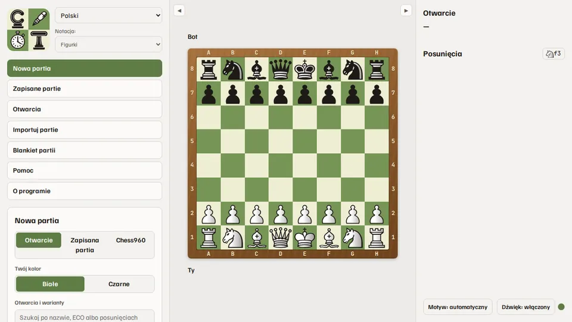
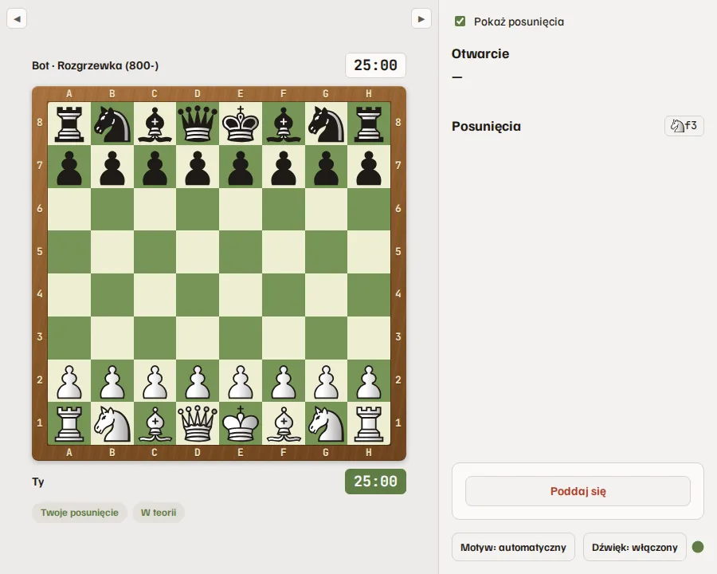
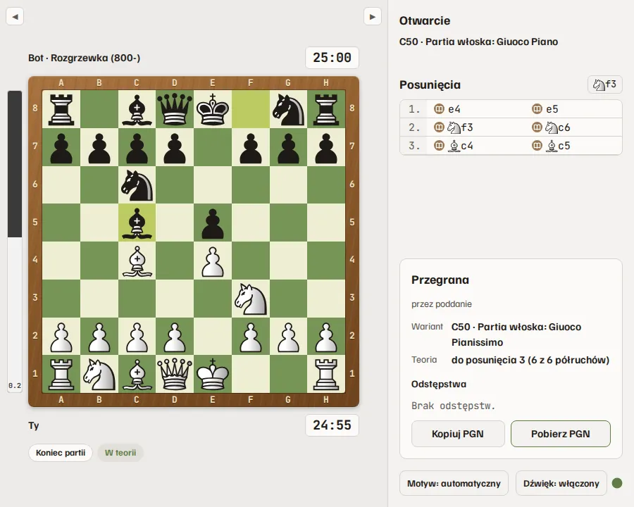
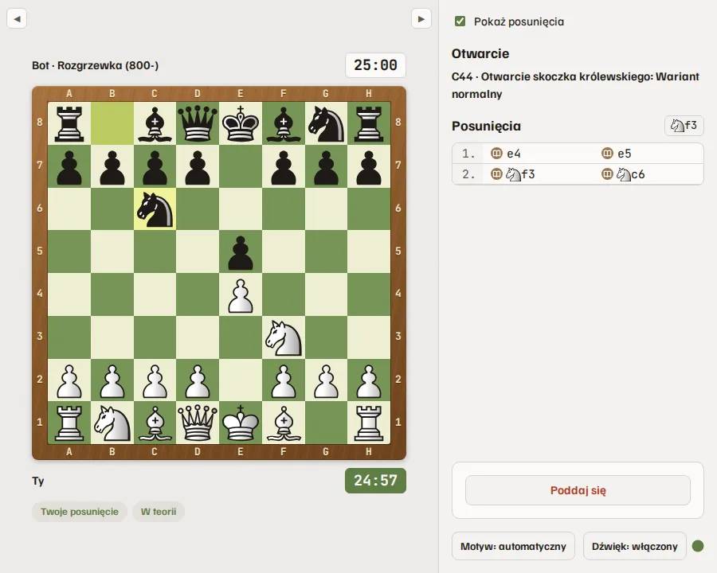
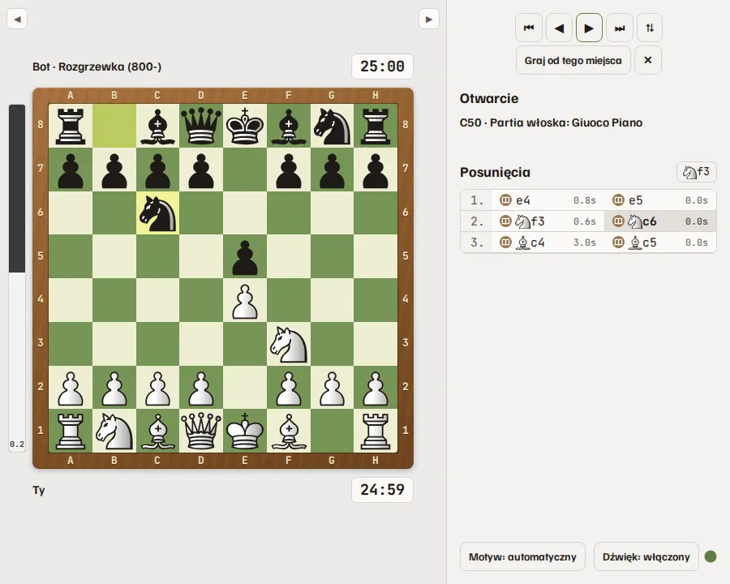

<!-- Generated by scripts/help_docs.py from the app's Help page. Do not edit. -->

# Jak używać Chess Trainer

[English (US)](HELP.md) · [English (UK)](HELP.en-GB.md) · [Português (Brasil)](HELP.pt-BR.md) · [Español (Latinoamérica)](HELP.es-419.md) · [Español (España)](HELP.es-ES.md) · [Português (Portugal)](HELP.pt-PT.md) · [Deutsch](HELP.de.md) · [Français](HELP.fr.md) · [Italiano](HELP.it.md) · [Türkçe](HELP.tr.md) · [Nederlands](HELP.nl.md) · [Bahasa Indonesia](HELP.id.md) · [Tiếng Việt](HELP.vi.md)

Chess Trainer służy do ćwiczeń: trenuj swoje otwarcia przeciwko botowi, który gra twoje linie, graj dalej przeciwko Stockfishowi, gdy kończy się teoria, i przeglądaj swoje partie. Wszystko działa i zostaje na twoim komputerze.

> **Nigdy nie używaj go do oszukiwania**
>
> Nie używaj Chess Trainer ani żadnego silnika szachowego w trakcie partii z inną osobą, online czy przy szachownicy. To oszustwo, a Chess.com, Lichess i FIDE go zakazują. Trenuj przed partiami i po nich, nigdy w ich trakcie.

> **Ocena jest tu podstawowa**
>
> Pasek oceny i ikony posunięć (najlepsze posunięcie, błąd, poważny błąd…) pochodzą z szybkiego sprawdzenia przez Stockfish i są tylko wskazówką. Do prawdziwej analizy wyeksportuj PGN i przeanalizuj go na Chess.com, Lichess albo w innym narzędziu do analizy.

## Zacznij partię

- Otwarcie: wybierz kolor i zaznacz otwarcia i warianty do trenowania. Każdy zaznaczony wariant ma taką samą szansę na wylosowanie. Zagranie posunięcia z wariantu, którego nie zaznaczyłeś, liczy się jako wyjście z teorii.
- Zapisana partia: trenuj linię partii, którą rozegrałeś albo zaimportowałeś, aby sprawdzać jej posunięcia, albo graj dalej od dowolnej z jej pozycji.
- Chess960: wylosuj pozycję początkową albo wklej FEN jednej z 960. Aby wykonać roszadę, kliknij króla, a potem pole między nim a wieżą albo samą wieżę.
- Poziom bota: ranking obok każdego poziomu jest umowny, w skali samego Stockfisha, i nie został zmierzony. To nie jest ranking Chess.com ani Lichess.
- Tempo gry: ustawienia prawdziwego zegara turniejowego, od bulleta po klasyczne, albo bez zegara. Czas odpowiedzi bota to Ludzki, który zużywa zegar jak człowiek, albo Natychmiastowy.
- Opcje: ostrzeżenie po wyjściu z teorii, ruchy wyprzedzające i celowe zboczenie bota z linii od wybranego posunięcia, aby trenować też przeciwko niespodziankom.

*Nowa partia: kolor, linie, poziom i zegar.*

## W trakcie partii

- Klikaj albo przeciągaj bierki. Bot gra posunięcia teoretyczne wylosowanej linii, a gdy teoria się kończy albo ktoś z niej wychodzi, przejmuje Stockfish na wybranym poziomie.
- Etykiety pod szachownicą mówią, czyje jest posunięcie, czy wciąż jesteś w teorii i gdzie ty albo bot z niej wyszliście.
- Pokaż posunięcia, w prawym panelu, ukrywa nazwę otwarcia i listę posunięć do końca partii: graj bez podpowiedzi albo zapisuj posunięcia na papierze.
- Notacja, pod językiem, pokazuje posunięcia jako symbole bierek (figurki), angielskimi literami (Nf3, litery plików PGN i serwisów szachowych) albo literami twojego języka. Przycisk obok Posunięcia przełącza między nimi, także w trakcie partii, a najechanie na posunięcie albo dojście do niego klawiszem Tab pokazuje je w dwóch pozostałych. Pliki PGN zawsze używają angielskich liter.
- Z włączonymi ruchami wyprzedzającymi możesz zaplanować jedno posunięcie, gdy bot myśli. Z wyłączonymi Cofnij posunięcie cofa twoje ostatnie posunięcie, dopóki odpowiedź bota nie jest jeszcze widoczna.
- Poddaj się wymaga drugiego kliknięcia, aby przypadkowe kliknięcie nie zakończyło partii.

*Kliknij albo przeciągnij bierkę; bot odpowiada z repertuaru.*

## Po partii

- Karta pod listą posunięć pokazuje wynik, wariant, jak daleko sięgała teoria i każde odstępstwo z oczekiwanym posunięciem.
- Skopiuj albo pobierz PGN. Nowa partia zaczyna następną z tymi samymi wyborami.

*Na końcu: wynik, wariant, teoria i odstępstwa.*

## Jak trenować

### Przegrywanie jest częścią nauki

Przegrywanie jest częścią nauki. Liczy się analiza każdej partii i nauka na własnych błędach. Aby naprawdę się poprawić, podnoś poziom bota stopniowo i podnieś go znowu dopiero wtedy, gdy poczujesz się pewnie z posunięciami, które gra.

### Każde tempo gry ma swoje zadanie

W długich partiach spokojnie przemyśl każde posunięcie i wyrób nawyk liczenia dwóch, trzech albo więcej posunięć do przodu. Szachy szybkie, blitz i bullet wykorzystuj do utrwalania schematów, które już przyswoiłeś.

### Zacznij od posunięć przeciwnika

Przed każdym posunięciem najpierw sprawdź, czym grozi przeciwnik: szachy, bicia i ataki. Potem szukaj własnego planu.

### Trenuj jak na turnieju

Najlepiej uczyć się z prawdziwą szachownicą i zegarem. Nie szkodzi, jeśli zegar rozjedzie się z zegarem w aplikacji.

Dlaczego trenować z szachownicą, zegarem i blankietem? Bo zmuszają do zapamiętywania, nie pozwalają grać bez myślenia i rozwijają liczenie i wyobraźnię, może aż zaczniesz grać w głowie, bez prawdziwej ani wirtualnej szachownicy przed sobą.

Przed partią otwórz Blankiet partii w menu, wydrukuj go albo zapisz jako PDF i wypełnij nagłówek. Wybierz długie tempo gry, na przykład szachy szybkie albo klasyczne, i odznacz Pokaż posunięcia.

W twoim posunięciu:

1. Przesuń bierkę na szachownicy.
1. Naciśnij zegar tą samą ręką, którą przesunąłeś bierkę.
1. Zagraj to samo posunięcie w aplikacji.
1. Zapisz posunięcie na blankiecie.

W posunięciu bota:

1. Zagraj jego posunięcie na szachownicy.
1. Naciśnij zegar po jego stronie.
1. Zapisz posunięcie na blankiecie.

Dopiero wtedy zacznij myśleć o swoim.

Pamiętaj: dotknięta bierka musi zostać zagrana. Dla jeszcze lepszego efektu nagraj, jak grasz, i obejrzyj to później, aby zobaczyć, jak zachowujesz się przy szachownicy. Nie spiesz się: z praktyką stanie się to naturalne.

Na końcu wpisz wynik i podpisy, porównaj swój blankiet z listą posunięć i z PGN i poszukaj posunięć zapisanych błędnie.

*Z odznaczonym Pokaż posunięcia lista posunięć się chowa, a ty zapisujesz na blankiecie.*

### Analizuj, zanim spojrzysz na ocenę

Gdy partia się skończy, najpierw przejrzyj ją sam i poszukaj momentu zwrotnego. Dopiero potem porównaj ją z oceną. Pasek widać na pozycji końcowej, więc nie zwracaj na niego uwagi, dopóki nie skończysz.

## Zapisane partie i przegląd

- Każda partia jest zapisywana. Przeszukuj i filtruj listę, otwórz partię na szachownicy i przechodź przez nią przyciskami albo strzałkami, Home i End.
- Graj od tego miejsca zaczyna nową partię od pozycji na szachownicy.
- Zaznacz partie, aby wyeksportować je do PGN albo je usunąć.

*Przegląd zapisanej partii z paskiem oceny.*

## Otwarcia

- Przejrzyj na szachownicy każdą linię repertuaru i zaznacz linie, aby wyeksportować je do PGN.

## Importuj partie

- Pobierz swoje partie z Chess.com albo Lichess po nazwie użytkownika i okresie albo wklej lub wgraj PGN. Trafiają do Zapisanych partii, gotowe do przeglądu albo treningu.

## Analizuj gdzie indziej

- Weź PGN z karty końca partii albo z Zapisanych partii.
- Na Chess.com albo Lichess otwórz planszę analizy i wklej albo zaimportuj PGN, aby uzyskać pełną, głębszą analizę.
