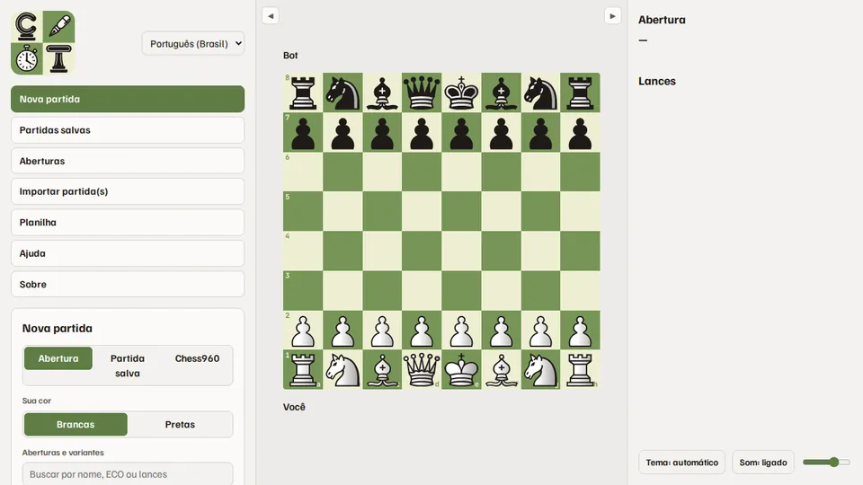
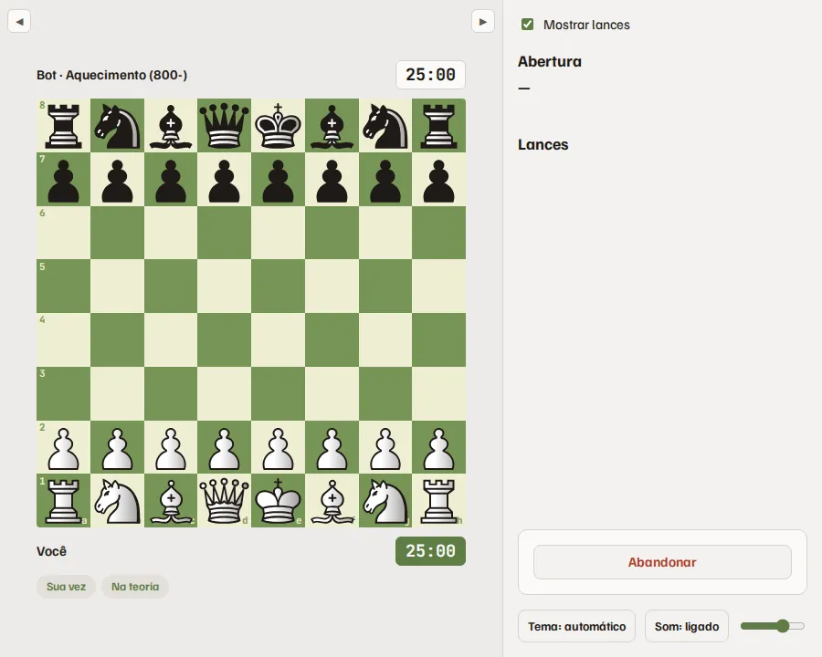
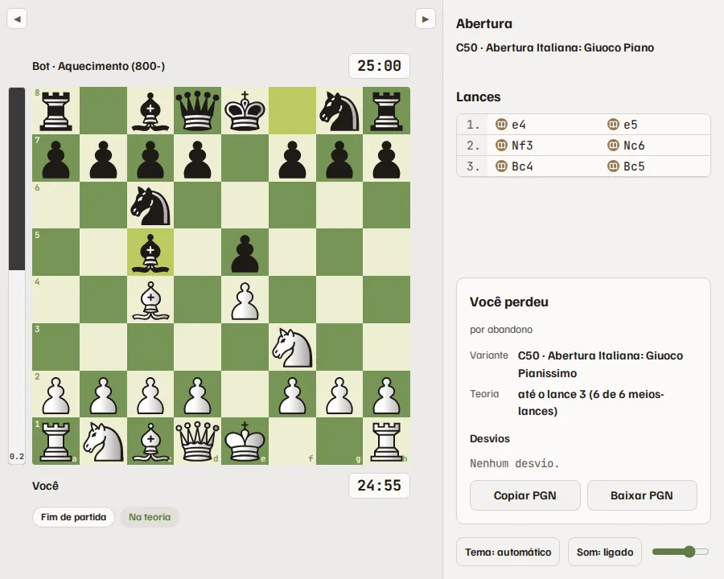
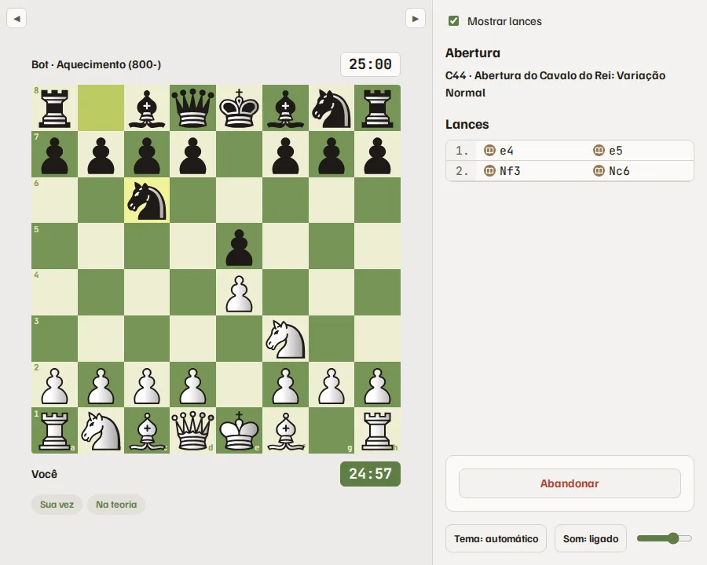
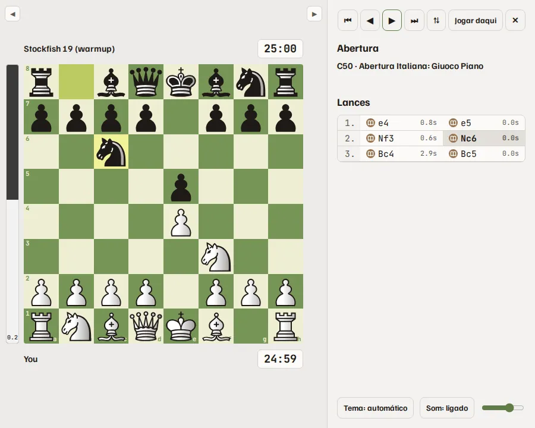

<!-- Generated by scripts/help_docs.py from the app's Help page. Do not edit. -->

# Como usar o Chess Trainer

[English](HELP.md) · [Español](HELP.es.md)

O Chess Trainer é para treinar: pratique suas aberturas contra um bot que joga as suas linhas, continue jogando contra o Stockfish quando a teoria acaba e revise suas partidas. Tudo roda e fica no seu computador.

> **Nunca use para trapacear**
>
> Não use o Chess Trainer, nem qualquer motor de xadrez, durante uma partida contra outra pessoa, online ou no tabuleiro. Isso é trapaça, e o Chess.com, o Lichess e a FIDE proíbem. Treine antes e depois das partidas, nunca durante.

> **A avaliação aqui é simples**
>
> A barra de avaliação e os ícones dos lances (melhor lance, erro, capivarada…) vêm de uma checagem rápida do Stockfish e são só uma dica. Para uma análise de verdade, exporte o PGN e analise no Chess.com, no Lichess ou em outra ferramenta de análise.

## Começar uma partida

- Abertura: escolha sua cor e marque as aberturas e variantes para treinar. Cada variante marcada tem a mesma chance de ser sorteada. Jogar um lance de uma variante que você não marcou conta como sair da teoria.
- Partida salva: treine a linha de uma partida que você jogou ou importou, com seus lances conferidos, ou continue jogando a partir de qualquer posição dela.
- Chess960: sorteie uma posição inicial ou cole o FEN de uma das 960. Para rocar, clique no rei e depois numa casa entre ele e a torre, ou na própria torre.
- Nível do bot: o rating ao lado de cada nível é nominal, na escala do próprio Stockfish, e não foi medido. Não é um rating do Chess.com nem do Lichess.
- Ritmo: os ritmos de um relógio de torneio de verdade, do bullet ao clássico, ou sem relógio. O tempo de resposta do bot é Humano, que gasta o relógio como uma pessoa, ou Instantâneo.
- Opções: avisar ao sair da teoria, permitir pré-lances e deixar o bot desviar da linha de propósito, a partir de um lance escolhido, para você treinar também contra surpresas.

*Nova partida: cor, linhas, nível e relógio.*

## Durante a partida

- Clique ou arraste as peças. O bot joga os lances de livro da linha sorteada e, quando a teoria acaba, ou alguém sai dela, o Stockfish assume no nível escolhido.
- As etiquetas embaixo do tabuleiro mostram de quem é a vez, se você ainda está na teoria e onde você ou o bot saíram dela.
- Mostrar lances, na barra da direita, esconde o nome da abertura e a lista de lances até o fim da partida: jogue sem dicas ou anote os lances no papel.
- Com pré-lances ligados, você pode deixar um lance na fila enquanto o bot pensa. Com pré-lances desligados, Voltar lance desfaz seu último lance enquanto a resposta do bot ainda não apareceu.
- Abandonar pede um segundo clique, para um clique sem querer não encerrar a partida.

*Clique ou arraste uma peça; o bot responde pelo livro.*

## Depois da partida

- O quadro embaixo da lista de lances mostra o resultado, a variante, até onde foi a teoria e cada desvio com o lance esperado.
- Copie ou baixe o PGN. Nova partida começa a próxima com as mesmas escolhas.

*No fim: resultado, variante, teoria e desvios.*

## Como treinar

### Perder faz parte

Perder faz parte do aprendizado. O importante é estudar cada partida e aprender com os próprios erros. Para evoluir de verdade, aumente o nível do bot aos poucos e só suba de novo quando se sentir confortável com os lances que ele propõe.

### Cada ritmo tem uma função

Nas partidas longas, pense com calma em cada lance e desenvolva o hábito de calcular duas, três ou mais jogadas à frente. Use as rápidas, as blitz e as bullet para treinar os padrões que você já internalizou.

### Comece pelos lances do adversário

Antes de cada lance, olhe primeiro o que o adversário ameaça: xeques, capturas e ataques. Depois procure o seu plano.

### Treine como no torneio

O ideal para aprender é jogar com tabuleiro e relógio físicos. Não tem problema se o relógio ficar dessincronizado do app.

Antes da partida, abra Planilha no menu e imprima, ou salve em PDF, e preencha o cabeçalho. Escolha um ritmo longo, como rápido ou clássico, e desmarque Mostrar lances.

No seu lance:

1. Mova a peça no tabuleiro.
1. Aperte o relógio com a mesma mão que moveu a peça.
1. Jogue o mesmo lance no app.
1. Anote o lance na planilha.

No lance do bot:

1. Reproduza o lance no tabuleiro.
1. Aperte o relógio do lado dele.
1. Anote o lance na planilha.

Só então comece a pensar no seu.

Lembre-se: peça tocada é peça jogada. Para uma experiência ainda melhor, grave-se jogando e assista depois para entender como você se comporta diante do tabuleiro. Faça tudo com calma: com o tempo, isso fica natural.

No fim, preencha o resultado e as assinaturas, compare sua planilha com a lista de lances e o PGN, e procure os lances que você anotou errado.

*Mostrar lances desmarcado: a lista some e você anota na planilha.*

### Analise antes de ver a avaliação

Ao terminar uma partida, revise-a sozinho primeiro e procure onde ela virou. Só depois confira com a avaliação. A barra aparece na posição final, então ignore-a até terminar.

## Partidas salvas e revisão

- Toda partida é salva. Busque e filtre a lista, abra uma partida no tabuleiro e percorra com os botões ou com as setas do teclado, Home e End.
- Jogar daqui começa uma nova partida a partir da posição do tabuleiro.
- Marque partidas para exportá-las em PGN ou para apagá-las.

*Revisando uma partida salva, com a barra de avaliação.*

## Aberturas

- Percorra no tabuleiro cada linha do livro e marque linhas para exportá-las em PGN.

## Importar partidas

- Traga suas partidas do Chess.com ou do Lichess pelo usuário e período, ou cole ou envie um PGN. Elas vão para Partidas salvas, prontas para revisar ou treinar.

## Analise em outro lugar

- Pegue o PGN no quadro de fim de partida ou em Partidas salvas.
- No Chess.com ou no Lichess, abra o tabuleiro de análise e cole ou importe o PGN, para uma análise completa e mais forte.
