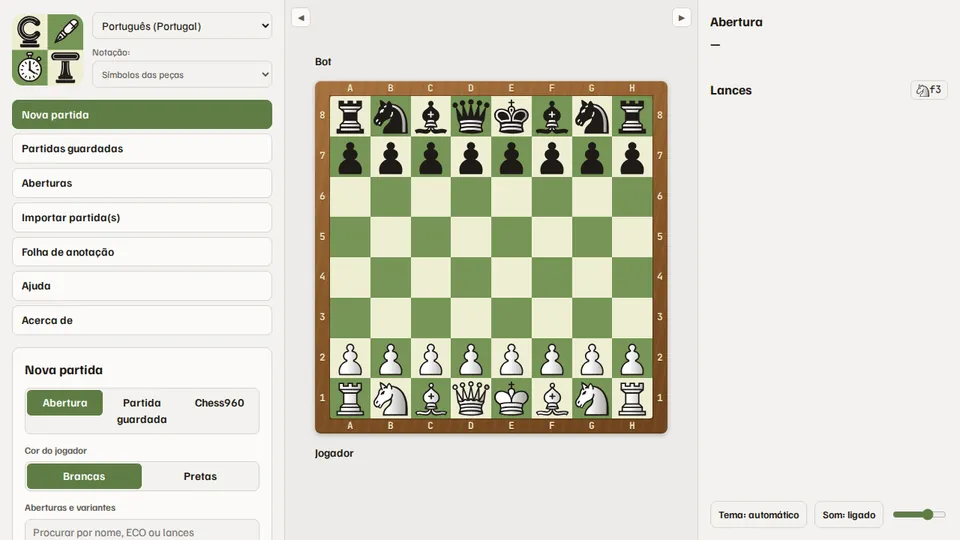
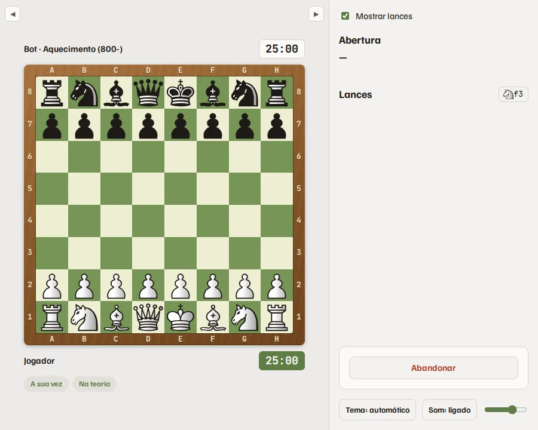
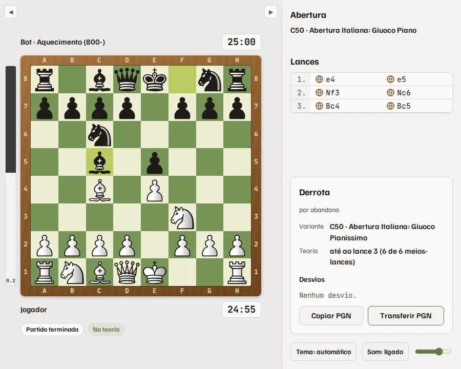
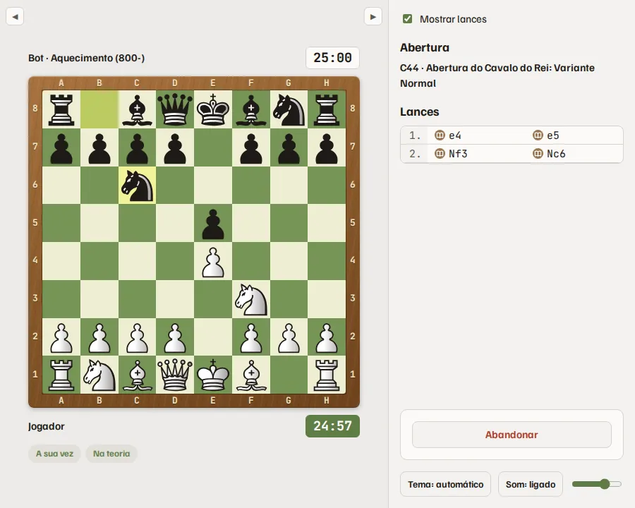
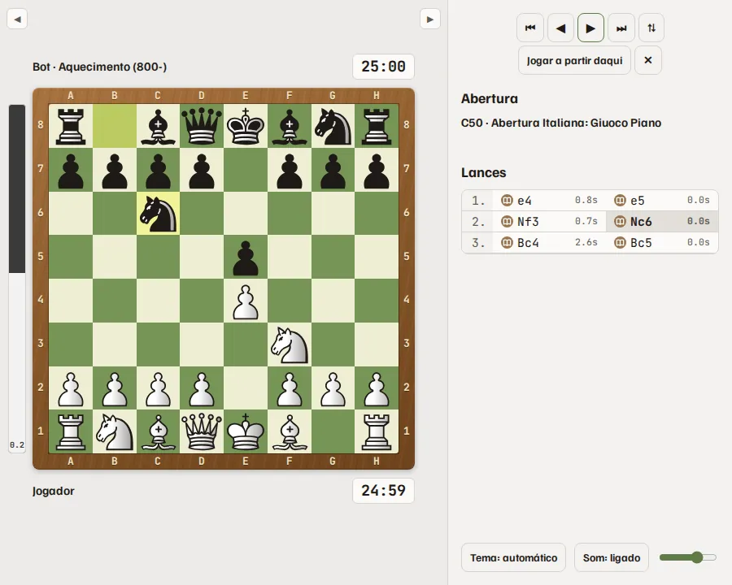

<!-- Generated by scripts/help_docs.py from the app's Help page. Do not edit. -->

# Como usar o Chess Trainer

[English (US)](HELP.md) · [English (UK)](HELP.en-GB.md) · [Português (Brasil)](HELP.pt-BR.md) · [Español (Latinoamérica)](HELP.es-419.md) · [Español (España)](HELP.es-ES.md) · [Deutsch](HELP.de.md) · [Français](HELP.fr.md) · [Italiano](HELP.it.md) · [Türkçe](HELP.tr.md) · [Polski](HELP.pl.md) · [Nederlands](HELP.nl.md) · [Bahasa Indonesia](HELP.id.md) · [Tiếng Việt](HELP.vi.md) · [Svenska](HELP.sv.md) · [Dansk](HELP.da.md) · [Norsk bokmål](HELP.nb.md) · [Suomi](HELP.fi.md) · [Русский](HELP.ru.md) · [Українська](HELP.uk.md)

O Chess Trainer serve para treinar: praticar aberturas contra um bot que joga as linhas escolhidas, continuar contra o Stockfish quando a teoria acaba e rever as próprias partidas. Tudo funciona e fica guardado no próprio computador.

> **Nunca o use para fazer batota**
>
> Não use o Chess Trainer, nem nenhum outro motor de xadrez, durante uma partida contra outra pessoa, online ou ao tabuleiro. Isso é batota, e o Chess.com, o Lichess e a FIDE proíbem-no. Treine antes e depois das partidas, nunca durante.

> **A avaliação aqui é simples**
>
> A barra de avaliação e os ícones dos lances (melhor lance, erro, erro grave…) resultam de uma verificação rápida do Stockfish e são apenas uma pista. Para uma análise a sério, exporte o PGN e analise-o no Chess.com, no Lichess ou noutra ferramenta de análise.

## Começar uma partida

- Abertura: escolha a cor e marque as aberturas e variantes a treinar. Cada variante marcada tem a mesma probabilidade de sair. Jogar um lance de uma variante não marcada conta como sair da teoria.
- Partida guardada: treine a linha de uma partida já disputada ou importada, com os lances verificados, ou continue a jogar a partir de qualquer uma das suas posições.
- Chess960: sorteie uma posição inicial ou cole o FEN de uma das 960. Para fazer o roque, clique no rei e depois numa casa entre ele e a torre, ou na própria torre.
- Nível do bot: o rating ao lado de cada nível é nominal, na escala do próprio Stockfish, e não foi medido. Não é um rating do Chess.com nem do Lichess.
- Ritmo: os ritmos de um relógio de torneio a sério, do bullet às clássicas, ou sem relógio. O tempo de resposta do bot é Humano, que gasta o relógio como uma pessoa, ou Instantâneo.
- Opções: avisar ao sair da teoria, permitir pré-lances e deixar o bot desviar-se da sua linha de propósito, a partir de um lance escolhido, para treinar também contra surpresas.

*Nova partida: cor, linhas, nível e relógio.*

## Durante a partida

- Clique nas peças ou arraste-as. O bot joga os lances de livro da linha sorteada e, quando a teoria acaba ou alguém sai dela, o Stockfish assume no nível escolhido.
- As etiquetas por baixo do tabuleiro indicam de quem é a vez, se a partida ainda está na teoria e onde o jogador ou o bot saíram dela.
- Mostrar lances, no painel direito, oculta o nome da abertura e a lista de lances até ao fim da partida: jogue sem pistas ou anote os lances em papel.
- Notação, por baixo do idioma, mostra os lances com símbolos das peças, com letras em inglês (Nf3, as letras dos ficheiros PGN e das plataformas de xadrez) ou com letras em português (Cf3). O botão ao lado de Lances muda a notação, mesmo a meio da partida, e ao passar o rato sobre um lance, ou ao chegar a ele com Tab, o lance aparece nas outras duas. O PGN usa sempre letras em inglês.
- Com os pré-lances ligados, é possível deixar um lance preparado enquanto o bot pensa. Com eles desligados, Anular lance desfaz o último lance enquanto a resposta do bot ainda não apareceu.
- Abandonar pede um segundo clique, para que um clique sem querer não termine a partida.

*Clique numa peça ou arraste-a; o bot responde com o livro.*

## Depois da partida

- O quadro por baixo da lista de lances mostra o resultado, a variante, até onde foi a teoria e cada desvio com o lance esperado.
- Copie ou transfira o PGN. Nova partida começa a seguinte com as mesmas opções.

*No fim: resultado, variante, teoria e desvios.*

## Como treinar

### Perder faz parte

Perder faz parte da aprendizagem. O importante é estudar cada partida e aprender com os próprios erros. Para evoluir a sério, suba o nível do bot aos poucos e só volte a subi-lo quando os lances que ele propõe já não forem um problema.

### Cada ritmo tem a sua função

Nas partidas longas, pense com calma em cada lance e ganhe o hábito de calcular dois, três ou mais lances à frente. Use as partidas rápidas, de blitz e de bullet para treinar os padrões já interiorizados.

### Comece pelos lances do adversário

Antes de cada lance, veja primeiro o que o adversário ameaça: xeques, capturas e ataques. Depois procure o seu próprio plano.

### Treine como num torneio

O ideal para aprender é jogar com tabuleiro e relógio físicos. Não há problema se o relógio ficar dessincronizado da aplicação.

Por que razão treinar com tabuleiro, relógio e folha de anotação? Porque obriga a memorizar, a não jogar sem pensar e a calcular, e treina a visualização, talvez até ao ponto de jogar de cabeça, sem precisar de ver um tabuleiro físico ou virtual.

Antes da partida, abra Folha de anotação no menu e imprima-a, ou guarde-a em PDF, e preencha o cabeçalho. Escolha um ritmo longo, como rápidas ou clássicas, e desmarque Mostrar lances.

No lance do jogador:

1. Mova a peça no tabuleiro.
1. Carregue no relógio com a mesma mão que moveu a peça.
1. Jogue o mesmo lance na aplicação.
1. Anote o lance na folha.

No lance do bot:

1. Reproduza o lance no tabuleiro.
1. Carregue no relógio do lado dele.
1. Anote o lance na folha.

Só então comece a pensar no lance seguinte.

Lembre-se: peça tocada, peça jogada. Para uma experiência ainda melhor, grave-se a jogar e veja a gravação depois, para perceber o seu comportamento diante do tabuleiro. Faça tudo com calma: com o tempo, torna-se natural.

No fim, preencha o resultado e as assinaturas, compare a folha com a lista de lances e o PGN, e procure os lances anotados de forma errada.

*Com a opção Mostrar lances desmarcada, a lista desaparece e os lances são anotados na folha.*

### Analise antes de ver a avaliação

No fim de uma partida, reveja-a primeiro sem ajuda e procure onde ela mudou. Só depois a compare com a avaliação. A barra aparece na posição final, por isso ignore-a até terminar.

## Partidas guardadas e revisão

- Todas as partidas são guardadas. Procure e filtre a lista, abra uma partida no tabuleiro e percorra-a com os botões ou com as setas do teclado, Home e End.
- Jogar a partir daqui começa uma nova partida a partir da posição do tabuleiro.
- Marque partidas para as exportar em PGN ou para as eliminar.

*A rever uma partida guardada, com a barra de avaliação.*

## Aberturas

- Percorra no tabuleiro cada linha do livro e marque linhas para as exportar em PGN.

## Importar partidas

- Importe partidas do Chess.com ou do Lichess por utilizador e período, ou cole ou carregue um PGN. Vão para Partidas guardadas, prontas para rever ou treinar.

## Analise noutro lado

- Copie o PGN do quadro de fim de partida ou de Partidas guardadas.
- No Chess.com ou no Lichess, abra o tabuleiro de análise e cole ou importe o PGN, para uma análise completa e mais forte.
