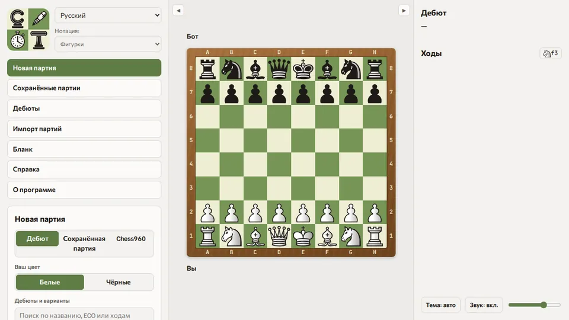
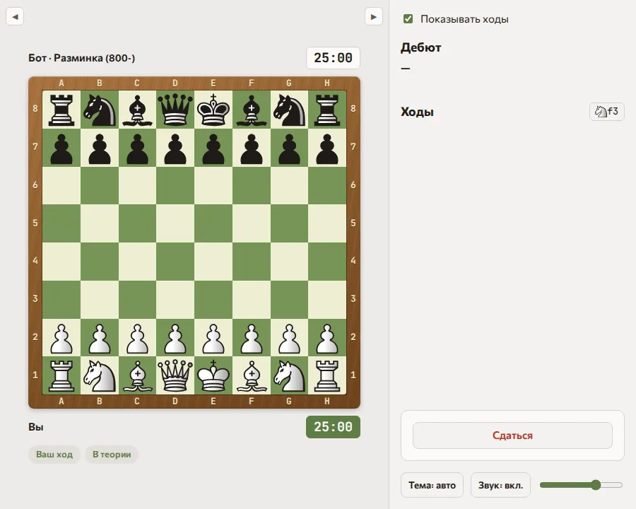
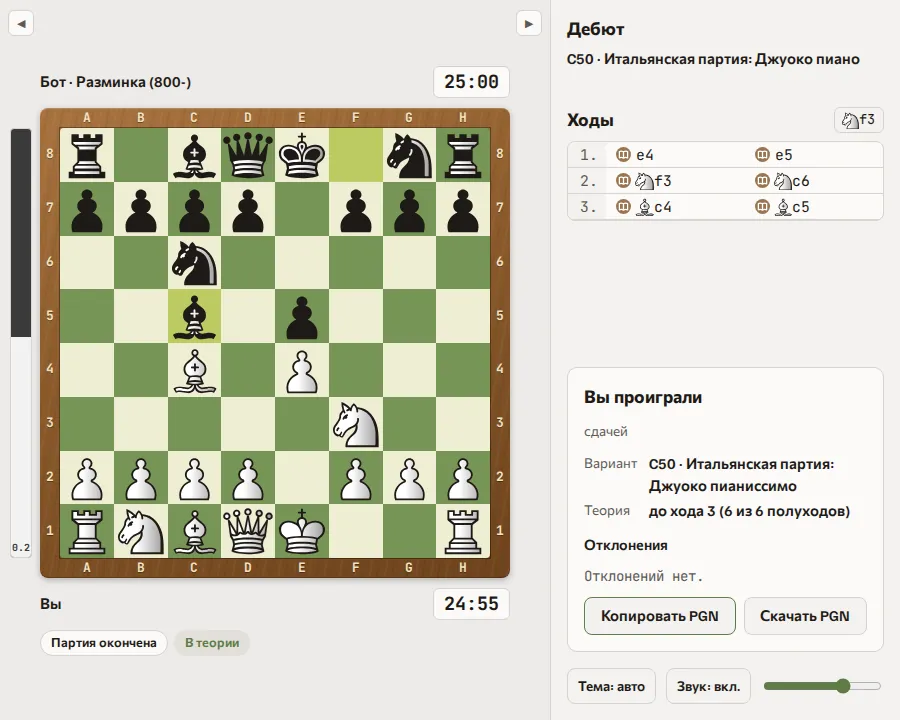
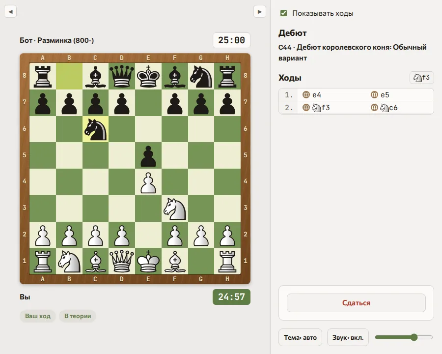
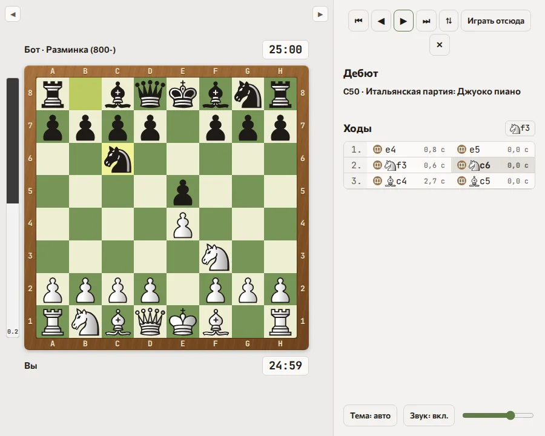

<!-- Generated by scripts/help_docs.py from the app's Help page. Do not edit. -->

# Как пользоваться Chess Trainer

[English (US)](HELP.md) · [English (UK)](HELP.en-GB.md) · [Português (Brasil)](HELP.pt-BR.md) · [Español (Latinoamérica)](HELP.es-419.md) · [Español (España)](HELP.es-ES.md) · [Português (Portugal)](HELP.pt-PT.md) · [Deutsch](HELP.de.md) · [Français](HELP.fr.md) · [Italiano](HELP.it.md) · [Türkçe](HELP.tr.md) · [Polski](HELP.pl.md) · [Nederlands](HELP.nl.md) · [Bahasa Indonesia](HELP.id.md) · [Tiếng Việt](HELP.vi.md) · [Svenska](HELP.sv.md) · [Dansk](HELP.da.md) · [Norsk bokmål](HELP.nb.md) · [Suomi](HELP.fi.md) · [Українська](HELP.uk.md) · [हिन्दी](HELP.hi.md) · [中文（简体）](HELP.zh-CN.md) · [日本語](HELP.ja.md) · [한국어](HELP.ko.md) · [العربية](HELP.ar.md) · [فارسی](HELP.fa.md) · [עברית](HELP.he.md)

> Этот перевод сделан машиной и не проверен. Исправления приветствуются: [предложить исправление](https://github.com/nielsencampos/chess-trainer/issues/new?template=translation-fix.yml&language=ru)

Chess Trainer создан для практики: отрабатывайте дебюты против бота, который играет ваши варианты, продолжайте играть против Stockfish, когда теория заканчивается, и разбирайте свои партии. Всё работает и хранится на вашем компьютере.

> **Никогда не используйте его для нечестной игры**
>
> Не используйте Chess Trainer или любой другой движок во время партии против другого человека, онлайн или за доской. Это нечестная игра, и Chess.com, Lichess и ФИДЕ за неё наказывают. Тренируйтесь до и после партий, но никогда во время них.

> **Оценка здесь простая**
>
> Шкала оценки берётся из быстрой проверки Stockfish и служит лишь подсказкой. Значки ходов (лучший ход, ошибка, зевок…) — это оценка сайта, с которого взята партия, прочитанная из её PGN: приложение само их не вычисляет. Для настоящего анализа экспортируйте PGN и разберите его на Chess.com, Lichess или в другой программе анализа.

## Начало партии

- Дебют: выберите цвет и отметьте дебюты и варианты для отработки. У каждого отмеченного варианта одинаковые шансы выпасть. Ход из варианта, который вы не отметили, считается выходом из теории.
- Из сохранённых: тренируйте вариант сыгранной или импортированной партии, чтобы ваши ходы сверялись с ней, или продолжайте игру с любой её позиции.
- Chess960: выберите случайную начальную позицию или вставьте FEN одной из 960. Чтобы сделать рокировку, нажмите на короля, а затем на поле между ним и ладьёй или на саму ладью.
- Уровень бота: рейтинг рядом с каждым уровнем условный, по собственной шкале Stockfish, и не измерялся. Это не рейтинг Chess.com или Lichess.
- Контроль времени: настройки настоящих турнирных часов, от пули до классики, или игра без часов. Время ответа бота: «Как человек», когда бот расходует время, как живой игрок, или «Мгновенно».
- Настройки: предупреждение о выходе из теории, премувы и намеренные отклонения бота от своего варианта, начиная с выбранного хода, чтобы вы тренировались и против сюрпризов.

*Новая партия: цвет, варианты, уровень и часы.*

## Во время партии

- Нажимайте на фигуры или перетаскивайте их. Бот играет книжные ходы выпавшего варианта, а когда теория заканчивается или кто-то из неё выходит, игру продолжает Stockfish на выбранном уровне.
- Метки под доской показывают, чей ход, остаётесь ли вы ещё в теории и где вы или бот из неё вышли.
- «Показывать ходы» на правой панели скрывает название дебюта и список ходов до конца партии: играйте без подсказок или записывайте ходы на бумаге.
- «Нотация» под языком показывает ходы значками фигур (фигурками), английскими буквами (Nf3, как в файлах PGN и на шахматных сайтах) или русскими буквами (Кf3). Кнопка рядом с «Ходы» переключает их, и во время партии тоже, а если навести указатель на ход или перейти к нему клавишей Tab, он показывается в двух других нотациях. Файлы PGN всегда используют английские буквы.
- Если премувы включены, можно заранее задать один ход, пока бот думает. Если выключены, «Вернуть ход» отменяет ваш последний ход, пока ответ бота ещё не показан.
- «Сдаться» требует второго нажатия, чтобы случайное нажатие не завершило партию.

*Нажмите на фигуру или перетащите её; бот отвечает по книге.*

## После партии

- Карточка под списком ходов показывает результат, вариант, докуда дошла теория и каждое отклонение с ожидаемым ходом.
- Скопируйте или скачайте PGN. «Новая партия» начинает следующую с теми же настройками.

*В конце: результат, вариант, теория и отклонения.*

## Как тренироваться

### Поражения — часть процесса

Поражения — часть обучения. Важно разбирать каждую партию и учиться на своих ошибках. Чтобы по-настоящему расти, повышайте уровень бота понемногу, и снова повышайте его, только когда будете уверенно справляться с его ходами.

### У каждого контроля времени своя задача

В длинных партиях спокойно обдумывайте каждый ход и вырабатывайте привычку считать на два, три и больше ходов вперёд. Рапид, блиц и пулю используйте, чтобы закреплять уже усвоенные схемы.

### Начинайте с ходов соперника

Перед каждым ходом сначала посмотрите, чем грозит соперник: шахи, взятия и нападения. Потом ищите свой план.

### Тренируйтесь, как на турнире

Лучше всего учиться с настоящей доской и часами. Неважно, если часы немного расходятся с программой.

Зачем тренироваться с доской, часами и бланком? Они заставляют запоминать, не дают играть бездумно и развивают счёт и визуализацию, возможно, до того, что вы начнёте играть в уме, без настоящей или виртуальной доски перед глазами.

Перед партией откройте в меню «Бланк» и распечатайте его или сохраните в PDF, а затем заполните шапку. Выберите длинный контроль времени, например рапид или классику, и снимите отметку «Показывать ходы».

В свой ход:

1. Сделайте ход на доске.
1. Нажмите на часы той же рукой, которой ходили.
1. Сделайте тот же ход в программе.
1. Запишите ход в бланк.

В ход бота:

1. Сделайте его ход на доске.
1. Нажмите на часы с его стороны.
1. Запишите ход в бланк.

Только после этого начинайте думать над своим ходом.

Помните: тронул — ходи. Чтобы было ещё полезнее, снимайте свою игру на видео и потом смотрите, как вы ведёте себя за доской. Не торопитесь: с практикой это станет естественным.

В конце впишите результат и подписи, сравните свой бланк со списком ходов и PGN и найдите ходы, которые записали неправильно.

*Без отметки «Показывать ходы» список ходов скрыт, и вы записываете ходы в бланк.*

### Анализируйте до того, как смотреть оценку

Когда партия закончится, сначала разберите её сами и найдите, где она переломилась. Только потом сверяйтесь с оценкой. Шкала видна на финальной позиции, поэтому не смотрите на неё, пока не закончите.

## Сохранённые партии и разбор

- Каждая партия сохраняется. Ищите и фильтруйте список, открывайте партию на доске и проходите её кнопками или клавишами со стрелками, Home и End.
- «Играть отсюда» начинает новую партию с позиции на доске.
- Отметьте партии, чтобы экспортировать их в PGN или удалить.

*Разбор сохранённой партии со шкалой оценки.*

## Дебюты

- Проходите на доске каждый вариант книги и отмечайте варианты, чтобы экспортировать их в PGN.

## Импорт партий

- Загружайте свои партии с Chess.com или Lichess по имени пользователя и периоду или вставьте либо загрузите PGN. Они попадают в «Сохранённые партии» и готовы к разбору или тренировке.

## Анализ в других программах

- Возьмите PGN из карточки конца партии или из «Сохранённых партий».
- На Chess.com или Lichess откройте доску анализа и вставьте или импортируйте PGN, чтобы получить полный и более глубокий анализ.
