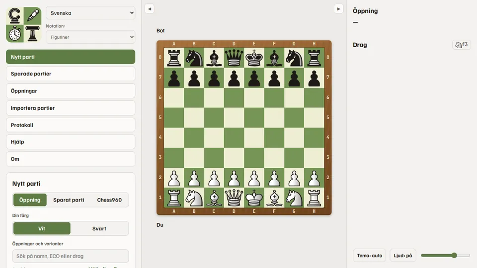
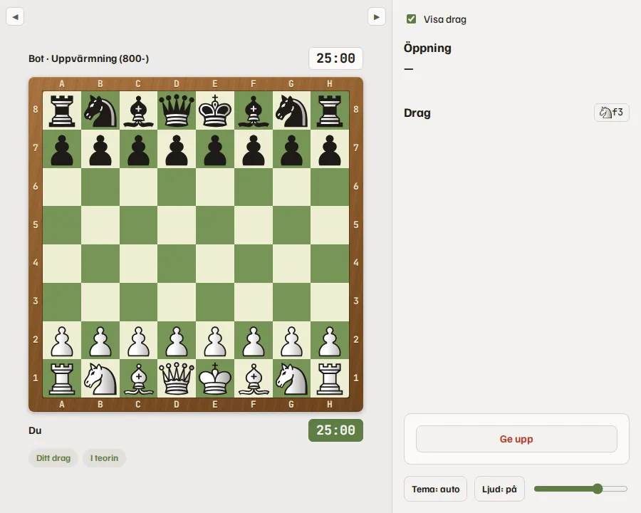
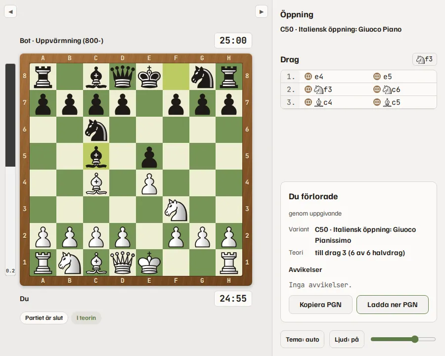
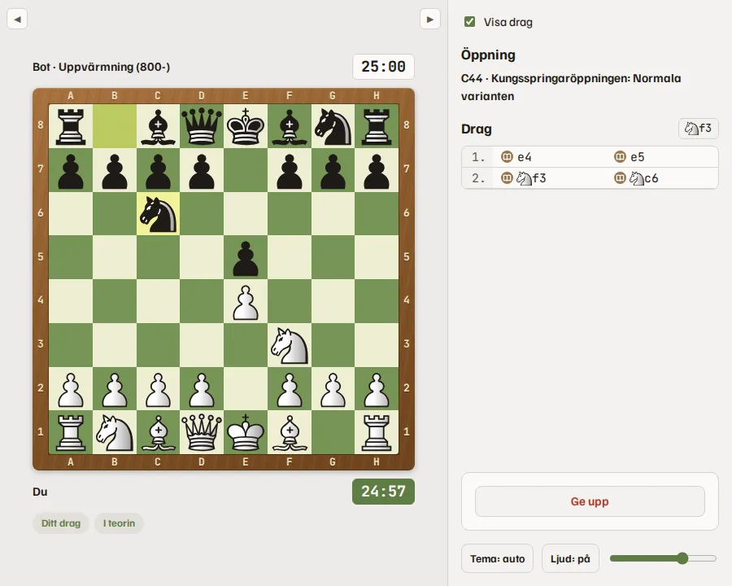
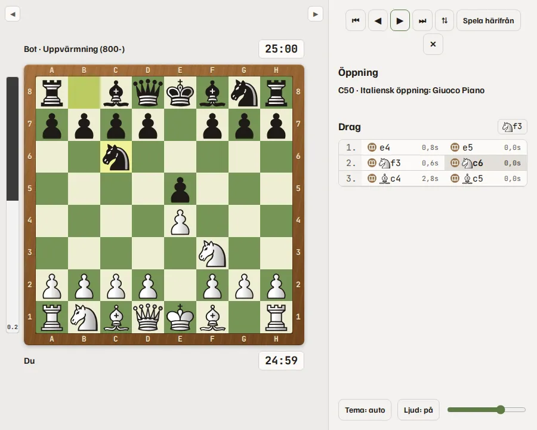

<!-- Generated by scripts/help_docs.py from the app's Help page. Do not edit. -->

# Så använder du Chess Trainer

[English (US)](HELP.md) · [English (UK)](HELP.en-GB.md) · [Português (Brasil)](HELP.pt-BR.md) · [Español (Latinoamérica)](HELP.es-419.md) · [Español (España)](HELP.es-ES.md) · [Português (Portugal)](HELP.pt-PT.md) · [Deutsch](HELP.de.md) · [Français](HELP.fr.md) · [Italiano](HELP.it.md) · [Türkçe](HELP.tr.md) · [Polski](HELP.pl.md) · [Nederlands](HELP.nl.md) · [Bahasa Indonesia](HELP.id.md) · [Tiếng Việt](HELP.vi.md) · [Dansk](HELP.da.md) · [Norsk bokmål](HELP.nb.md) · [Suomi](HELP.fi.md) · [Русский](HELP.ru.md) · [Українська](HELP.uk.md)

Chess Trainer är till för träning: nöt in dina öppningar mot en bot som spelar dina varianter, spela vidare mot Stockfish när teorin tar slut och gå igenom dina partier. Allt körs och stannar på din dator.

> **Använd det aldrig för att fuska**
>
> Använd inte Chess Trainer, eller någon schackmotor, under ett parti mot en annan person, online eller vid brädet. Det är fusk, och Chess.com, Lichess och FIDE förbjuder det. Träna före och efter dina partier, aldrig under dem.

> **Bedömningen här är enkel**
>
> Bedömningsstapeln och dragikonerna (bästa drag, misstag, grovt misstag…) kommer från en snabb kontroll med Stockfish och är bara en fingervisning. För en riktig analys exporterar du PGN och analyserar den på Chess.com, Lichess eller ett annat analysverktyg.

## Starta ett parti

- Öppning: välj färg och kryssa i de öppningar och varianter du vill nöta. Varje ikryssad variant har samma chans att lottas. Ett drag från en variant du inte kryssade i räknas som att lämna teorin.
- Sparat parti: träna varianten från ett parti du spelade eller importerade, så att dess drag kontrolleras, eller spela vidare från vilken ställning som helst i det.
- Chess960: slumpa en utgångsställning eller klistra in FEN för en av de 960. För att rockera klickar du på kungen och sedan på en ruta mellan den och tornet, eller på tornet självt.
- Botens nivå: ratingen bredvid varje nivå är nominell, på Stockfish egen skala, och har inte mätts. Det är ingen rating från Chess.com eller Lichess.
- Betänketid: förinställningarna på en riktig tävlingsklocka, från bullet till klassiskt, eller utan klocka. Botens svarstid är Mänsklig, som använder klockan som en människa, eller Direkt.
- Alternativ: varna när du lämnar teorin, tillåt förhandsdrag och låt boten avvika från sin variant med flit, från ett valt drag, så att du också tränar mot överraskningar.

*Nytt parti: färg, varianter, nivå och klocka.*

## Under partiet

- Klicka på eller dra pjäserna. Boten spelar teoridragen i den lottade varianten, och när teorin tar slut, eller någon lämnar den, tar Stockfish över på den valda nivån.
- Etiketterna under brädet visar vems drag det är, om du fortfarande är i teorin och var du eller boten lämnade den.
- Visa drag, i höger panel, döljer öppningens namn och draglistan till partiets slut: spela utan ledtrådar, eller skriv dragen på papper.
- Notation, under språket, visar dragen som pjässymboler (figuriner), med engelska bokstäver (Nf3, bokstäverna i PGN-filer och på schacksajter) eller med ditt språks bokstäver (Sf3). Knappen bredvid Drag växlar mellan dem, även mitt i partiet, och när du håller muspekaren över ett drag, eller når det med Tab, visas det i de andra två. PGN-filer använder alltid engelska bokstäver.
- Med förhandsdrag påslagna kan du ställa ett drag i kö medan boten tänker. Med förhandsdrag avslagna ångrar Ta tillbaka ditt senaste drag så länge botens svar inte har visats.
- Ge upp kräver ett andra klick, så att ett felklick inte avslutar partiet.

*Klicka på eller dra en pjäs; boten svarar ur boken.*

## Efter partiet

- Kortet under draglistan visar resultatet, varianten, hur långt teorin räckte och varje avvikelse med det väntade draget.
- Kopiera eller ladda ner PGN. Nytt parti startar nästa med samma val.

*I slutet: resultat, variant, teori och avvikelser.*

## Så tränar du

### Att förlora hör till

Att förlora hör till lärandet. Det viktiga är att studera varje parti och lära sig av sina egna misstag. För att verkligen bli bättre höjer du botens nivå lite i taget, och höjer den igen först när du känner dig bekväm med dragen den spelar.

### Varje betänketid har en uppgift

I långa partier tänker du lugnt på varje drag och bygger vanan att räkna två, tre eller fler drag framåt. Använd snabbschack, blixt och bullet för att nöta in mönster du redan har tagit till dig.

### Börja med motståndarens drag

Före varje drag tittar du först på vad motståndaren hotar: schackar, slag och angrepp. Sedan letar du efter din egen plan.

### Träna som på en tävling

Det bästa sättet att lära sig är med ett riktigt bräde och en riktig klocka. Det gör inget om klockan glider ifrån appens.

Varför träna med bräde, klocka och protokoll? För att de tvingar dig att memorera, hindrar dig från att spela utan att tänka och bygger upp din förmåga att räkna och visualisera, kanske tills du börjar spela i huvudet, utan något fysiskt eller virtuellt bräde framför dig.

Före partiet öppnar du Protokoll i menyn och skriver ut det, eller sparar det som PDF, och fyller i huvudet. Välj en lång betänketid, som snabbschack eller klassiskt, och kryssa ur Visa drag.

När det är ditt drag:

1. Flytta pjäsen på brädet.
1. Tryck på klockan med samma hand som flyttade pjäsen.
1. Spela samma drag i appen.
1. Skriv draget i protokollet.

När det är botens drag:

1. Spela dess drag på brädet.
1. Tryck på klockan på dess sida.
1. Skriv draget i protokollet.

Först då börjar du tänka på ditt.

Kom ihåg: rörd är förd. För en ännu bättre upplevelse kan du filma dig själv när du spelar och titta på det efteråt för att se hur du beter dig vid brädet. Ta den tid du behöver: med övning blir det naturligt.

I slutet fyller du i resultatet och underskrifterna, jämför ditt protokoll med draglistan och PGN och letar efter de drag du skrev fel.

*Utan kryss i Visa drag döljs draglistan, och du skriver i protokollet.*

### Analysera innan du tittar på bedömningen

När ett parti är slut går du först igenom det på egen hand och letar efter var det vände. Först därefter jämför du med bedömningen. Stapeln visas på slutställningen, så strunta i den tills du är klar.

## Sparade partier och genomgång

- Varje parti sparas. Sök och filtrera listan, öppna ett parti på brädet och gå igenom det med knapparna eller piltangenterna, Home och End.
- Spela härifrån startar ett nytt parti från ställningen på brädet.
- Kryssa i partier för att exportera dem som PGN eller radera dem.

*Genomgång av ett sparat parti, med bedömningsstapeln.*

## Öppningar

- Gå igenom alla varianter i boken på brädet, och kryssa i varianter för att exportera dem som PGN.

## Importera partier

- Hämta dina partier från Chess.com eller Lichess med användarnamn och period, eller klistra in eller ladda upp en PGN. De hamnar i Sparade partier, redo att gås igenom eller tränas.

## Analysera någon annanstans

- Hämta PGN från kortet i slutet av partiet eller från Sparade partier.
- På Chess.com eller Lichess öppnar du analysbrädet och klistrar in eller importerar PGN, för en fullständig och djupare analys.
