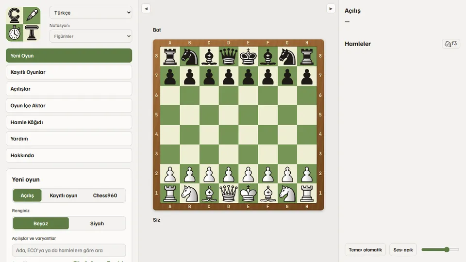
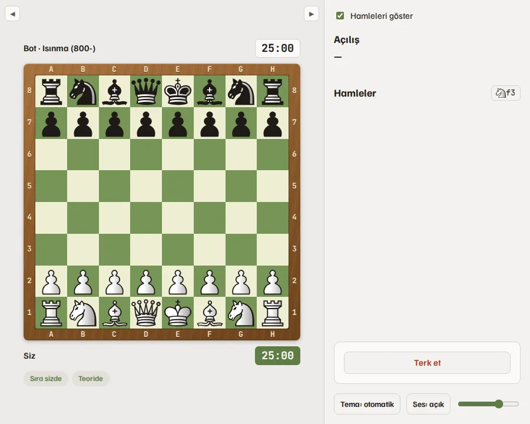
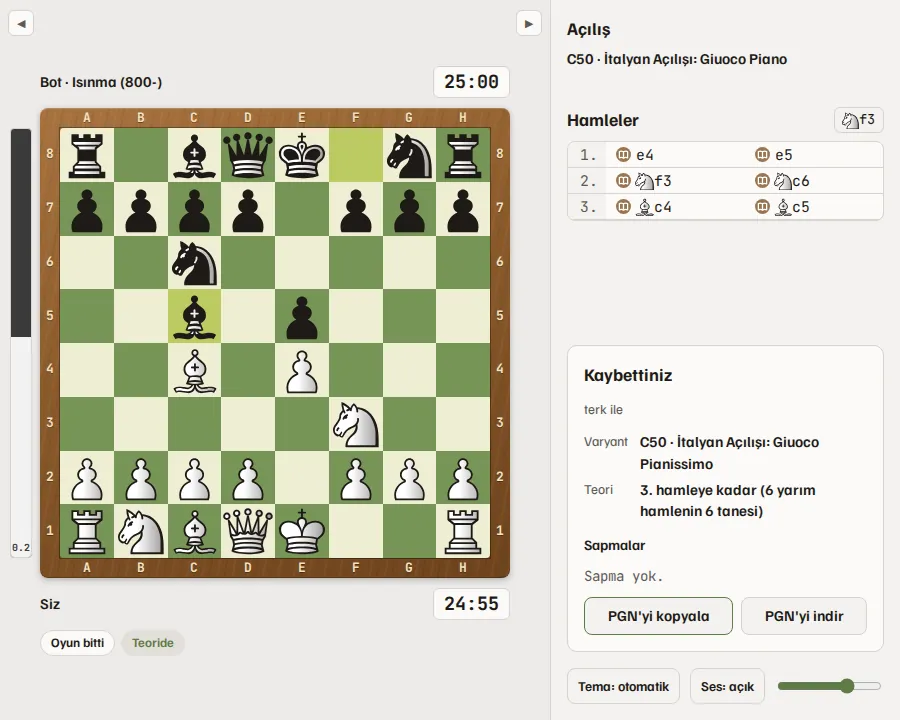
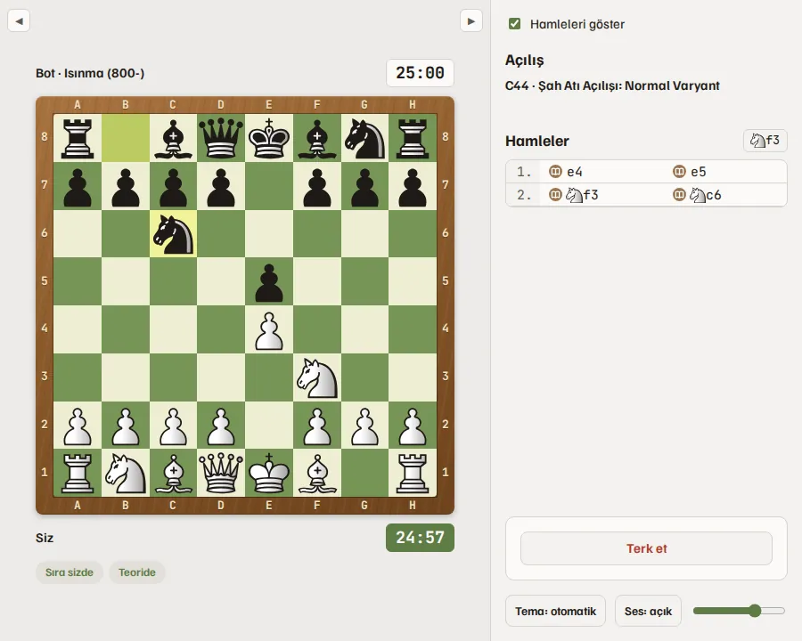
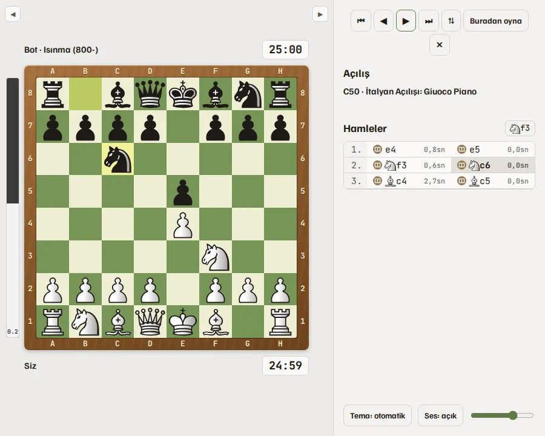

<!-- Generated by scripts/help_docs.py from the app's Help page. Do not edit. -->

# Chess Trainer nasıl kullanılır

[English (US)](HELP.md) · [English (UK)](HELP.en-GB.md) · [Português (Brasil)](HELP.pt-BR.md) · [Español (Latinoamérica)](HELP.es-419.md) · [Español (España)](HELP.es-ES.md) · [Português (Portugal)](HELP.pt-PT.md) · [Deutsch](HELP.de.md) · [Français](HELP.fr.md) · [Italiano](HELP.it.md) · [Polski](HELP.pl.md) · [Nederlands](HELP.nl.md) · [Bahasa Indonesia](HELP.id.md) · [Tiếng Việt](HELP.vi.md) · [Svenska](HELP.sv.md) · [Dansk](HELP.da.md) · [Norsk bokmål](HELP.nb.md) · [Suomi](HELP.fi.md) · [Русский](HELP.ru.md) · [Українська](HELP.uk.md) · [हिन्दी](HELP.hi.md) · [中文（简体）](HELP.zh-CN.md) · [日本語](HELP.ja.md) · [한국어](HELP.ko.md) · [العربية](HELP.ar.md) · [فارسی](HELP.fa.md) · [עברית](HELP.he.md)

> Bu çeviri makine tarafından yapıldı ve gözden geçirilmedi. Düzeltmeler memnuniyetle karşılanır: [düzeltme önerin](https://github.com/nielsencampos/chess-trainer/issues/new?template=translation-fix.yml&language=tr)

Chess Trainer pratik içindir: hatlarınızı oynayan bir bota karşı açılışlarınızı çalışın, teori bitince Stockfish'e karşı oynamaya devam edin ve oyunlarınızı inceleyin. Her şey bilgisayarınızda çalışır ve orada kalır.

> **Asla hile için kullanmayın**
>
> Başka bir kişiye karşı oynadığınız bir oyun sırasında, çevrim içi ya da tahta başında, Chess Trainer'ı veya herhangi bir satranç motorunu kullanmayın. Bu hiledir; Chess.com, Lichess ve FIDE bunu yasaklar. Oyunlarınızdan önce ve sonra çalışın, asla oyun sırasında değil.

> **Buradaki değerlendirme basittir**
>
> Değerlendirme çubuğu Stockfish'in hızlı bir kontrolünden gelir ve yalnızca bir ipucudur. Hamle simgeleri (en iyi hamle, hata, büyük hata…) oyunun geldiği sitenin sınıflandırmasıdır ve PGN'sinden okunur: uygulama hiçbirini hesaplamaz. Gerçek bir analiz için PGN'yi dışa aktarın ve Chess.com, Lichess ya da başka bir analiz aracında analiz edin.

## Bir oyun başlatın

- Açılış: renginizi seçin ve çalışmak istediğiniz açılışları ve varyantları işaretleyin. İşaretlenen her varyantın seçilme olasılığı aynıdır. İşaretlemediğiniz bir varyanttan hamle oynamak teoriden çıkmak sayılır.
- Kayıtlı oyun: oynadığınız ya da içe aktardığınız bir oyunun hattını çalışın, böylece hamleleriniz kontrol edilir, ya da konumlarından herhangi birinden oynamaya devam edin.
- Chess960: rastgele bir başlangıç konumu seçin ya da 960 konumdan birinin FEN'ini yapıştırın. Rok için şaha, ardından şahla kale arasındaki bir kareye ya da kalenin kendisine tıklayın.
- Bot seviyesi: her seviyenin yanındaki Elo puanı nominaldir, Stockfish'in kendi ölçeğindedir ve ölçülmemiştir. Chess.com ya da Lichess puanı değildir.
- Zaman kontrolü: bullet'tan klasiğe gerçek bir turnuva saatinin hazır ayarları ya da saatsiz. Botun yanıt süresi, süresini bir insan gibi kullanan İnsan gibi ya da Anında'dır.
- Seçenekler: teoriden çıktığınızda uyarı, ön hamlelere izin ve botun seçilen bir hamleden itibaren bilerek hattından sapması; böylece sürprizlere karşı da çalışırsınız.

*Yeni Oyun: renk, hatlar, seviye ve saat.*

## Oyun sırasında

- Taşlara tıklayın ya da onları sürükleyin. Bot seçilen hattın teori hamlelerini oynar; teori bittiğinde ya da biri teoriden çıktığında Stockfish seçilen seviyede devralır.
- Tahtanın altındaki etiketler sıranın kimde olduğunu, hâlâ teoride olup olmadığınızı ve sizin ya da botun teoriden nerede çıktığını gösterir.
- Sağ çubuktaki Hamleleri göster, oyunun sonuna kadar açılışın adını ve hamle listesini gizler: ipucu olmadan oynayın ya da hamleleri kâğıda yazın.
- Dilin altındaki Notasyon, hamleleri taş simgeleriyle (figürinler), İngilizce harflerle (Nf3, PGN dosyalarının ve satranç sitelerinin harfleri) ya da kendi dilinizin harfleriyle gösterir. Hamleler'in yanındaki düğme, oyun sırasında da, bunlar arasında geçiş yapar; bir hamlenin üzerine gelmek ya da Tab ile ona ulaşmak onu diğer ikisinde gösterir. PGN dosyaları her zaman İngilizce harfleri kullanır.
- Ön hamleler açıkken bot düşünürken bir hamleyi sıraya koyabilirsiniz. Ön hamleler kapalıyken, botun yanıtı henüz görünmüyorsa Hamleyi geri al son hamlenizi geri alır.
- Terk et ikinci bir tıklama ister; böylece yanlışlıkla yapılan bir tıklama oyunu bitirmez.

*Bir taşa tıklayın ya da sürükleyin; bot kitaptan yanıt verir.*

## Oyundan sonra

- Hamle listesinin altındaki kart sonucu, varyantı, teorinin ne kadar sürdüğünü ve beklenen hamleyle birlikte her sapmayı gösterir.
- PGN'yi kopyalayın ya da indirin. Yeni Oyun, sonrakini aynı seçimlerle başlatır.

*Sonunda: sonuç, varyant, teori ve sapmalar.*

## Nasıl çalışılır

### Kaybetmek işin parçası

Kaybetmek öğrenmenin bir parçasıdır. Önemli olan her oyunu incelemek ve kendi hatalarınızdan öğrenmektir. Gerçekten gelişmek için botun seviyesini azar azar yükseltin ve yalnızca oynadığı hamlelerle rahat hissettiğinizde yeniden yükseltin.

### Her zaman kontrolünün bir görevi var

Uzun oyunlarda her hamleyi sakince düşünün ve iki, üç ya da daha fazla hamle ileriyi hesaplama alışkanlığı edinin. Rapid, blitz ve bullet'ı zaten öğrendiğiniz kalıpları pekiştirmek için kullanın.

### Rakibinizin hamleleriyle başlayın

Her hamleden önce rakibinizin neyi tehdit ettiğine bakın: şahlar, almalar ve saldırılar. Sonra kendi planınızı arayın.

### Turnuvadaki gibi çalışın

Öğrenmenin en iyi yolu gerçek bir tahta ve saatle çalışmaktır. Saatin uygulamanınkinden biraz farklı gitmesi önemli değildir.

Neden tahta, saat ve hamle kâğıdıyla çalışmalı? Çünkü ezberlemenizi sağlar, düşünmeden oynamanızı engeller ve hesaplama ile görselleştirme yeteneğinizi geliştirir; belki önünüzde gerçek ya da sanal bir tahta olmadan, kafanızda oynamaya başlayana kadar.

Oyundan önce menüden Hamle Kâğıdı'nı açın, yazdırın ya da PDF olarak kaydedin ve başlığı doldurun. Rapid ya da klasik gibi uzun bir zaman kontrolü seçin ve Hamleleri göster işaretini kaldırın.

Sizin hamlenizde:

1. Taşı tahtada oynayın.
1. Saate taşı oynadığınız elle basın.
1. Aynı hamleyi uygulamada oynayın.
1. Hamleyi hamle kâğıdına yazın.

Botun hamlesinde:

1. Onun hamlesini tahtada oynayın.
1. Saate onun tarafında basın.
1. Hamleyi hamle kâğıdına yazın.

Ancak bundan sonra kendi hamlenizi düşünmeye başlayın.

Unutmayın: dokunulan taş oynanır. Daha da iyi bir deneyim için oynarken kendinizi kaydedin ve tahta başında nasıl davrandığınızı görmek için sonra izleyin. Acele etmeyin: pratikle doğal hâle gelir.

Sonunda sonucu ve imzaları doldurun, kâğıdınızı hamle listesi ve PGN ile karşılaştırın ve yanlış yazdığınız hamleleri arayın.

*Hamleleri göster işaretsizken hamle listesi gizlenir ve siz hamle kâğıdına yazarsınız.*

### Değerlendirmeye bakmadan önce analiz edin

Bir oyun bittiğinde önce kendi başınıza inceleyin ve nerede döndüğünü arayın. Ancak sonra değerlendirmeyle karşılaştırın. Çubuk son konumda görünür; işiniz bitene kadar ona aldırmayın.

## Kayıtlı oyunlar ve inceleme

- Her oyun kaydedilir. Listede arayın ve filtreleyin, bir oyunu tahtada açın ve düğmelerle ya da ok tuşları, Home ve End ile gezinin.
- Buradan oyna, tahtadaki konumdan yeni bir oyun başlatır.
- PGN olarak dışa aktarmak ya da silmek için oyunları işaretleyin.

*Değerlendirme çubuğuyla kayıtlı bir oyunu incelemek.*

## Açılışlar

- Kitaptaki her hattı tahtada inceleyin ve PGN olarak dışa aktarmak için hatları işaretleyin.

## Oyun içe aktar

- Oyunlarınızı Chess.com ya da Lichess'ten kullanıcı adı ve döneme göre getirin ya da bir PGN yapıştırın veya yükleyin. Kayıtlı Oyunlar'a giderler; incelemeye ya da çalışmaya hazırdırlar.

## Başka yerde analiz edin

- PGN'yi oyun sonu kartından ya da Kayıtlı Oyunlar'dan alın.
- Chess.com ya da Lichess'te analiz tahtasını açın ve tam, daha derin bir analiz için PGN'yi yapıştırın ya da içe aktarın.
