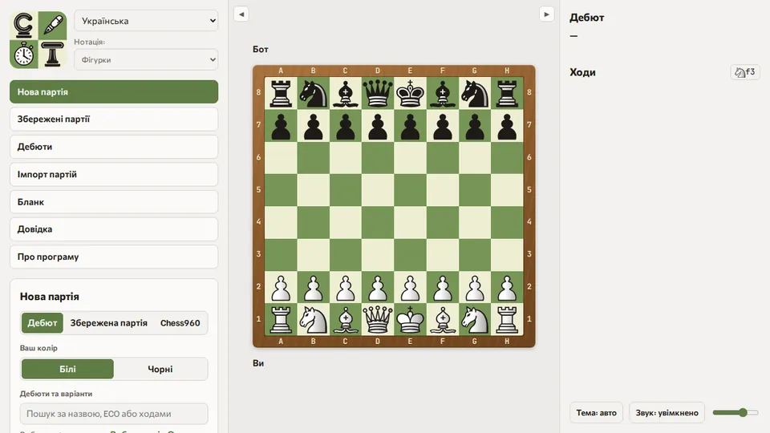
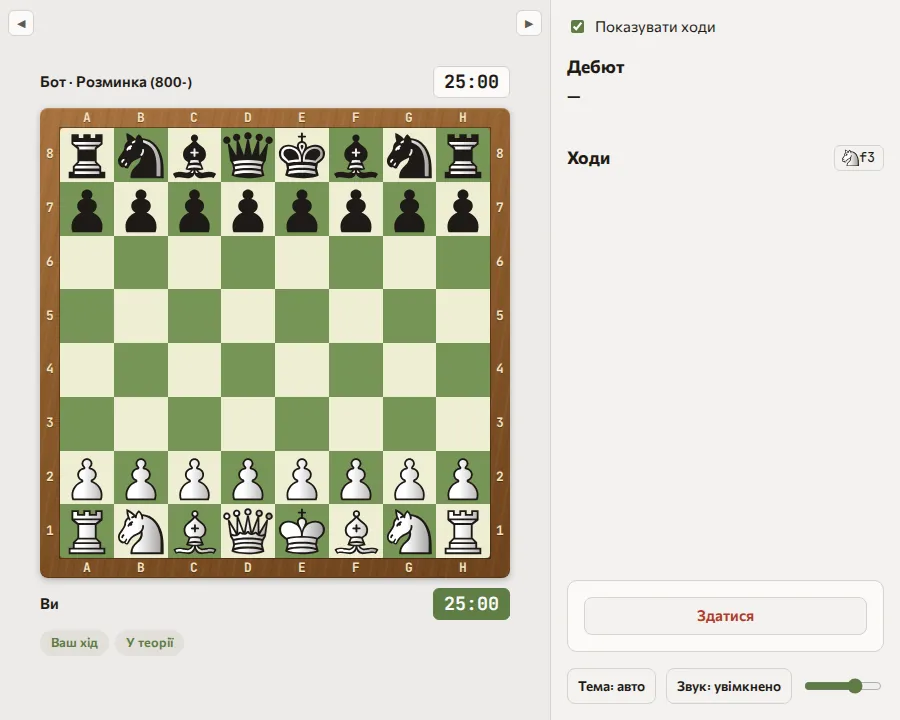
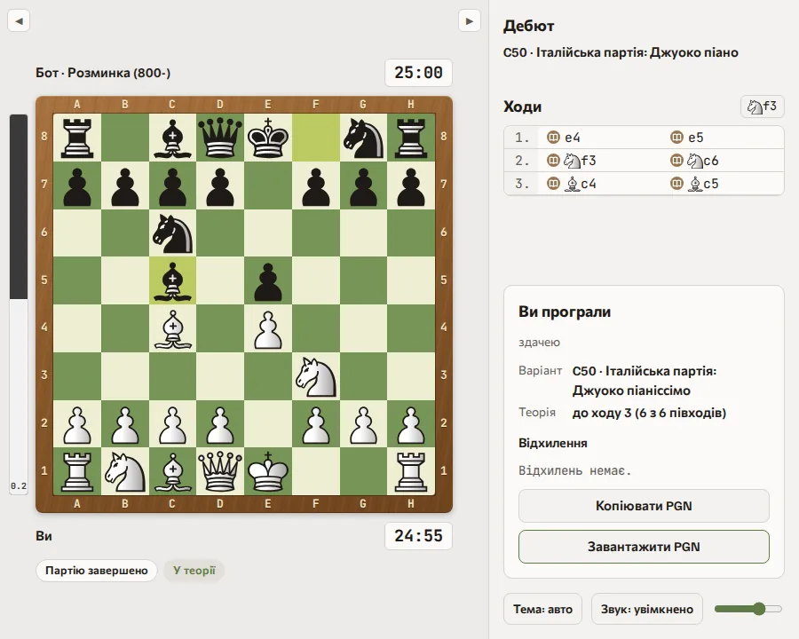
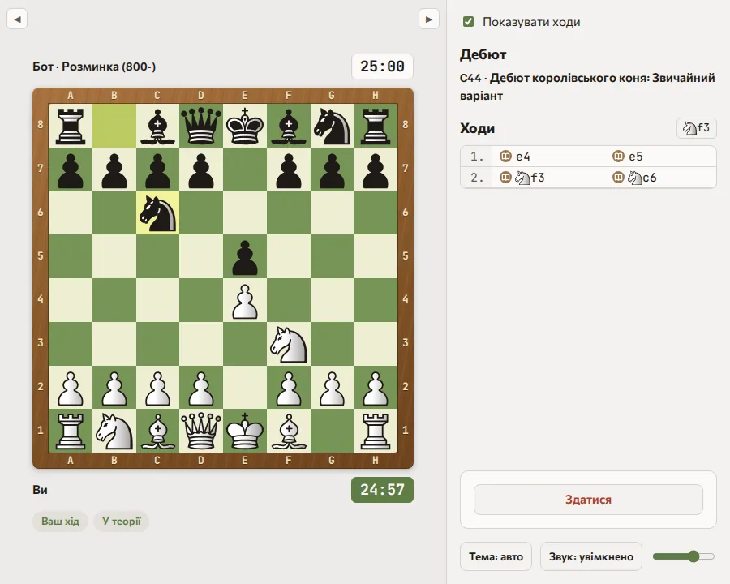
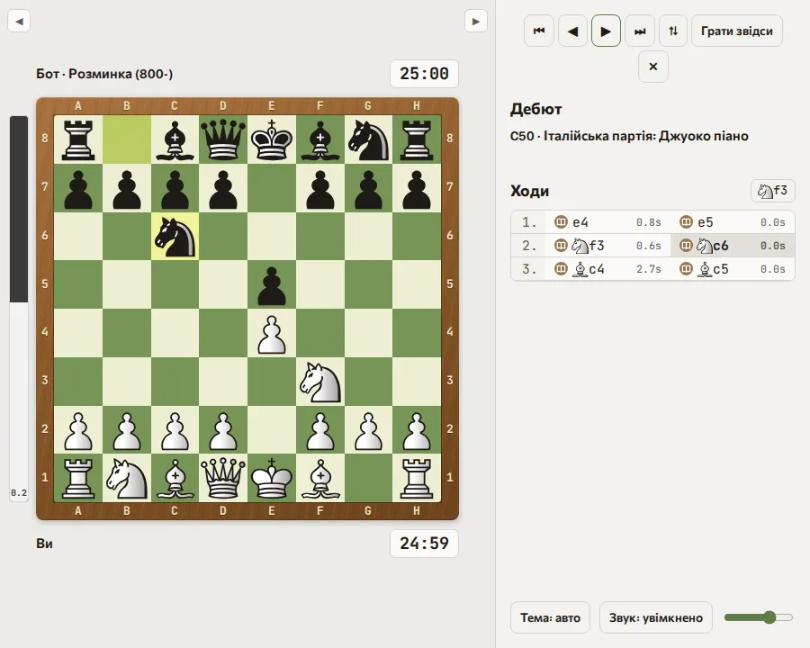

<!-- Generated by scripts/help_docs.py from the app's Help page. Do not edit. -->

# Як користуватися Chess Trainer

[English (US)](HELP.md) · [English (UK)](HELP.en-GB.md) · [Português (Brasil)](HELP.pt-BR.md) · [Español (Latinoamérica)](HELP.es-419.md) · [Español (España)](HELP.es-ES.md) · [Português (Portugal)](HELP.pt-PT.md) · [Deutsch](HELP.de.md) · [Français](HELP.fr.md) · [Italiano](HELP.it.md) · [Türkçe](HELP.tr.md) · [Polski](HELP.pl.md) · [Nederlands](HELP.nl.md) · [Bahasa Indonesia](HELP.id.md) · [Tiếng Việt](HELP.vi.md) · [Svenska](HELP.sv.md) · [Dansk](HELP.da.md) · [Norsk bokmål](HELP.nb.md) · [Suomi](HELP.fi.md) · [Русский](HELP.ru.md) · [हिन्दी](HELP.hi.md) · [中文（简体）](HELP.zh-CN.md) · [日本語](HELP.ja.md) · [한국어](HELP.ko.md) · [العربية](HELP.ar.md) · [فارسی](HELP.fa.md) · [עברית](HELP.he.md)

> Цей переклад зроблено машиною, і його не перевірено. Виправлення вітаються: [запропонувати виправлення](https://github.com/nielsencampos/chess-trainer/issues/new?template=translation-fix.yml&language=uk)

Chess Trainer створено для практики: відпрацьовуйте дебюти проти бота, який грає ваші варіанти, продовжуйте грати проти Stockfish, коли теорія закінчується, і розбирайте свої партії. Усе працює і зберігається на вашому комп'ютері.

> **Ніколи не використовуйте його для нечесної гри**
>
> Не використовуйте Chess Trainer чи будь-який інший рушій під час партії проти іншої людини, онлайн або за шахівницею. Це нечесна гра, і Chess.com, Lichess та ФІДЕ за неї карають. Тренуйтеся до і після партій, але ніколи під час них.

> **Оцінка тут проста**
>
> Шкала оцінки та значки ходів (найкращий хід, помилка, груба помилка…) беруться зі швидкої перевірки Stockfish і є лише підказкою. Для справжнього аналізу експортуйте PGN і розберіть його на Chess.com, Lichess або в іншій програмі аналізу.

## Початок партії

- Дебют: виберіть колір і позначте дебюти та варіанти для відпрацювання. Кожен позначений варіант має однакові шанси випасти. Хід із варіанта, який ви не позначили, вважається виходом з теорії.
- Збережена партія: тренуйте варіант зіграної або імпортованої партії, щоб ваші ходи звірялися з нею, або продовжуйте гру з будь-якої її позиції.
- Chess960: виберіть випадкову початкову позицію або вставте FEN однієї з 960. Щоб зробити рокірування, натисніть на короля, а потім на поле між ним і турою або на саму туру.
- Рівень бота: рейтинг поруч із кожним рівнем умовний, за власною шкалою Stockfish, і не вимірювався. Це не рейтинг Chess.com чи Lichess.
- Контроль часу: налаштування справжнього турнірного годинника, від кулі до класики, або гра без годинника. Час відповіді бота: «Як людина», коли бот витрачає час, як живий гравець, або «Миттєво».
- Налаштування: попередження про вихід з теорії, премуви та навмисні відхилення бота від свого варіанта, починаючи з вибраного ходу, щоб ви тренувалися і проти несподіванок.

*Нова партія: колір, варіанти, рівень і годинник.*

## Під час партії

- Натискайте на фігури або перетягуйте їх. Бот грає книжкові ходи варіанта, що випав, а коли теорія закінчується або хтось із неї виходить, гру продовжує Stockfish на вибраному рівні.
- Позначки під шахівницею показують, чий хід, чи ви ще в теорії й де ви або бот з неї вийшли.
- «Показувати ходи» на правій панелі ховає назву дебюту і список ходів до кінця партії: грайте без підказок або записуйте ходи на папері.
- «Нотація» під мовою показує ходи значками фігур (фігурками), англійськими літерами (Nf3, як у файлах PGN і на шахових сайтах) або українськими літерами (Кf3). Кнопка поруч із «Ходи» перемикає їх, і під час партії теж, а якщо навести вказівник на хід або перейти до нього клавішею Tab, він показується у двох інших нотаціях. Файли PGN завжди використовують англійські літери.
- Якщо премуви увімкнено, можна заздалегідь задати один хід, поки бот думає. Якщо вимкнено, «Повернути хід» скасовує ваш останній хід, поки відповідь бота ще не показано.
- «Здатися» потребує другого натискання, щоб випадкове натискання не завершило партію.

*Натисніть на фігуру або перетягніть її; бот відповідає за книгою.*

## Після партії

- Картка під списком ходів показує результат, варіант, як далеко дійшла теорія і кожне відхилення з очікуваним ходом.
- Скопіюйте або завантажте PGN. «Нова партія» починає наступну з тими самими налаштуваннями.

*Наприкінці: результат, варіант, теорія і відхилення.*

## Як тренуватися

### Поразки — частина процесу

Поразки — частина навчання. Важливо розбирати кожну партію і вчитися на власних помилках. Щоб по-справжньому зростати, підвищуйте рівень бота потроху і знову підвищуйте його, лише коли впевнено даватимете раду його ходам.

### Кожен контроль часу має своє завдання

У довгих партіях спокійно обмірковуйте кожен хід і виробляйте звичку рахувати на два, три й більше ходів уперед. Рапід, бліц і кулю використовуйте, щоб закріплювати вже засвоєні схеми.

### Починайте з ходів суперника

Перед кожним ходом спочатку подивіться, чим загрожує суперник: шахи, взяття і напади. Потім шукайте свій план.

### Тренуйтеся, як на турнірі

Найкраще вчитися зі справжньою шахівницею і годинником. Неважливо, якщо годинник трохи розходиться з програмою.

Навіщо тренуватися із шахівницею, годинником і бланком? Вони змушують запам'ятовувати, не дають грати бездумно й розвивають розрахунок і візуалізацію, можливо, аж до того, що ви почнете грати подумки, без справжньої чи віртуальної шахівниці перед очима.

Перед партією відкрийте в меню «Бланк» і надрукуйте його або збережіть у PDF, а потім заповніть шапку. Виберіть довгий контроль часу, наприклад рапід або класику, і зніміть позначку «Показувати ходи».

У свій хід:

1. Зробіть хід на шахівниці.
1. Натисніть на годинник тією ж рукою, якою ходили.
1. Зробіть той самий хід у програмі.
1. Запишіть хід у бланк.

У хід бота:

1. Зробіть його хід на шахівниці.
1. Натисніть на годинник з його боку.
1. Запишіть хід у бланк.

Лише після цього починайте думати над своїм ходом.

Пам'ятайте: торкнувся — ходи. Щоб було ще корисніше, знімайте свою гру на відео і потім дивіться, як ви поводитеся за шахівницею. Не поспішайте: з практикою це стане природним.

Наприкінці впишіть результат і підписи, порівняйте свій бланк зі списком ходів і PGN і знайдіть ходи, які записали неправильно.

*Без позначки «Показувати ходи» список ходів сховано, і ви записуєте ходи в бланк.*

### Аналізуйте, перш ніж дивитися на оцінку

Коли партія закінчиться, спочатку розберіть її самі й знайдіть, де стався перелом. Лише потім звіряйтеся з оцінкою. Шкалу видно на фінальній позиції, тож не дивіться на неї, доки не закінчите.

## Збережені партії та розбір

- Кожна партія зберігається. Шукайте і фільтруйте список, відкривайте партію на шахівниці й проходьте її кнопками або клавішами зі стрілками, Home та End.
- «Грати звідси» починає нову партію з позиції на шахівниці.
- Позначте партії, щоб експортувати їх у PGN або видалити.

*Розбір збереженої партії зі шкалою оцінки.*

## Дебюти

- Проходьте на шахівниці кожен варіант книги й позначайте варіанти, щоб експортувати їх у PGN.

## Імпорт партій

- Завантажуйте свої партії з Chess.com або Lichess за ім'ям користувача і періодом або вставте чи завантажте PGN. Вони потрапляють до «Збережених партій» і готові до розбору або тренування.

## Аналіз в інших програмах

- Візьміть PGN із картки кінця партії або зі «Збережених партій».
- На Chess.com або Lichess відкрийте шахівницю аналізу і вставте або імпортуйте PGN, щоб отримати повний і глибший аналіз.
