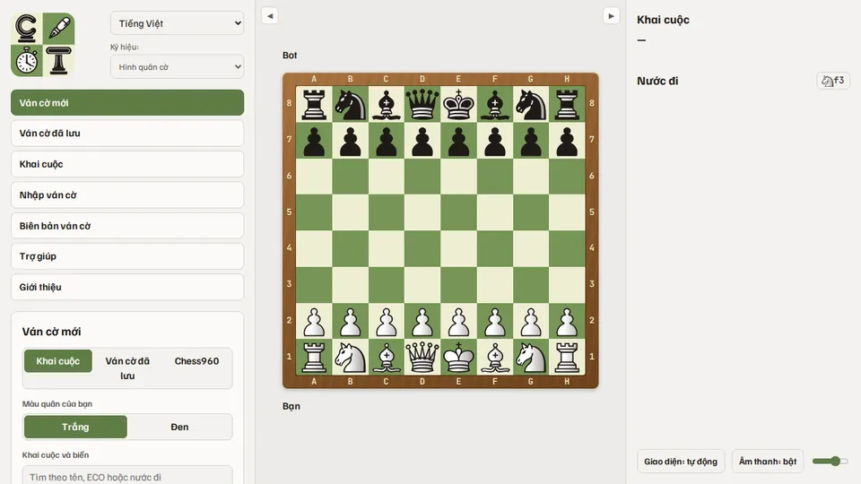
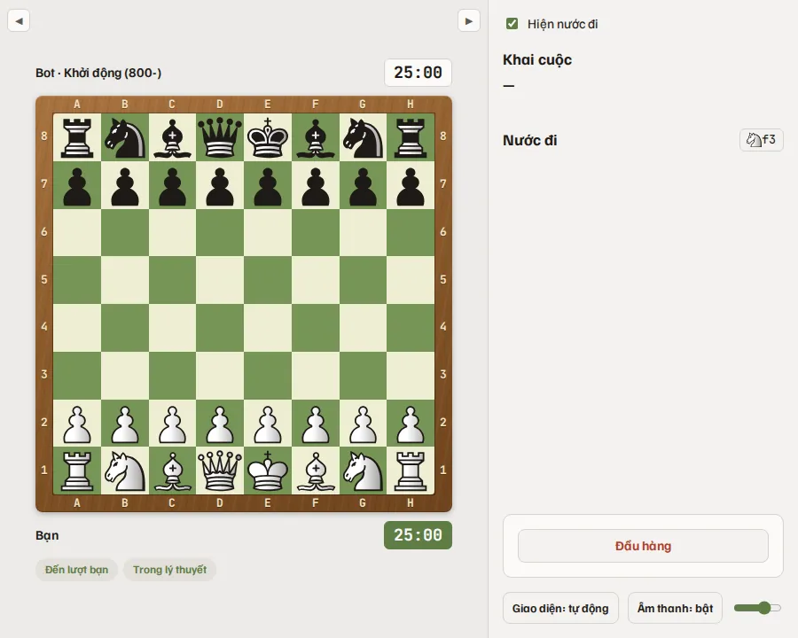
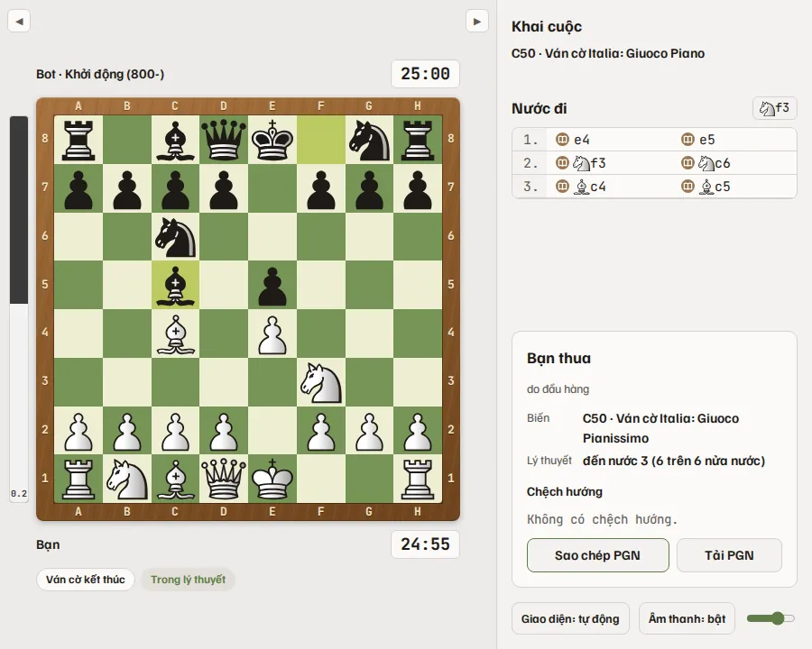
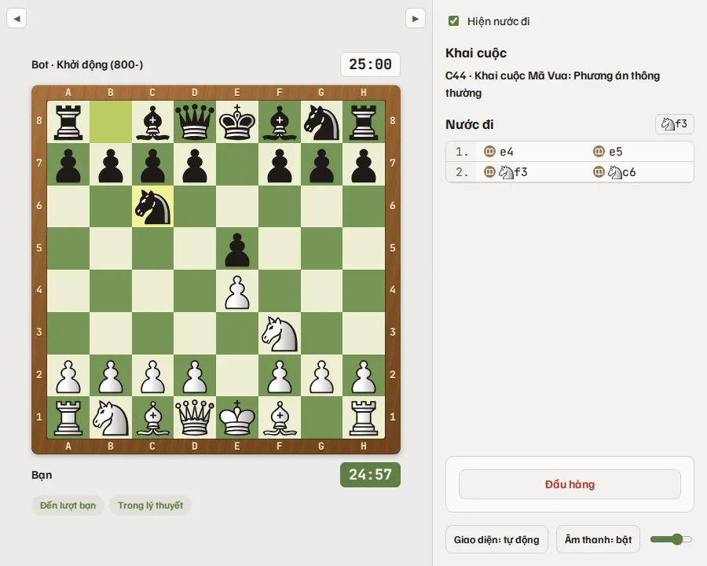
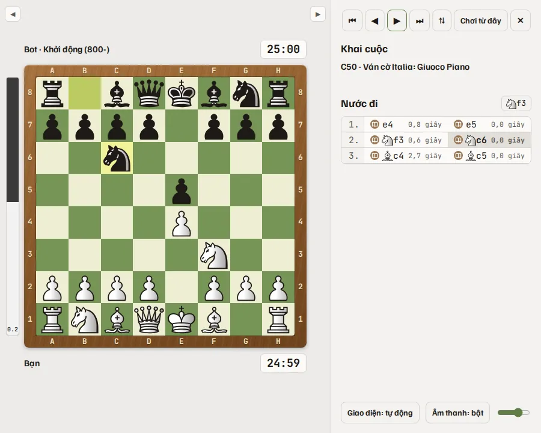

<!-- Generated by scripts/help_docs.py from the app's Help page. Do not edit. -->

# Cách dùng Chess Trainer

[English (US)](HELP.md) · [English (UK)](HELP.en-GB.md) · [Português (Brasil)](HELP.pt-BR.md) · [Español (Latinoamérica)](HELP.es-419.md) · [Español (España)](HELP.es-ES.md) · [Português (Portugal)](HELP.pt-PT.md) · [Deutsch](HELP.de.md) · [Français](HELP.fr.md) · [Italiano](HELP.it.md) · [Türkçe](HELP.tr.md) · [Polski](HELP.pl.md) · [Nederlands](HELP.nl.md) · [Bahasa Indonesia](HELP.id.md) · [Svenska](HELP.sv.md) · [Dansk](HELP.da.md) · [Norsk bokmål](HELP.nb.md) · [Suomi](HELP.fi.md) · [Русский](HELP.ru.md) · [Українська](HELP.uk.md) · [हिन्दी](HELP.hi.md) · [中文（简体）](HELP.zh-CN.md) · [日本語](HELP.ja.md) · [한국어](HELP.ko.md) · [العربية](HELP.ar.md) · [فارسی](HELP.fa.md) · [עברית](HELP.he.md)

> Bản dịch này được tạo bằng máy và chưa được duyệt lại. Rất hoan nghênh các góp ý sửa lỗi: [đề xuất sửa](https://github.com/nielsencampos/chess-trainer/issues/new?template=translation-fix.yml&language=vi)

Chess Trainer dùng để luyện tập: luyện khai cuộc của bạn với một bot chơi theo các diễn biến của bạn, chơi tiếp với Stockfish khi hết lý thuyết, và xem lại các ván cờ của bạn. Mọi thứ chạy và ở lại trên máy tính của bạn.

> **Đừng bao giờ dùng nó để gian lận**
>
> Đừng dùng Chess Trainer, hay bất kỳ chương trình cờ vua nào, trong một ván cờ với người khác, trực tuyến hay trên bàn cờ. Đó là gian lận, và Chess.com, Lichess và FIDE đều cấm điều đó. Hãy luyện tập trước và sau các ván cờ, không bao giờ trong lúc chơi.

> **Đánh giá ở đây chỉ là cơ bản**
>
> Thanh đánh giá đến từ một lần kiểm tra nhanh của Stockfish và chỉ là gợi ý. Các biểu tượng nước đi (nước đi tốt nhất, sai lầm, sai lầm nghiêm trọng…) là cách phân loại của trang web mà ván cờ đến từ đó, đọc từ PGN của nó: ứng dụng không tự tính biểu tượng nào. Để phân tích thật sự, hãy xuất PGN và phân tích trên Chess.com, Lichess hoặc một công cụ phân tích khác.

## Bắt đầu một ván cờ

- Khai cuộc: chọn màu quân và đánh dấu các khai cuộc và biến muốn luyện. Mỗi biến được đánh dấu có cùng khả năng được chọn. Đi một nước thuộc biến bạn không đánh dấu được tính là ra khỏi lý thuyết.
- Ván cờ đã lưu: luyện diễn biến của một ván bạn đã chơi hoặc đã nhập, để các nước đi được kiểm tra, hoặc chơi tiếp từ bất kỳ thế cờ nào của nó.
- Chess960: chọn ngẫu nhiên một thế cờ ban đầu hoặc dán FEN của một trong 960 thế cờ. Để nhập thành, hãy bấm vào Vua rồi vào một ô giữa Vua và Xe, hoặc vào chính quân Xe.
- Cấp độ bot: hệ số Elo bên cạnh mỗi cấp độ chỉ là danh nghĩa, theo thang đo riêng của Stockfish, và chưa được đo. Đó không phải là hệ số Elo của Chess.com hay Lichess.
- Thời gian thi đấu: các thiết lập sẵn của một đồng hồ thi đấu thật, từ bullet đến cờ tiêu chuẩn, hoặc không có đồng hồ. Thời gian phản hồi của bot là Như người, dùng đồng hồ như một người chơi, hoặc Tức thì.
- Tùy chọn: cảnh báo khi bạn ra khỏi lý thuyết, cho phép đi trước, và cho bot cố ý chệch khỏi diễn biến của nó từ một nước đi đã chọn, để bạn cũng luyện tập trước những bất ngờ.

*Ván cờ mới: màu quân, diễn biến, cấp độ và đồng hồ.*

## Trong ván cờ

- Bấm hoặc kéo các quân cờ. Bot chơi các nước lý thuyết của diễn biến được chọn, và khi hết lý thuyết, hoặc có người ra khỏi nó, Stockfish tiếp quản ở cấp độ đã chọn.
- Các nhãn dưới bàn cờ cho biết đến lượt ai, bạn có còn trong lý thuyết không, và bạn hay bot đã ra khỏi nó ở đâu.
- Hiện nước đi, ở thanh bên phải, ẩn tên khai cuộc và danh sách nước đi cho đến cuối ván: chơi không có gợi ý, hoặc ghi các nước đi ra giấy.
- Ký hiệu, dưới ngôn ngữ, hiển thị nước đi bằng hình quân cờ, bằng chữ tiếng Anh (Nf3, chữ của tệp PGN và các trang cờ vua) hoặc bằng chữ của ngôn ngữ bạn. Nút bên cạnh Nước đi chuyển giữa chúng, kể cả giữa ván, và rê chuột lên một nước đi, hoặc đến nó bằng Tab, sẽ hiển thị nó ở hai cách còn lại. Tệp PGN luôn dùng chữ tiếng Anh.
- Khi bật đi trước, bạn có thể xếp sẵn một nước đi trong lúc bot suy nghĩ. Khi tắt đi trước, Đi lại sẽ hủy nước đi cuối của bạn khi nước trả lời của bot chưa hiện ra.
- Đầu hàng cần bấm lần thứ hai, để một cú bấm nhầm không kết thúc ván cờ.

*Bấm hoặc kéo một quân; bot trả lời theo lý thuyết.*

## Sau ván cờ

- Thẻ dưới danh sách nước đi hiển thị kết quả, biến, lý thuyết kéo dài đến đâu, và mỗi lần chệch hướng cùng nước đi dự kiến.
- Sao chép hoặc tải PGN. Ván cờ mới bắt đầu ván tiếp theo với cùng các lựa chọn.

*Khi kết thúc: kết quả, biến, lý thuyết và chệch hướng.*

## Cách luyện tập

### Thua là một phần của nó

Thua là một phần của việc học. Điều quan trọng là nghiên cứu từng ván cờ và học từ chính sai lầm của mình. Để thật sự tiến bộ, hãy tăng cấp độ bot từng chút một, và chỉ tăng tiếp khi bạn thấy thoải mái với các nước đi nó chơi.

### Mỗi kiểu thời gian có một nhiệm vụ

Trong các ván dài, hãy bình tĩnh suy nghĩ mỗi nước đi và tạo thói quen tính trước hai, ba nước hoặc hơn. Dùng cờ nhanh, cờ chớp và bullet để luyện các mẫu hình bạn đã nắm được.

### Bắt đầu từ nước đi của đối thủ

Trước mỗi nước đi, hãy xem đối thủ đang đe dọa gì trước: chiếu, ăn quân và tấn công. Sau đó mới tìm kế hoạch của mình.

### Luyện tập như ở giải đấu

Cách học tốt nhất là với bàn cờ và đồng hồ thật. Đồng hồ lệch một chút so với ứng dụng cũng không sao.

Tại sao luyện với bàn cờ, đồng hồ và biên bản? Vì chúng buộc bạn phải ghi nhớ, giữ bạn không chơi mà không suy nghĩ, và rèn khả năng tính toán và hình dung, có thể đến khi bạn bắt đầu chơi trong đầu, không cần bàn cờ thật hay ảo trước mặt.

Trước ván cờ, mở Biên bản ván cờ trong menu và in ra, hoặc lưu thành PDF, rồi điền phần đầu. Chọn một kiểu thời gian dài, như cờ nhanh hoặc cờ tiêu chuẩn, và bỏ chọn Hiện nước đi.

Đến lượt bạn:

1. Đi quân trên bàn cờ.
1. Bấm đồng hồ bằng chính bàn tay đã đi quân.
1. Đi cùng nước đó trong ứng dụng.
1. Ghi nước đi vào biên bản.

Đến lượt bot:

1. Đi nước của nó trên bàn cờ.
1. Bấm đồng hồ ở phía của nó.
1. Ghi nước đi vào biên bản.

Chỉ sau đó mới bắt đầu nghĩ nước của bạn.

Hãy nhớ: chạm quân nào phải đi quân đó. Để có trải nghiệm còn tốt hơn, hãy quay video lúc bạn chơi rồi xem lại để thấy bạn cư xử thế nào bên bàn cờ. Cứ từ từ: luyện tập nhiều sẽ thành tự nhiên.

Cuối cùng, điền kết quả và chữ ký, so biên bản của bạn với danh sách nước đi và PGN, rồi tìm những nước bạn ghi sai.

*Khi bỏ chọn Hiện nước đi, danh sách nước đi được ẩn, và bạn ghi vào biên bản.*

### Phân tích trước khi nhìn đánh giá

Khi ván cờ kết thúc, hãy tự xem lại trước và tìm chỗ ván cờ xoay chiều. Chỉ sau đó mới so với đánh giá. Thanh đánh giá hiện ở thế cờ cuối, nên hãy bỏ qua nó cho đến khi bạn xong.

## Ván cờ đã lưu và xem lại

- Mọi ván cờ đều được lưu. Tìm và lọc danh sách, mở một ván trên bàn cờ và xem lần lượt bằng các nút hoặc phím mũi tên, Home và End.
- Chơi từ đây bắt đầu một ván cờ mới từ thế cờ trên bàn.
- Đánh dấu các ván cờ để xuất chúng dưới dạng PGN hoặc xóa chúng.

*Xem lại một ván cờ đã lưu, với thanh đánh giá.*

## Khai cuộc

- Xem lần lượt mọi diễn biến của bộ khai cuộc trên bàn cờ, và đánh dấu các diễn biến để xuất chúng dưới dạng PGN.

## Nhập ván cờ

- Lấy các ván cờ của bạn từ Chess.com hoặc Lichess theo tên người dùng và khoảng thời gian, hoặc dán hay tải lên một PGN. Chúng vào Ván cờ đã lưu, sẵn sàng để xem lại hoặc luyện tập.

## Phân tích ở nơi khác

- Lấy PGN từ thẻ cuối ván hoặc từ Ván cờ đã lưu.
- Trên Chess.com hoặc Lichess, mở bàn phân tích và dán hoặc nhập PGN, để có phân tích đầy đủ và sâu hơn.
