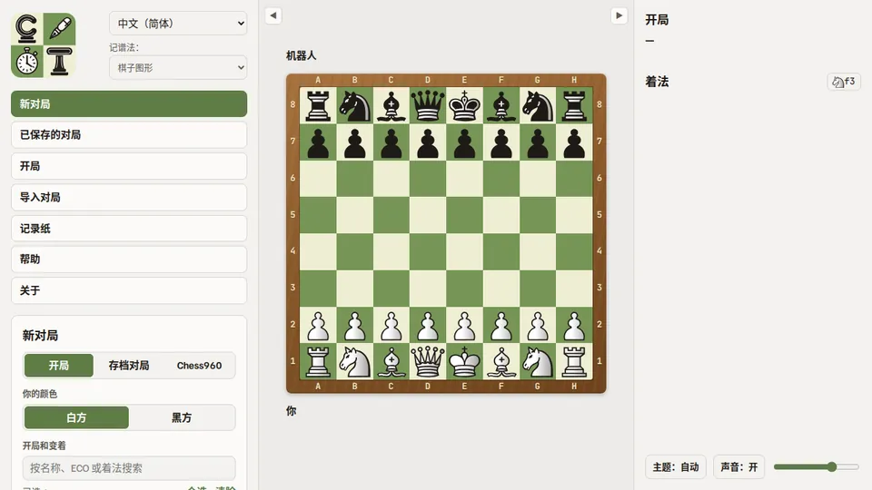
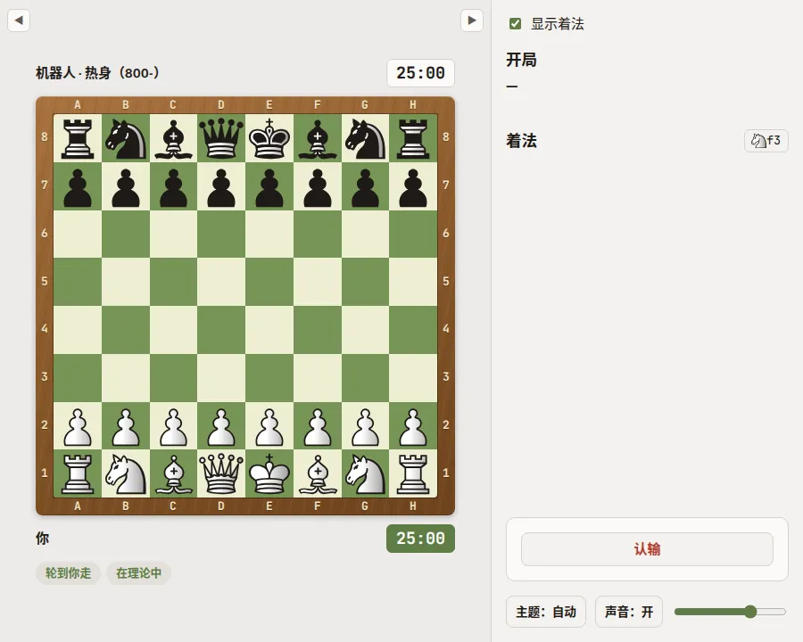
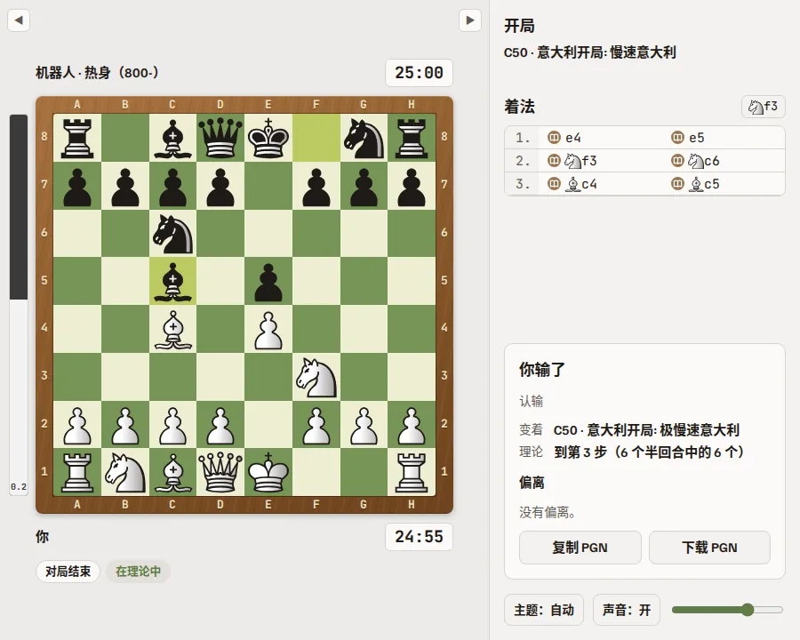
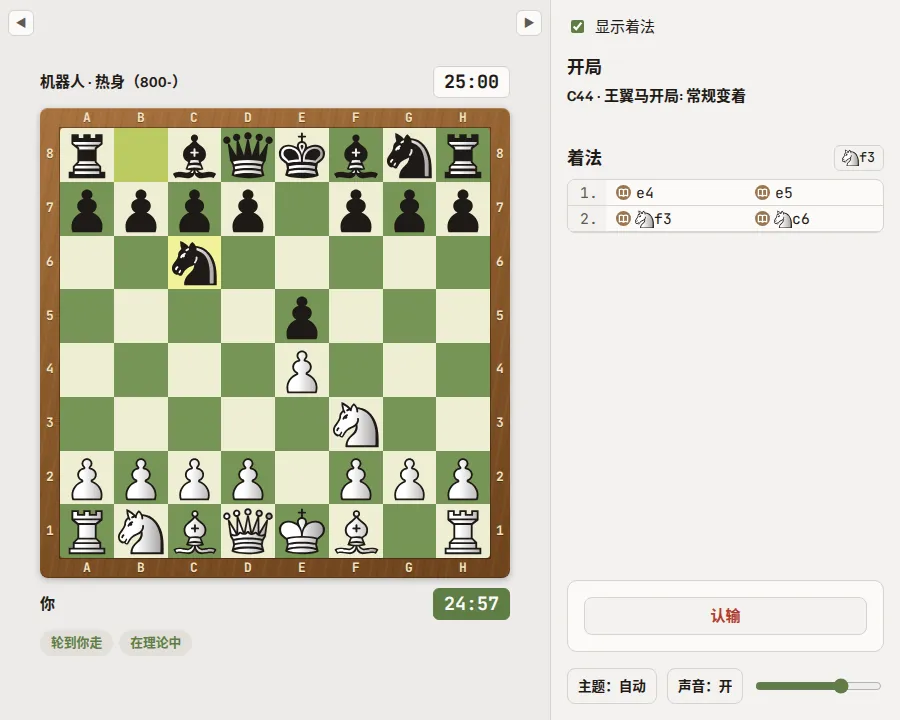
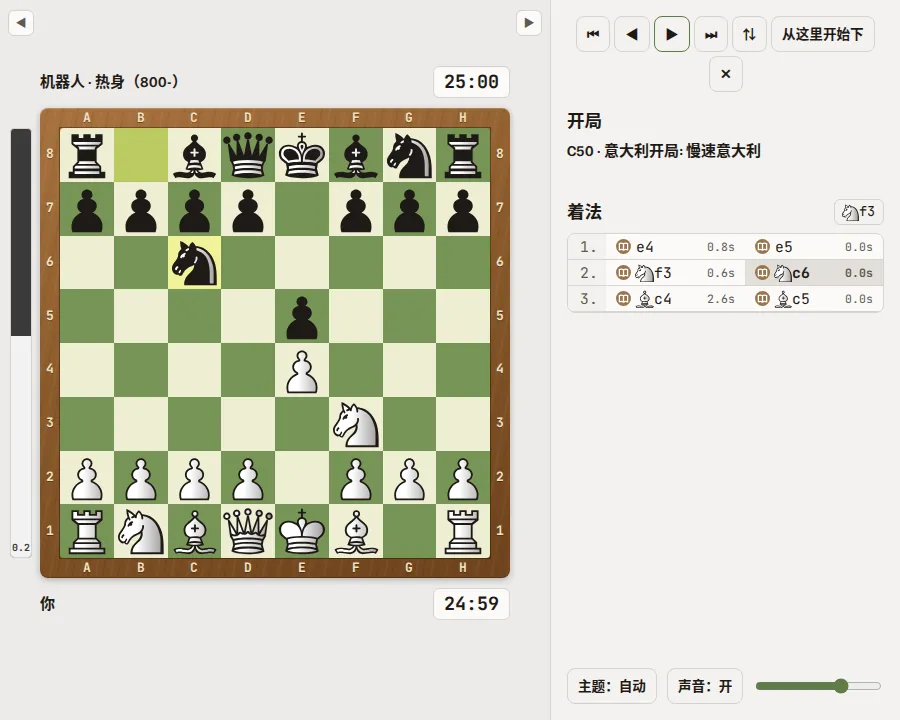

<!-- Generated by scripts/help_docs.py from the app's Help page. Do not edit. -->

# 如何使用 Chess Trainer

[English (US)](HELP.md) · [English (UK)](HELP.en-GB.md) · [Português (Brasil)](HELP.pt-BR.md) · [Español (Latinoamérica)](HELP.es-419.md) · [Español (España)](HELP.es-ES.md) · [Português (Portugal)](HELP.pt-PT.md) · [Deutsch](HELP.de.md) · [Français](HELP.fr.md) · [Italiano](HELP.it.md) · [Türkçe](HELP.tr.md) · [Polski](HELP.pl.md) · [Nederlands](HELP.nl.md) · [Bahasa Indonesia](HELP.id.md) · [Tiếng Việt](HELP.vi.md) · [Svenska](HELP.sv.md) · [Dansk](HELP.da.md) · [Norsk bokmål](HELP.nb.md) · [Suomi](HELP.fi.md) · [Русский](HELP.ru.md) · [Українська](HELP.uk.md) · [हिन्दी](HELP.hi.md) · [日本語](HELP.ja.md) · [한국어](HELP.ko.md) · [العربية](HELP.ar.md) · [فارسی](HELP.fa.md) · [עברית](HELP.he.md)

Chess Trainer 用来练习：与一个按你的变化走棋的机器人一起操练开局，理论结束后继续与 Stockfish 对弈，并复盘你的对局。一切都在你的电脑上运行，也只保存在你的电脑上。

> **绝不要用它作弊**
>
> 与他人对局时，无论在网上还是在棋盘前，都不要使用 Chess Trainer 或任何引擎。那是作弊，Chess.com、Lichess 和 FIDE 都禁止。在对局之前和之后练习，绝不要在对局中。

> **这里的评估很基础**
>
> 评估条和着法图标（最佳着法、错着、漏着…）来自 Stockfish 的快速检查，只是一个提示。要做真正的分析，请导出 PGN，在 Chess.com、Lichess 或其他分析工具中分析。

## 开始对局

- 开局：选择你的颜色，勾选要操练的开局和变着。每个勾选的变着被抽中的机会相同。走出你没有勾选的变着中的一步，算作离开理论。
- 已保存的对局：练习你下过或导入的一局对局的变化，让它的着法得到检查；或者从它的任意局面接着下。
- Chess960：随机一个初始局面，或粘贴 960 个之一的 FEN。王车易位时，先点击王，再点击王和车之间的一格，或者直接点击车。
- 机器人等级：每个等级旁的等级分只是名义上的，采用 Stockfish 自己的标尺，没有经过测量。它不是 Chess.com 或 Lichess 的等级分。
- 用时规则：真实比赛棋钟的预设，从超快棋到慢棋，或者不计时。机器人的应着时间可以是“像人一样”，像人那样使用自己的时间，也可以是“立即”。
- 选项：离开理论时提醒，允许预走，以及让机器人从选定的那一步起故意偏离它的变化，这样你也能练习应对意外。

*新对局：颜色、变化、等级和棋钟。*

## 对局中

- 点击或拖动棋子。机器人走抽中变化的谱着；当理论结束，或有一方离开理论时，Stockfish 以选定的等级接手。
- 棋盘下方的标签显示轮到谁走、你是否仍在理论中，以及你或机器人在哪里离开了理论。
- 右栏中的“显示着法”会在对局结束前隐藏开局名称和着法列表：可以不看提示下棋，或者把着法写在纸上。
- 语言下方的“记谱法”把着法显示为棋子图形、英文字母（Nf3，PGN 文件和国际象棋网站使用的字母）或你的语言的字母；中文使用的就是英文字母。“着法”旁的按钮在它们之间切换，对局中也可以；把鼠标移到一步着法上，或用 Tab 键移到它上面，会显示另外两种写法。PGN 文件始终使用英文字母。
- 开启预走时，你可以在机器人思考时预先排好一步。关闭预走时，在机器人的应着显示之前，“悔棋”可以撤销你的上一步。
- 认输需要再点一次，这样误点不会结束对局。

*点击或拖动棋子；机器人按开局库应着。*

## 对局之后

- 着法列表下方的卡片显示结果、变着、理论持续到哪里，以及每次偏离和应走的着法。
- 复制或下载 PGN。“新对局”会用同样的选择开始下一局。

*结束时：结果、变着、理论和偏离。*

## 如何练习

### 输棋是其中一部分

输棋是学习的一部分。重要的是研究每一局对局，从自己的错误中学习。要真正进步，就一点一点地提高机器人的等级，只有在你对它走的着法感到得心应手之后才再提高。

### 每种用时规则各有用处

在长时间的对局里，冷静地思考每一步，养成提前计算两步、三步或更多步的习惯。用快棋、闪电棋和超快棋来操练你已经掌握的模式。

### 先看对手的着法

每走一步之前，先看对手有什么威胁：将军、吃子和攻击。然后再找你自己的计划。

### 像比赛一样练习

最好的学习方式是用实体棋盘和棋钟。棋钟和应用的时间有偏差也没关系。

为什么要用棋盘、棋钟和记录纸练习？因为它们迫使你记忆，让你不会不假思索地走棋，并锻炼你的计算和想象能力，也许直到你开始在脑中下棋，面前不需要实体或虚拟的棋盘。

对局前，在菜单中打开“记录纸”并打印，或保存为 PDF，然后填好表头。选择较长的用时规则，例如快棋或慢棋，并取消勾选“显示着法”。

轮到你走时：

1. 在棋盘上移动棋子。
1. 用移动棋子的那只手按棋钟。
1. 在应用中走同样的一步。
1. 把这步着法写在记录纸上。

轮到机器人走时：

1. 在棋盘上走出它的着法。
1. 按下它那一侧的棋钟。
1. 把这步着法写在记录纸上。

这之后才开始思考你的着法。

记住：摸子走子。为了更好的体验，可以把自己下棋的过程拍下来，之后回看自己在棋盘前的表现。慢慢来：多练习就会变得自然。

最后，填好结果和签名，把你的记录纸与着法列表和 PGN 对比，找出你写错的着法。

*取消勾选“显示着法”后，着法列表会隐藏，你在记录纸上记录。*

### 先自己分析，再看评估

对局结束后，先自己复盘，找出局势在哪里发生了转折。之后再与评估对照。评估条会在最终局面显示，所以在你分析完之前先忽略它。

## 已保存的对局和复盘

- 每一局对局都会被保存。搜索和筛选列表，在棋盘上打开一局，用按钮或方向键、Home 和 End 逐步查看。
- “从这里开始下”会从棋盘上的局面开始一局新对局。
- 勾选对局，可以把它们导出为 PGN 或删除。

*带评估条复盘一局已保存的对局。*

## 开局

- 在棋盘上逐步查看开局库中的每一条变化，并勾选变化，把它们导出为 PGN。

## 导入对局

- 按用户名和时间范围从 Chess.com 或 Lichess 导入你的对局，或者粘贴或上传 PGN。它们会进入“已保存的对局”，可以复盘或练习。

## 在别处分析

- 从对局结束卡片或“已保存的对局”获取 PGN。
- 在 Chess.com 或 Lichess 上打开分析棋盘，粘贴或导入 PGN，进行完整、更深入的分析。
